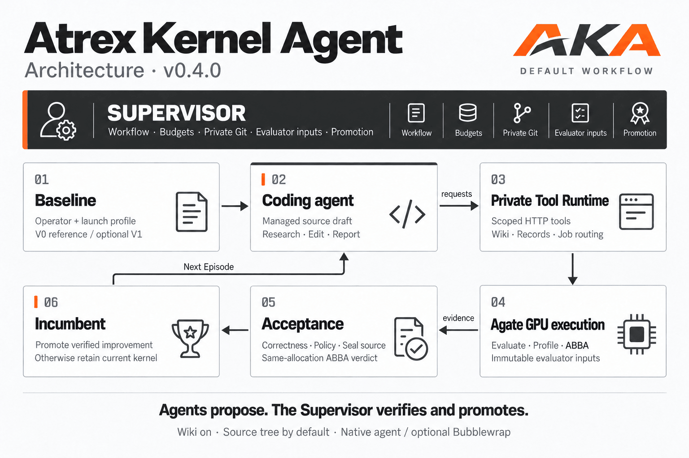
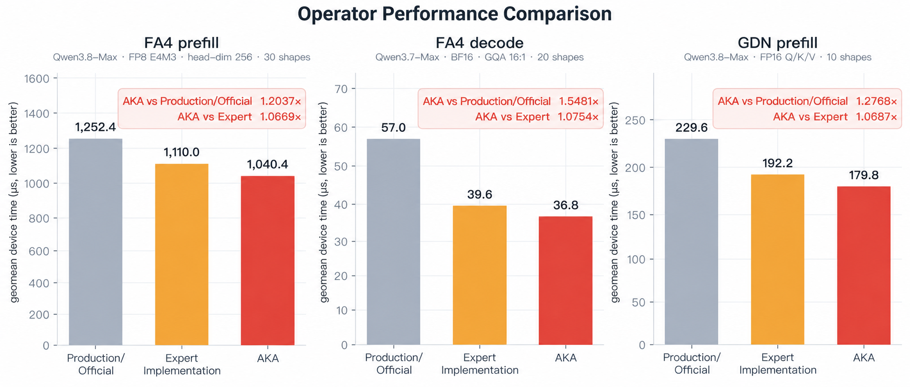

<div align="center">

<picture>
  <source media="(prefers-color-scheme: dark)" srcset="assets/aka-logo-light.png">
  <source media="(prefers-color-scheme: light)" srcset="assets/aka-logo-dark.png">
  
</picture>

**GPU kernel optimization with coding agents and measured evidence**

</div>

## Overview

Atrex Kernel Agent (AKA) optimizes GPU kernels through an iterative loop of research,
implementation, profiling, and evaluation. Coding agents propose candidates; the Supervisor
verifies correctness and performance before promoting an improvement.

Its lightweight workflow keeps the optimization loop focused, while a plugin architecture
lets users configure and replace agents, workspaces, evaluation, execution, and knowledge providers.

AKA supports Claude, Qoder, Codex, Pi, and [DSH](docs/dsh-harness-adapter.md),
with CUDA, Triton, CuTeDSL, FlyDSL, and TileLang
tooling for supported NVIDIA, AMD, and T-Head PPU environments. Native Atrex-Bench evaluation
runs through Agate; GPU Wiki provides optimization knowledge.

## How AKA works



1. **Establish a baseline.** Freeze the operator's evaluator inputs and measure the initial implementation.
2. **Explore and measure.** The agent researches, edits a managed source draft, and uses private tools to evaluate and profile candidates.
3. **Submit evidence.** A report binds the candidate to its exact source snapshot and measurement records.
4. **Verify and promote.** The Supervisor checks correctness and applicable policy, then compares candidate and incumbent in the same GPU allocation using ABBA measurements. Only a verified improvement is promoted.
5. **Continue or finish.** Retain evidence and reusable knowledge across Episodes, recover interrupted work, and export the retained implementation.

## News

- [2026-10] **v0.4.0: A lightweight workflow and plugin architecture.** Better kernel performance with **20–30% lower average token consumption**, plus configurable, replaceable providers for agents, workspaces, evaluation, execution, and knowledge. [Release notes](docs/releases/v0.4.0.md).
- [2026-09] [From leaderboards to real-world workloads: accelerating Qwen3.8-Max's core inference operators](https://mp.weixin.qq.com/s/q1wrpgu3R8S8dEqR-PhQgw) (WeChat): **AKA** delivers lower average latency than expert implementations for all **three key operator families** across **60 real-world shapes**, with up to **1.55× speedup** over production/official baselines.

  

- [2026-09] We released **Atrex Kernel Agent v0.3.0** with resumable fast, full, and goal episodes; native Atrex-Bench and multi-framework production campaigns; Claude, Qoder, Codex, and Pi backends; isolated SSH GPU execution with recovery; PPU profiling; plugin-backed GPU Wiki retrieval; and production-mode supplemental numerical probes. See the [v0.3.0 release notes](docs/releases/v0.3.0.md).
- [2026-08] We slimmed down **Atrex Kernel Agent** by consolidating on a single orchestrated workflow and removing legacy paths and redundant context for a smaller context footprint and lower token usage.
- [2026-07] We helped **Qwen3.8** rank **No. 1** on the **SOL-ExecBench FlashInfer operator optimization leaderboard**.
- [2026-07] We released **Atrex Kernel Agent v0.2.0** with an orchestrated clean-session loop, native SOL-ExecBench operator workflow, Triton-to-Gluon conversion support, and a fuller NVIDIA profiling toolchain. [[Release](https://github.com/alibaba/atrex-kernel-agent/releases/tag/v0.2.0)]
- [2026-07] We released **the Atrex paper**: [Are LLM-Generated GPU Kernels Production-Ready? A Trace-Driven Benchmark and Optimization Agent](https://arxiv.org/abs/2607.14541).
- [2026-06] We released **Atrex Kernel Agent v0.1.0** as the initial open-source version, with the GPU Wiki knowledge base, profile-driven optimization workflow, profiling tools, and reference templates. [[Release](https://github.com/alibaba/atrex-kernel-agent/releases/tag/v0.1.0)]

## Quick Start

**Recommended: launch through a prompt.** Open this repository in your coding agent and
give it the operator path, target GPU, framework, and optimization budget:

```text
Read docs/quickstart.md and set up the matching AKA packages from this checkout.
Optimize /path/to/atrex-bench/operator on a <gpu_arch> Agate worker using CUDA,
Claude as the coding agent, production mode, and up to 20 iterations.
Use ~/aka-opt as the workspace. Check the required environment, launch the
campaign, and report the verified result and output location.
```

Replace the example values with your workload and configured GPU environment.
See the [setup guide](docs/quickstart.md) for prerequisites and problem preparation.

## Documentation

- [Documentation index](docs/README.md) — all guides and validation reports.
- [Quick Start](docs/quickstart.md) — setup, inputs, launch, and outputs.
- [Architecture](docs/design.md) — ownership, lifecycle, verification, and recovery.
- [Configuration](docs/optional-light-modules.md) — modules, profiles, and optional features.
- [Source layouts](docs/native-cuda.md) — multi-file candidates and native CUDA.
- [GPU Wiki](gpu-wiki/README.md) — structured optimization knowledge.
- [Release notes](docs/releases/v0.4.0.md) — changes and upgrade guidance.

## Acknowledgements

AKA builds on and learns from many open-source projects, including:

- GPU kernel projects: [CUTLASS](https://github.com/NVIDIA/cutlass),
  [cutex](https://github.com/deciding/cutex), [cuLA](https://github.com/inclusionAI/cuLA),
  [FlashAttention](https://github.com/Dao-AILab/flash-attention),
  [FlashInfer](https://github.com/flashinfer-ai/flashinfer),
  [FlyDSL](https://github.com/ROCm/FlyDSL), [Triton](https://github.com/triton-lang/triton),
  [DeepGEMM](https://github.com/deepseek-ai/DeepGEMM),
  [LeetCUDA](https://github.com/xlite-dev/LeetCUDA),
  [FlashMLA](https://github.com/deepseek-ai/FlashMLA),
  [Composable Kernel](https://github.com/ROCm/composable_kernel),
  [cute-gemm](https://github.com/reed-lau/cute-gemm),
  [hpc-ops](https://github.com/Tencent/hpc-ops),
  [AIter](https://github.com/ROCm/aiter), [quack](https://github.com/Dao-AILab/quack), and
  [TileLang](https://github.com/tile-ai/tilelang).
- Knowledge and agent tooling: [KernelWiki](https://github.com/mit-han-lab/KernelWiki),
  [modern-gpu-programming-for-mlsys](https://github.com/mlc-ai/modern-gpu-programming-for-mlsys),
  [ncu-report-skill](https://github.com/mit-han-lab/ncu-report-skill),
  [humanize](https://github.com/PolyArch/humanize),
  [AKO4ALL](https://github.com/TongmingLAIC/AKO4ALL), and
  [KDA](https://github.com/mit-han-lab/kernel-design-agents).

## Citation

If AKA is useful in your work, please cite the [Atrex paper](https://arxiv.org/abs/2607.14541):

```bibtex
@misc{atrex2026,
  title         = {Are LLM-Generated GPU Kernels Production-Ready? A Trace-Driven Benchmark and Optimization Agent},
  author        = {Lingyun Yang and Yuxiao Wang and Shenghao Liang and Linfeng Yang and Daocheng Ying and Chunbo You and Rui Zhang and Luping Wang and Yinghao Yu and Guodong Yang and Liping Zhang},
  year          = {2026},
  eprint        = {2607.14541},
  archivePrefix = {arXiv},
  primaryClass  = {cs.AI},
  url           = {https://arxiv.org/abs/2607.14541}
}
```

## License

Licensed under the [Apache License 2.0](LICENSE).
