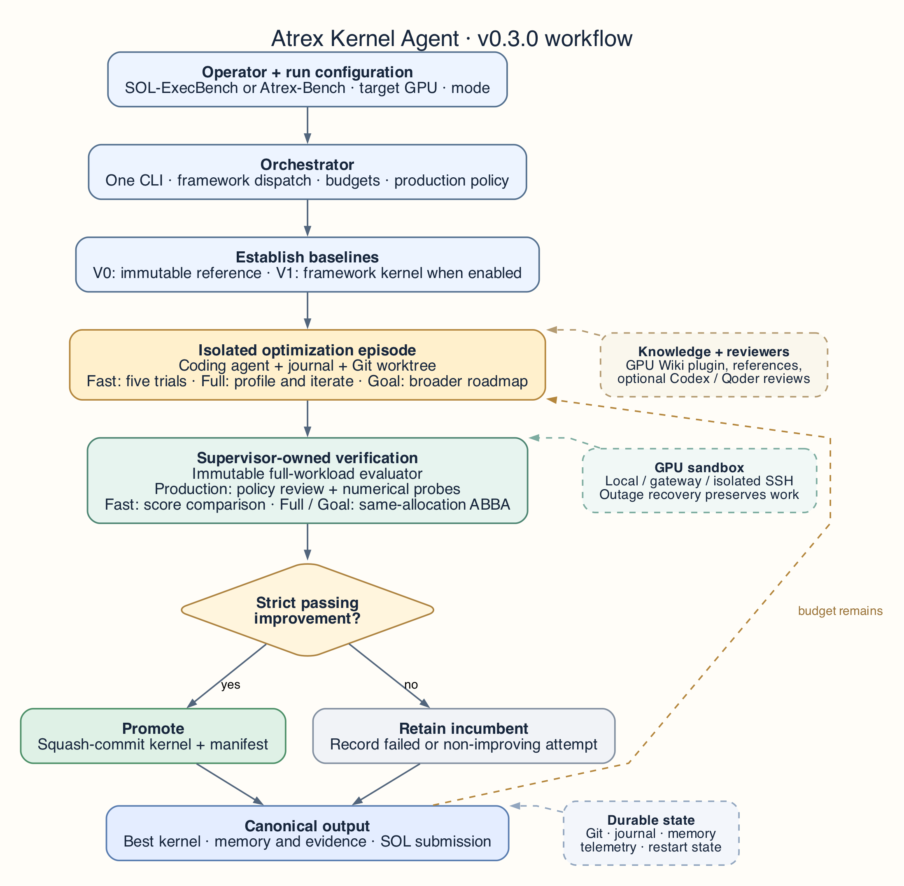

<div align="center">

<picture>
  <source media="(prefers-color-scheme: dark)" srcset="assets/aka-logo-light.png">
  <source media="(prefers-color-scheme: light)" srcset="assets/aka-logo-dark.png">
  
</picture>

**An orchestrated agent system for production-grade GPU kernel development**

</div>

---

## Overview

Atrex Kernel Agent (AKA) turns an evaluator-owned operator into a measured, optimized GPU kernel.
It coordinates coding agents, GPU profiling, correctness checks, performance verification, Git
isolation, recovery, and final packaging while keeping acceptance and termination under mechanical
supervisor control.

The optimization application is launched through the installed `aka optimize` command.
It selects the application through Core, and the installed Workflow module supplies its
episode engine.
The supervisor establishes an evaluator-backed V0 and, when enabled, a framework-native V1. Coding
agents then explore fast, full, or goal episodes in isolated Git worktrees. The supervisor owns
correctness, production policy, performance verification, and promotion; every outcome is recorded
without letting an unverified candidate replace the incumbent.



AKA supports:

- SOL-ExecBench and native Atrex-Bench operator layouts;
- NVIDIA, AMD, and T-Head PPU (zwm890p) targets through isolated sandbox execution;
- gateway and Bubblewrap-isolated OpenSSH GPU execution, with automatic environment recovery;
- Triton, CuteDSL, CUDA, FlyDSL, and TileLang campaigns;
- Claude, Qoder, Codex, and Pi coding-agent backends;
- leaderboard and fail-closed production modes;
- automatic local plugins and structured GPU Wiki retrieval with traceable attribution;
- production-mode numerical probes and mode-specific performance verification;
- resumable, Git-isolated optimization with canonical measurement history.

For Agate evaluations requesting two or more GPUs, production source-policy inspection is
disabled automatically. The GPU count comes from the evaluator's
`benchmark_contract.distributed_evaluation` (`torchrun`, `nccl`, `world_size >= 2`), the same
contract used to submit Agate's `num_gpus`. These campaigns can reuse communication libraries
and the validated V0 without a self-authored framework conversion. Correctness, numerical
probes, performance checks and immutable evaluation inputs remain enforced. Single-GPU and
SSH campaigns retain source-policy inspection. Invalid distributed contracts are errors;
operator names and candidate dependency declarations do not enable this exception.
The source-policy decision is frozen per campaign from private evaluator metadata, or from
the committed V0 metadata on resume (the original operator directory before V0 exists).
Creating or editing metadata in the candidate workspace cannot change that decision.
Legacy metadata without a `distributed_evaluation` key retains single-GPU submission and
source checks even if `hardware.required_gpus` describes multiple GPUs. An explicit distributed
contract requires every supplied `hardware.required_gpus` value, including `1`, to match its
`world_size`.

`ATREX_SANDBOX_ATREX_BENCH_VERSION` and `ATREX_SANDBOX_REQUIREMENTS_FILE` can pin an Agate
runtime. The requirements path is resolved through the Problem plugin, validated as UTF-8 flat
package specifications, and frozen into the Task snapshot. Baseline, Agent sandbox, dispatch and
resume bind the same frozen file; an explicit empty file remains empty. When replaying a typed
request through the CLI, its parsed contents must match the request, so missing or changed pins fail
instead of silently selecting a different runtime.

## News

- [2026-09] [From leaderboards to real-world workloads: accelerating Qwen3.8-Max's core inference operators](https://mp.weixin.qq.com/s/q1wrpgu3R8S8dEqR-PhQgw) (WeChat): **AKA** delivers lower average latency than expert implementations for all **three key operator families** across **60 real-world shapes**, with up to **1.55× speedup** over production/official baselines.
- [2026-09] We released **Atrex Kernel Agent v0.3.0** with resumable fast, full, and goal episodes; native Atrex-Bench and multi-framework production campaigns; Claude, Qoder, Codex, and Pi backends; isolated SSH GPU execution with recovery; PPU profiling; plugin-backed GPU Wiki retrieval; and production-mode supplemental numerical probes. See the [v0.3.0 release notes](docs/releases/v0.3.0.md).
- [2026-08] We slimmed down **Atrex Kernel Agent** by consolidating on a single orchestrated workflow and removing legacy paths and redundant context for a smaller context footprint and lower token usage.
- [2026-07] We helped **Qwen3.8** rank **No. 1** on the **SOL-ExecBench FlashInfer operator optimization leaderboard**.
- [2026-07] We released **Atrex Kernel Agent v0.2.0** with an orchestrated clean-session loop, native SOL-ExecBench operator workflow, Triton-to-Gluon conversion support, and a fuller NVIDIA profiling toolchain. [[Release](https://github.com/alibaba/atrex-kernel-agent/releases/tag/v0.2.0)]
- [2026-07] We released **the Atrex paper**: [Are LLM-Generated GPU Kernels Production-Ready? A Trace-Driven Benchmark and Optimization Agent](https://arxiv.org/abs/2607.14541).
- [2026-06] We released **Atrex Kernel Agent v0.1.0** as the initial open-source version, with the GPU Wiki knowledge base, profile-driven optimization workflow, profiling tools, and reference templates. [[Release](https://github.com/alibaba/atrex-kernel-agent/releases/tag/v0.1.0)]

## Quick Start

See the [Quick Start guide](docs/quickstart.md) for prerequisites and complete runnable examples of
the orchestrated optimization loop.

Or start a coding agent such as Claude Code, Codex, or Qoder in this repository and ask it to
launch an AKA optimization task. We recommend the following prompt:

```text
Use the installed `aka optimize` command with this checkout as `--repo-root` to start one optimization task for atrex-bench/xx. Put the workspace under ~/aka-opt, set the platform to H20, use the local sandbox, use claude as the Agent CLI, set max-iters to 300, specify cuda as the framework, and run in production mode.
```

## Documentation

| Document | Contents |
| --- | --- |
| [Quick Start](docs/quickstart.md) | Setup, commands, campaign steps, configuration, and outputs |
| [Architecture Design](docs/design.md) | Components, authority boundaries, state machine, verification, and recovery |
| [GPU Wiki](gpu-wiki/README.md) | Structured hardware/kernel knowledge, queries, and trace mining |
| [Local plugins](docs/plugins.md) | Extend AKA tools and Skills through automatically discovered local plugins |
| [Optimization dashboard](docs/optimization-dashboard.md) | Optional Core plugin for local progress, performance history and settled token usage |
| [v0.3.0 release notes](docs/releases/v0.3.0.md) | New features, correctness and measurement changes, and upgrade guidance |

Run `aka optimize --help` and `aka optimize --repo-root "$PWD" -- --help` for the framework and
optimization interfaces and defaults.

For a GPU server reachable through OpenSSH, use a dedicated low-privilege account and pass
`--sandbox-ssh user@gpu-host --sandbox-ssh-gpu 0` with an explicit `--framework`. AKA keeps Agent,
Git, memory, and episode state local, transfers only
the sandbox allowlist to a fresh remote temporary directory, and runs it in a mandatory networkless
Bubblewrap namespace before copying back requested artifacts. Use `--sandbox-ssh-runtime-bind` for
read-only venv or toolchain trees outside the minimal system mounts. Runtime sources are checked
against sensitive host paths after remote symlink resolution, and only the assigned physical NVIDIA
GPU is visible; MIG execution fails closed until capability-node assignment is supported.
If the remote environment fails its GPU health probe, AKA stops, preserves the active worktree, and
starts a detached monitor that resumes the original command after the server recovers. See
[Quick Start: Isolated OpenSSH GPU host](docs/quickstart.md#isolated-openssh-gpu-host).
The generated `stop-recovery.sh` also stops a recovered optimizer and leaves automatic recovery
disabled until the generated `recover.sh` is run explicitly. The recovery monitor stays with the
restarted optimizer: an unexpected exit returns to health polling and automatic restart, while only a
durably clean zero exit completes recovery.

## Acknowledgements

AKA builds on and learns from many open-source projects, including:

- GPU kernel projects: [CUTLASS](https://github.com/NVIDIA/cutlass),
  [cutex](https://github.com/deciding/cutex), [cuLA](https://github.com/inclusionAI/cuLA),
  [FlashAttention](https://github.com/Dao-AILab/flash-attention),
  [FlashInfer](https://github.com/flashinfer-ai/flashinfer),
  [FlyDSL](https://github.com/ROCm/FlyDSL), [Triton](https://github.com/triton-lang/triton),
  [DeepGEMM](https://github.com/deepseek-ai/DeepGEMM),
  [LeetCUDA](https://github.com/xlite-dev/LeetCUDA),
  [FlashMLA](https://github.com/deepseek-ai/FlashMLA),
  [Composable Kernel](https://github.com/ROCm/composable_kernel),
  [cute-gemm](https://github.com/reed-lau/cute-gemm),
  [hpc-ops](https://github.com/Tencent/hpc-ops),
  [AIter](https://github.com/ROCm/aiter), [quack](https://github.com/Dao-AILab/quack), and
  [TileLang](https://github.com/tile-ai/tilelang).
- Knowledge and agent tooling: [KernelWiki](https://github.com/mit-han-lab/KernelWiki),
  [modern-gpu-programming-for-mlsys](https://github.com/mlc-ai/modern-gpu-programming-for-mlsys),
  [ncu-report-skill](https://github.com/mit-han-lab/ncu-report-skill),
  [humanize](https://github.com/PolyArch/humanize),
  [AKO4ALL](https://github.com/TongmingLAIC/AKO4ALL), and
  [KDA](https://github.com/mit-han-lab/kernel-design-agents).

## Citation

If AKA is useful in your work, please cite the [Atrex paper](https://arxiv.org/abs/2607.14541):

```bibtex
@misc{atrex2026,
  title         = {Are LLM-Generated GPU Kernels Production-Ready? A Trace-Driven Benchmark and Optimization Agent},
  author        = {Lingyun Yang and Yuxiao Wang and Shenghao Liang and Linfeng Yang and Daocheng Ying and Chunbo You and Rui Zhang and Luping Wang and Yinghao Yu and Guodong Yang and Liping Zhang},
  year          = {2026},
  eprint        = {2607.14541},
  archivePrefix = {arXiv},
  primaryClass  = {cs.AI},
  url           = {https://arxiv.org/abs/2607.14541}
}
```

## Application framework

After installing the Core, Contracts, Bootstrap and Optimization packages, run:

```sh
aka optimize --repo-root /path/to/aka -- \
  --op-dir /path/to/problem --platform L20N --framework Triton
```

`--repo-root` selects the matching AKA checkout; `--op-dir` selects the native
Atrex-Bench or SOL problem. See the [installation and application selection
guide](docs/application-plugin-migration.md) and [Core interface](docs/plugin-framework.md).

## License

Licensed under the [Apache License 2.0](LICENSE).
