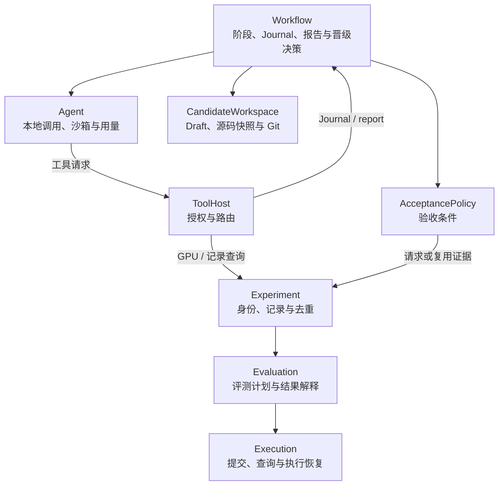

# AKA-light 模块化迁移与 PR 拆分方案

本文保留最初的拆分目标与评审批次。当前集成实现、可选项与验证边界见 [Optional light implementations](optional-light-modules.md)。截至 2026-10-19，已合入 main `72472062`，并将 Evaluation、Experiment、Acceptance 和 Journal 接入 Core 的实际依赖注入；Agent 的沙箱/采集仍可单独启用。新增服务使用 light 包内的版本局部契约，不是对上游最新未合并接口的稳定性承诺。下文是原始拆分计划，不代表每个历史 helper 都已完成内部重写。

## 1. 代码基线与实施位置

2026-10-14 检查的版本：

| 来源 | Revision | 用途 |
| --- | --- | --- |
| 当前工作分支 `codex/aka-light-into-main` | `ad9579ed` | AKA-light 行为与修复的来源；本方案保存在该分支 |
| 上游 `main` | `5ad94ffa` | 已包含 Core/Application、Dashboard/Observation、Problem/Source/CandidateWorkspace |
| [PR #113](https://github.com/alibaba/atrex-kernel-agent/pull/113) | `fd7e0466` | Execution 抽取、进程监督、模块 Skill contribution |
| [PR #114](https://github.com/alibaba/atrex-kernel-agent/pull/114) | `bb7660e1` | Agent/Workflow 抽取、普通调用、原生会话、依赖注入和生命周期 |
| 之前的可选沙箱迁移 `codex/optional-agent-sandbox` | `fa41ce57` | 可复用的挂载、Home、FD 传参和辅助工作区实现及测试；其全局接入方式不作为新方案 |

本分支已在两个本地 merge 中接入上述 #113/#114 固定版本，并在 `src/aka/light` 下实现可选替代模块。上游默认组合仍不变；原实现保存在 `codex/aka-light-before-modularization`。这不表示两个上游 PR 已合并。

旧合并分支与当前 main 的共同祖先是 `3d27c1eb`；从该祖先到旧合并分支涉及 138 个文件，新增 19,453 行、删除 11,779 行。这个数字描述旧改动规模，不是从最新 main 迁移所需的净增量。main 和 #114 已改变大量文件归属，不能按旧文件路径整批覆盖。

## 2. 核心调整：由模块拥有机制，由 Workflow 组织业务

现有 AKA-light 的 `orchestrator/supervisor_runtime.py` 同时承担服务启动、权限、快照、执行、记录、Journal 和候选正确性检查。新实现保留这些能力，但分配给明确的 owner。

| 能力 | 目标 owner | 旧分支主要来源 | 迁移边界 |
| --- | --- | --- | --- |
| 本地 Agent 隔离、Home、进程清理 | Agent 的 sandboxed 实现 | `agent_sandbox.py`、`agent_home.py`、`agent_installations.py`、`sandbox_launch.py`、`agent_workspace.py` | 普通调用和持续会话共用生命周期；不决定 Episode、重试次数或晋级 |
| Session trace、子 Agent、Token 用量 | Agent 内部采集与后端 Adapter | `session_capture.py`、`session_native.py`、`session_tail.py`、`session_transcript.py`、`session_usage.py`、`agent_runtime/codex_ledger.py` | 归一化调用事实；Observation 模块读取这些事实，不另算一份账 |
| Agent 公开输入与私有评测输入 | Problem | `supervisor_runtime.execute` 中的输入选择与私有输入绑定 | 复用上游 `LoadedProblem.agent` / `evaluation`，不新增第二套 problem loader |
| Draft、scratch、源码快照、Git 提交与晋级操作 | CandidateWorkspace | `episode_workspace.py`、`supervisor/workspace.py`、`git_episode.py`、`promotion_audit.py` | Workspace 提供文件和事务机制；Workflow 决定何时创建、清空、封存或晋级 |
| Agate 提交、查询、错误分类与执行恢复 | Execution 的 Agate 实现 | `gateway.py` 的传输部分、`gateway_jobs.py`、相关 `local_gateway.py` 修复 | 只处理执行状态和执行重试；不把模型重试、优化策略或晋级阈值放进 Executor |
| 输入构造、Evaluate/ABBA/Profile、指标与结果解释 | Evaluation | `gateway.py` 的评测部分、`operations.py`、`projection.py`、`measurements.aggregate` | 根据 Problem 的评测输入构造可信请求；计算结果，不直接提交 Git 或推进 Episode |
| 精确源码/请求/结果持久化、去重、结果查询 | Experiment | `measurement_records.py`、`measurements.execute/query`、`abba_checkpoints.py` | 绑定一次逻辑实验与物理执行；通过 Evaluation/Execution 完成工作，不回调整个 Campaign |
| Direction、研究记录、Episode Report | Workflow 的 Journal 组件 | `supervisor/journal.py`、`direction_lifecycle.py`、`direction_genealogy.py` | 保存 Agent 的假设和分析，引用 Experiment 的测量证据；Journal 不自行执行 GPU 或操作 Git |
| 候选验收条件、ABBA 阈值、数值与生产策略 | AcceptancePolicy，由 Workflow 调用 | `_validate_candidate_correctness`、`recorded_verifier.py`、`numerical_policy.py`、既有 verifier | 策略请求必要证据、返回结论；Workflow 决定报告是否完成、是否晋级 |
| 工具授权、路由、请求限制、撤销 | 宿主侧 ToolHost 适配层 | `supervisor_runtime.py` 的 HTTP/capability 部分、`tools/sandbox.py` | 调用注入的模块，保留薄客户端；不再成为所有业务逻辑的 owner |
| Wiki 查询与 Skill | 现有知识工具插件及模块资源贡献 | Wiki 路由、`plugin_executor.py`、`plugin_output.py`、相关 Skills | 复用上游插件与资源装配，避免复制 registry 或维护两套 Wiki 入口 |
| Bootstrap、Episode、恢复、预算和 Prompt | 可选择的 light Workflow 实现 | `campaign.py`、`long_horizon/campaign.py`、Prompt、recovery | 最后迁入流程简化；保持 legacy Workflow 可用 |

表中的 Evaluation、Experiment、AcceptancePolicy 和 ToolHost 是拟引入或抽取的边界，不是当前上游已经存在的接口。只在第一条真实调用链需要时定义最小接口；不预先增加无消费者的插件、协议或发行包。

两个容易混淆的概念应明确分开：

- **测量 Experiment** 是宿主执行并持久化的事实，包含源码、请求、执行结果和公共投影。
- **Journal 中的 `record-experiment`** 是 Agent 对研究工作的陈述，包含 hypothesis/change/evidence/analysis，引用一个或多个 Gateway Record。两者可以沿用现有外部命名和 ID，但不能混成同一份可信度相同的数据。

图表示调用关系，不表示相互注入整个对象。ToolHost 只绑定具体 handler；Agent 只持有工具连接；Evaluation 借用 Executor。Workflow 的研究 Journal 不得反向成为底层 Execution 的依赖。

## 3. 建议拆成八个交付批次

不沿用原七个 PR 的文件集合。每批以可运行的模块调用链交付，并携带该能力已有的安全和恢复修复。

| 批次 | 主题 | 主要交付 | 依赖与明确验收 |
| --- | --- | --- | --- |
| M1 | Sandboxed Agent | 在 #114 的 Agent 选择点增加可选实现；复用后端 Adapter，封装 bwrap、独立 Home、有限挂载和辅助会话输入输出 | 依赖 #114；同一 Workflow 可选择 native 或 sandboxed；真实 Linux namespace 检查、超时/中断/同会话继续均通过 |
| M2 | Agent Session 观测 | 迁入 conversation、Provider 原始记录、子 Agent、用量协调和容量保护；接入现有 Observation reader | 依赖 #114，可与 M1 分开评审；两种 Agent 模式均验证，采集故障不得改变功能性 stdout 或终止 Agent |
| M3 | 可靠 Agate Execution | 在 #113 的执行边界迁入 Agate 状态机、接受 ID 后恢复、明确拒绝与未知结果分类、限定重试和错误保留 | 依赖 #113；旧调用入口仍可运行；中断恢复不能重复提交未知结果任务，Eval 超时不能误判为整个环境故障 |
| M4 | Evaluation 请求与结果 | 抽取可信 evaluator/input、Evaluate/ABBA/Profile/Check/Disassemble 的构造、校验、指标与公共投影；Dev 保留任意 probe 语义 | 依赖 M3 和 Problem；先从现有宿主评测入口使用，不要求 HTTP 或 Journal 已迁入；全部操作有固定输入输出对照 |
| M5 | Recorded Experiment 与工具服务 | 精确快照、全局 ID、跨 Episode 去重、物理批次检查点、结果/源码读取；增加薄 ToolHost 和 Agent client，接入 Wiki | 依赖 M3–M4、Workspace 快照能力；Agent 通过服务运行 GPU；重复请求无新 GPU job，查询只返回已存公共结果，隔离模式下私有输入不可见 |
| M6 | Workflow Journal 与可修正 Report | Direction 生命周期、研究 Experiment、跨 Episode 查询、报告校验与重交；贡献 runtime-records Skill | 依赖 M5；先适配 legacy Workflow 的现有完成条件；报告格式错误不结束 Episode，不能用 Agent 修改的投影替代私有 Journal |
| M7 | Managed Workspace 与可信验收 | Git-free draft、精确源码封存、AcceptancePolicy、匹配证据复用、晋级审计与恢复 | 依赖 M5–M6；从报告源码到测量、Commit、晋级逐项绑定；此时才切换完全隐藏 Git 的工作区模式 |
| M8 | Light Workflow | 选择新的流程实现：确定性 V0、统一 Episode、简化 Prompt/Skill、去除 light 流程内的 Setup/Fast/plan/phase 依赖 | 依赖前述闭环；与 legacy Workflow 分开比较结果、Token、调用次数和恢复成功率；不全局删除 legacy 所需资源 |

M4 若超过一个可审查 PR，应先交付 Evaluate/ABBA，再以相同接口交付 Profile/Dev/Check/Disassemble；八个批次是职责计划，不是必须凑齐八个 PR 的数量约束。新增生产消费者和最小接口应一起提交，不能先留一批没有调用者的抽象。

M3 的物理 job 检查点先供既有调用者使用；M5 再将其归入逻辑 Experiment 的存储目录。Execution 只接受宿主提供的执行存储范围，不通过环境变量重新发现 Campaign 根目录。

### M1：如何重做已有 sandbox 迁移

#114 的 `LegacyAgent` 已统一持有 runtime 和 session，并支持注入 `process_runner`。可以复用这一机制，但不能只在最终 `Popen` 外包一层：Home 必须在 Codex ledger、会话发现和认证配置初始化之前确定。

实现时需要：

1. 通过 profile 选择 Agent 实现，生命周期由 Core 管理，Workflow 借用。普通调用、原生会话以及宿主发起的辅助 Agent 都经过同一实现。
2. 在 Agent 内完成配置和访问范围检查、Home 准备、后端命令构造、隔离启动、结果观测和清理。退出只清理当前调用拥有的进程，不取消远端 Experiment。
3. Workspace/宿主提供公开输入、可写输出和允许访问的资源。Agent 将这些要求落实为挂载，不能根据业务角色自行扩大权限。
4. `scratch/` 的 Episode 边界生命周期归 Workspace，由 Workflow 触发。Agent 的新调用不等于新 Episode，同会话继续不能清空 scratch。
5. native 保持默认；明确选择 bwrap 后不静默降级。第一批保留 legacy Workflow 仍需要的 Git/工具权限，完整私有化在 M5/M7 配套完成。
6. 复用 `fa41ce57` 中经过验证的细粒度安装路径、FD 传递环境、无跟随文件读取和辅助输出规则；不迁入 `LegacyStartup` 的全局 ContextVar 沙箱开关，不把所有 GPU/工具子进程也包进 Agent 沙箱。

附件《Agent模块接口约定》与 #114 尚有差异：附件要求 `agent_runtime`/`agent_runner` 双视图、固定后端配置、Descriptor/AccessPlan/MCPServer 和 SessionRef；#114 当前提供单个 `agent` 服务、按 runtime ID 获取后端，尚无这些新类型。迁移前应将“实际接入契约”和“后续协议升级”明确写入 M1 的设计，不能假称两者已经相同。

建议先沿 #114 实际接口交付可选沙箱，保留单一 owner；若本批同时落实附件的双视图，就必须同批更新 token 和全部消费者，不能新增两套可独立选择的后端。历史 SessionRef 恢复不作为 M1 的隐含能力；它需要单独实现存储验证、独占和用量游标协调。两种接法共用本方案的模块归属，不影响后续拆分。

### M3–M5：将旧 Gateway 拆成三层

`supervisor/gateway.py` 当前有 5,337 行，不能复制到 Execution 插件后继续增长。按执行状态、评测语义和逻辑记录分开迁移：

| 层 | 负责 | 不负责 |
| --- | --- | --- |
| Execution | 构造 Agate transport 请求、提交、保存 job ID、查询、执行错误与恢复 | Shape 含义、latency 聚合、Journal 状态、接受候选 |
| Evaluation | 用可信输入生成评测计划；校验覆盖、正确性和指标；生成 Agent 可见结果 | Campaign 根目录发现、跨 Episode 去重、候选提交 |
| Experiment | 冻结并绑定输入、协调评测计划、保留原始结果与投影、查询与去重 | 决定下一轮优化方向或晋级阈值 |

通用 Dev/Check/Disassemble 不必强制伪装成 Evaluate。Evaluation 只为需要评测语义的操作构造计划；通用操作可由 Experiment 直接委托 Execution，再生成对应投影。Env/Wiki 查询也不生成虚假的 Kernel 测量。

ToolHost 绑定这些模块提供的 handler，只做认证、访问范围、请求大小、排队/截止时间和错误映射。HTTP 可以沿用旧实现；是否增加 MCP 应跟实际 Agent 支持一起交付，不能先宣称 #114 已有 MCP 连接协议。现有 `tools/sandbox.py` 可作为 CLI 兼容客户端，内部不再包含第二份 evaluator/Agate 实现。

需要保留两个不同的入口身份：#113 的 `orchestrator/session_io._sandbox_command` 将仓库的 `SANDBOX_TOOL` 作为 launcher 传给 `LegacyExecutor`。如果先把仓库里的该脚本整体替换为 HTTP client，宿主 GPU 执行会绕回 Agent 服务或因没有 Session capability 失败。M3 应先让新 Execution provider 使用自己的宿主执行入口；M5 将薄客户端作为模块资源安装为 **Agent 工作区**的 `tools/sandbox.py`。legacy provider 仍使用其明确的兼容入口，不能靠是否碰巧存在某个 token 环境变量猜测运行角色。

类似地，Task 的 `CandidateWorkspace.install_runtime` 当前负责链接整棵 `tools/reference/skills` 并安装 evaluator。M5 要提供受管工作区的资源安装方式，只安装公开客户端和声明资源；不能只改已经成为兼容入口的 `orchestrator/workspace_runtime.py`，也不能在上游 Task 安装完后由 Agent 猜测哪些文件需要隐藏。

保留最新合并分支的错误与 Profile 修复：Dev 编译/文件缺失错误应可诊断，结果查询与首次返回一致；Profile 同时保留 DRAM 利用率、DRAM/L2 流量、occupancy 等，不能仅靠 Memory SOL 引导 Agent 判断整个算子已接近带宽极限。错误保留仍需有界并移除凭据和私有路径，不等于返回私有 evaluator 全部日志。

### M6–M8：将 Report、验收与 Git 解开

旧 `SupervisorJournalService._submit_report` 既做 Journal 校验，也执行正确性 callback，并直接调用 `EpisodeWorktree.commit_candidate`。迁移后由 Workflow 的报告处理流程协调三方：

1. Journal 校验字段、Direction 状态和证据引用，产出可处理的报告。
2. Workflow 冻结候选，调用 AcceptancePolicy；策略通过 Experiment 复用或获取必要证据。
3. CandidateWorkspace 按通过检查的精确源码封存 Commit，Workflow 持久化报告、执行晋级决策并记录审计。

拒绝报告保持可修正；已接受报告只允许相同内容重放。崩溃恢复必须识别“已封存但报告未发布”“已晋级但 checkpoint 未完成”等中间状态。不能把原来一个函数拆成三个调用后丢失幂等和恢复保证。

报告接收不等于晋级。标准 Evaluate、额外数值/生产检查、ABBA 性能门槛应分别有清晰证据要求；普通 Evaluate 不能替代 ABBA。报告之后 Agent 再修改 draft，不应改变已封存候选。私有输入通过 Problem 的评测角色传递，不能重读可变工作区来决定验收策略。

M6 仍允许 legacy Workflow 使用其已有提交方式；M7 将提交权和 Git 可见性一起切换。M8 再改变业务流程，旧 Setup/Fast/phase 等资源只能从 light 的装配和提示词中移除，不能顺手删除上游 legacy Workflow 的依赖。

## 4. 不能随模块迁移悄悄变化的行为

| 行为 | 迁移约束 |
| --- | --- |
| bwrap 默认值 | 保持 native 默认；sandboxed 显式选择并报告实际隔离能力 |
| 工作区隔离 | M1 不承诺已经完成 evaluator/Git 私有化；M5/M7 与服务和提交权配套切换。native 同 UID 模式不是防恶意 Agent 的安全边界 |
| 重复测量 | Agent 同条件重复请求返回错误及旧 Gateway Record ID；内部验收可复用。不能为了接口简化改变为 Agent 请求自动返回缓存成功 |
| 测量次数 | 旧合并分支默认是一次，可选三次逐 Shape 中位数；不能误写成三次默认。策略进入身份，改变策略会产生新测量 |
| 正确性策略 | Atrex-Bench 六 case、SOL 全 workload 和额外数值检查分别处理；先保留上游默认，light 策略的启用与成本单独说明 |
| Eval 执行路由 | 沿已合入的 #102 语义走 Eval，不能因失败静默改成 Dev；SOL 不支持同一路径时明确使用其受支持的 evaluator adapter 或报不支持，不能恢复宽泛 fallback |
| 提交错误 | 已确认 429/503 可按预算重试；无 accepted ID 的其他代理 5xx、连接中断或超时可能结果未知，不能盲目重提 |
| 已接受任务 | 恢复先查询相同 job ID；`logs_unavailable` 特例按操作预算提交新任务；取消或不完整结果不能污染候选失败缓存 |
| Eval `command_timeout` | 候选执行失败，不是远端环境不可用；不能让它触发整条 Campaign 的环境恢复 |
| Capture | 功能性 stdout/stderr 与诊断容量分开；保留已有 Provider 权威用量来源、子 Agent 去重及 partial/unavailable 语义 |
| 返回结果 | 首次结果与 record-read 共享保存的公共投影；保留可操作错误、非 marker 提示和必要 Profile 指标 |
| 恢复与版本 | 记录模块实现、输入、策略和必要环境身份；不承诺旧 AKA-light 状态可直接由新模块布局恢复 |

这些约束以代码为准逐项复验。旧分支文档有局部漂移，例如 measurement-records 的图仍写泛化 5xx，而代码已收紧为确认的 429/503；迁移时不能将旧文字直接视为新规范。

## 5. 在旧 merge 分支上如何推进

1. 本分支保留为集成线，使用 `ad9579ed` 作为本次迁移前的固定参考，不重写现有提交。方案和迁移对照表先在这里维护。
2. 开始实现时先接入最新 main 的 Core/Task/Observation，并等待 #114 的稳定版本或明确固定其 head。#113 仅在开始 Execution 批次时接入；其当前实现还存在评审中的接口范围问题，不能把未使用扩展当作必须保留的设计。
3. 合并冲突按模块归属解决：`orchestrator/campaign.py`、`long_horizon/campaign.py`、`agent_runtime/*`、`workspace_runtime.py` 在 #114/Task 中已变成适配层或迁入新路径，不用旧文件整体覆盖新的模块。
4. 每完成一批，在本分支保留可定位的主题提交和验证记录。真正投稿的小 PR 从最新上游基线或显式 stacked base 导出，只包含本批及必要依赖；不能直接从含有全部旧实现的集成分支向 main 发“第一批”PR。
5. 对仍服务旧 AKA-light 的代码保留有明确消费者的适配；新模块不依赖旧的 `SupervisorRuntime` 巨型对象。新路径完成替换后再删除对应旧实现，避免先制造两份长期维护的 Gateway。
6. Core 负责装配和 dispose；实现只借用声明的依赖。Resources/Skills 走模块 contribution 和 Workspace 安装，且更新实现身份及构建归属。文件搬到 `src/aka` 不等于已经被 wheel 打包。

不需要为每个内部 helper 创建一个插件，也不要求一个模块对应一个新发行包。共享的有界文件 I/O、错误投影等先作为具体模块的内部库；只有真实可替换的能力才暴露稳定边界。

## 6. 验证计划与迁移完成标准

现有修复记录可以作为回归清单，但旧分支的测试结果不能自动计入新模块实现。遵守仓库约定，测试脚本和原始验证数据可保留在仓库外，在各 PR 描述中给出命令、环境、revision 和结果。

| 层次 | 必须验证的内容 |
| --- | --- |
| 接口与装配 | provider 可替换；无不声明的全局服务；关闭/异常路径释放 owner；未使用的抽象不进入新接口 |
| Agent 本地路径 | native/bwrap、普通/持续/辅助会话、Home 先于 ledger、无秘密 argv、只发布正常完成的辅助输出、超时和中断清理 |
| Capture 与 Observation | 大历史、超大行、写盘失败、子 Agent、Pi compaction、Qoder unavailable、Claude 权威 result usage、Codex resume 不重复计费；Dashboard 不叠加相同事实 |
| 执行与记录 | HTTP/CLI 拒绝、未知提交、已接受 ID 恢复、重试预算、跨 Episode 去重、损坏索引、ABBA 部分完成、原始结果与公共查询一致 |
| 评测与验收 | 全 Shape 覆盖、正确性/性能分离、evaluator 身份、SOL 配置可信来源、非默认 ABBA 参数复用、Profile 指标与 Dev 错误完整性 |
| Workspace 与 Journal | 无跟随快照、Episode scratch 生命周期、跨 Episode 并发查询、报告重交、后改 draft、精确 Commit、晋级后丢失审计的恢复 |
| 安装和实跑 | 源码/安装包内容一致；Linux/Lima 真实 bwrap；真实 Agent 至少一个 Episode；再做小算子的 Bootstrap + Episode + 恢复冒烟 |

M1–M7 的目标是模块与职责迁移，并明确披露隔离、记录、去重等行为变化；优化阶段和搜索策略保持可比较。M8 才启用 light 流程并测量行为差异。实跑至少记录 latency、总 Token/缓存分项、GPU 物理提交数、未知结果重提数和报告修复次数，不能只以本地单测通过宣称优化效果等价。

当前实现已经提供可选 Agent、可靠 Execution、托管 CandidateWorkspace、Evaluation、Recorded Experiment、Acceptance、Journal 和 light Workflow/Tool Runtime 组合，且通过本地及 Linux Bubblewrap 的受控 Episode 闭环。测量事务通过有限执行/发布回调工作，验收通过证据读取/测量回调工作，不借用整个 Runtime。私有 Gateway、Journal 报告事务等仍复用已验证的兼容实现；不宣称旧大文件已全部消失。拆成投稿 PR 时仍应按上表逐项提取与复验，真实模型/GPU、远端故障恢复与优化效果比较仍需部署验证。
