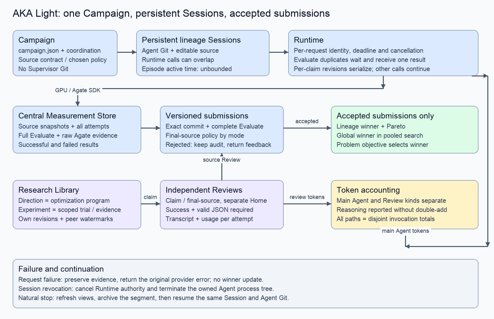

# AKA Light architecture

AKA runs the Light workflow. `aka optimize` builds a public `WorkflowLaunch` from
`--problem`, `--workspace-base`, settings and runtime options. There is no second
Legacy workflow or `--` argument boundary. The `light` profile runs a native Agent;
`light-sandbox` uses Bubblewrap. Explicit SSH and DSH remain available.

## Public owners

| Owner | Responsibility |
|---|---|
| `aka.agent` | Provider Sessions, continuation, tool host, capture, process isolation |
| `aka.task` | Problem inputs, source contracts and candidate workspace initialization |
| `aka.evaluation` | Typed request preparation, Shape batching, interpretation, objective aggregation |
| `aka.execution` | Agate SDK or explicit SSH, transport recovery and job collection |
| `aka.experiment` | Durable execution attempts, measurements and source evidence |
| `aka.resources` | Runtime clients, Skills, prompt resources and plugin resources |
| `aka.workflow.light` | Campaign, lineage coordination, Research Library, submissions and policy |

Light orchestrates these public services; it does not carry a second Agent or Gateway
implementation. Agate control-plane operations use the SDK. Source archives upload through
SDK-issued upload slots. Explicit SSH uses the public SSH execution modules.

## Persistent Campaign

The Campaign root is not a Git repository. `campaign.json` contains launch identity and
source contract. Each `lineages/tNNNN/agent-workspace` contains a persistent Agent-owned Git
repository. Source initialization creates the common starting commit without evaluating it.
The Agent chooses when to measure. A segment ending does not reseed, checkout, rollback or
rewrite the Agent repository; the next segment resumes the Session and workspace.

All GPU measurements, failed attempts and source evidence enter the central
`measurements/` store. Lineages record visible IDs; Agent `records/` files are projections.
`research-library/` stores immutable Direction and Experiment versions, with attachments
and review evidence. `submissions/` stores versioned final-source reviews. Runtime requests
and Agent/reviewer conversation and token usage remain in Campaign-private audit storage.

The common initial Git root is used by every trajectory. At a publication, peer history is
imported as `refs/remotes/atrex/Tn`, pointing to that peer's published HEAD. It does not move
the consumer's HEAD. Synchronous research visibility stops at the last Epoch watermark;
asynchronous visibility follows publication updates. Revision remains owner-only.

## Optimization and submissions

A Direction describes a durable optimization program; Experiments describe specific tests,
measurements and interpretation. A supported Experiment does not complete its Direction.
Research annotations are optional. The default serial launch disables both modules.

`submit-kernel` reviews an exact Agent commit. It requires a passing complete full Evaluate
with parseable per-Shape performance, but no performance improvement. Fast skips independent
final-source review; Performance requires self-authored core computation; Ultra additionally
requires the explicitly configured DSL. Explicit ABBA remains an optional measurement.

Only accepted submissions enter lineage winners, global winners and Pareto views. Scores
follow the problem's declared objective after all Shape batches are aggregated. Runtime
refreshes local views after accepted submissions and segment completion; peer visibility
follows the configured publication schedule. There is no Framework Baseline, handoff,
episode-report, promotion or Supervisor-owned Git state machine.

## Measurement defaults

Defaults are 10 warmups, 20 benchmark iterations and a 60-second per-step timeout, configurable
with `--warmup-iters`, `--bench-iters`, and `--evaluation-step-timeout`. Explicit request values
are preserved or rejected with a concrete explanation, not silently clipped. Agent Sessions
and Reviews have no active-time deadline.

Outer batches contain at most 10 Shapes. Ray Data uses `shape_shards=1`. Ordinary Evaluate
and native ABBA retain the full reference and select batch IDs through `options.shape_ids`.
Requests ask for
best-effort clock locking without prescribing MHz. Structured SDK rejection and candidate
failure diagnostics remain in both audit evidence and actionable Agent receipts.

## Runtime and lifetime boundaries

**Episode active time is intentionally unbounded.** An Episode is an audit segment delimited
by a natural Agent stop. Continuing resumes the same Session, workspace and Git history;
there is no Episode timer, automatic handoff, promotion or rollback. A positive Campaign token
budget is checked at invocation boundaries. Operators can cancel or revoke a Session; revocation
also terminates its owned Agent process tree. GPU request/queue/per-step limits are separate.
The optional Agent provider `timeout_seconds` is unset by default.

`pause_agent_during_requests` defaults to **false**. A Runtime call does not suspend
the Agent process; the Agent can continue or issue another request. Waiting therefore
counts toward an explicitly configured provider active-time limit. Each measurement
uses its frozen request/source snapshot, even if the Agent edits its workspace meanwhile.

Independent Runtime requests can overlap within one Session. Each has its own authenticated
identity, cancellation and deadline. Only updates to the same research/submission identity are
serialized; slow Reviews do not hold a global Session lock. Read-modify-publish sections use
short locks, with request-local research snapshots across external calls.

## Why this workflow

The old Episode protocol required a handoff, private source sealing, acceptance ABBA and
promotion before continuing. That duplicated Agent Git and measurement identity and made
ordinary probes depend on an Episode state machine. This workflow serves operators running
long optimization Sessions and pooled searches: Agent-owned Git remains authoritative, all
measurements enter one Campaign Store, and only accepted submissions participate in winners.
Research records help choose the next trial; they do not gate experimentation.

Observed failures in the earlier handoff workflow included
`Promoted Episode has no sealed Agent Kernel commit identity` after a passing Evaluate,
and `ABBA baseline commits require a registered Episode Git workspace` during terminal
validation. These are concrete identity/coordination failures this design removes;
they are not measurements of speedup or token savings.

Observable acceptance criteria are: exact-commit evidence can be traced to its source and raw
Agate response; duplicate in-flight Evaluate requests share one physical execution and each
receive a normal receipt; rejected submissions retain their reviews and do not move winners;
main-Agent and Review tokens remain separate and each invocation is counted once. These are
correctness/operability criteria, not a claim of improved Kernel latency or reduced token use.

The tradeoffs are larger private evidence archives and potentially long Sessions/Reviews.
There is no automatic wall-clock watchdog at the Episode layer. Native mode trusts the local
OS user; Bubblewrap host-proc mode preserves filesystem mounts but shares the host PID namespace
and cannot protect same-UID processes from signals. See [isolation](agent-workspace-isolation.md).
The process-policy poller detects prohibited host GPU work and shared Gateway mutation
on a best-effort basis. It is not a substitute for OS isolation and does not freeze
Agent-owned Git/source. Reference knowledge is installed separately and excluded from
candidate uploads, including implicit file arguments and manifest source entries.

## Migration and rollback

Use a new Campaign directory for this workflow and keep the original checkout/environment for
old handoff/promotion Campaigns. This change does not convert a live old Campaign or its Journal.
`production`/`leaderboard` are replaced by `fast`/`performance`/`ultra`; Ultra requires a DSL.
`projected` proc mode is removed; choose `private`, or `host` for Aone Sandbox. GPU Wiki and the
Workflow startup entry point default to enabled so normal launches expose the selected knowledge
provider and CLI; disable Wiki explicitly with `wiki: false` if unwanted.

To roll back, stop the current controller, retain its evidence, and use the pinned older checkout
with its own compatible Campaign directory. Do not delete private records, rewrite the Agent Git,
or downgrade an in-flight Campaign. The obsolete terminal numerical-planner option is removed;
standard Evaluate still uses **five correctness cases per Shape**.

For a reproducible historical handoff implementation, commit
[`64322a9775af04c5cb3b7b144e1c239b17883c6d`](https://github.com/alibaba/atrex-kernel-agent/commit/64322a9775af04c5cb3b7b144e1c239b17883c6d)
contains the old `episode-report` contract. Resume an existing old Campaign with its
**own recorded launch commit and dependencies**, not an arbitrary historical pin.
That historical commit is a code reference, not a migration target for current Campaign data.
