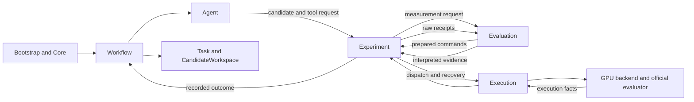

# Architecture Design

AKA's default `light` profile composes a coding Agent, managed CandidateWorkspace,
private HTTP Tool Runtime, and Supervisor-owned optimization workflow. The Agent proposes
implementations and evidence. Task owns trusted inputs, Evaluation owns measurement
preparation and interpretation, Experiment owns records and recovery, and Workflow owns
acceptance, Git sealing, promotion and phase budgets.



[Launch and configuration](quickstart.md) · [Detailed module reference](optional-light-modules.md)

## Entry point and composition

`aka optimize --repo-root /path/to/aka ...` converts optimization arguments into a typed
Workflow request, then launches through Bootstrap and Core. A launch manifest selects a
composition and startup target. Core validates configuration, assembles dependencies, and
disposes owned providers when the invocation ends.

| Profile | Workflow | Agent |
| --- | --- | --- |
| `light` | Managed drafts and unified Episodes | Native with capture |
| `light-sandbox` | Same Light workflow | Bubblewrap with capture |
| `workflow` | Explicit Legacy Fast/Full/goal workflow | Legacy |
| `observed` / `sandbox` | Legacy workflow with an Agent replacement | Capture-enabled native / Bubblewrap |

Light requires the framework, legacy, and light distributions from a matching revision.
Shared Agent, Task, Evaluation, Experiment and Execution implementations belong to the framework
package. The legacy package supplies orchestration components also used by Light; installing it
does not select the Legacy workflow. Recorded continuations restore their frozen selection
rather than adopting new-launch defaults.

## Project structure

```text
src/aka/
├── core/                  # Composition, dependency injection, lifecycle
├── contracts/             # Shared service interfaces
├── bootstrap/             # Launch selection and continuation identity
├── agent/                 # Sessions, capture and process isolation
├── task/                  # Trusted inputs, candidate layouts and snapshots
├── evaluation/            # Preparation, timing policy and result interpretation
├── experiment/            # Measurement identity, records and safe retries
├── execution/             # GPU transport, original-job queries and cancellation
├── resources/             # Prompts, Skills and published runtime assets
├── acceptance/            # Promotion requirements
├── workflow/              # Stage budgets and selected business orchestration
│   ├── legacy/            # Fast/Full Episodes
│   └── light/             # Managed drafts, tool runtime and unified Episodes
├── observation/           # Workflow observation adapter
└── dashboard/             # Optional viewer
```

`packages/` owns distribution metadata. `plugins/`, `gpu-wiki/`, and selected
`reference-projects/` supply checkout resources. Runtime prompts, Skills, clients, and
profiling helpers belong to their packages and are published into campaign workspaces.

## Authority boundaries

| Owner | Authority |
| --- | --- |
| Problem / Source | Public problem contract, private evaluator roles, frozen initial source and runtime requirements |
| CandidateWorkspace | Candidate layout, allowed edits, exact snapshots, draft publication, private Git transactions |
| Agent | CLI sessions, process supervision, usage observations, optional filesystem isolation |
| Tool Runtime | Session capability, workspace authorization, request routing, deadlines and revocation |
| Evaluation / Experiment / Execution | Measurement plan and result semantics / durable facts and reuse / physical GPU jobs |
| Wiki provider | Knowledge source and public query operations; Runtime retains authorization and caching |
| Journal / Acceptance | Report and optional research records / required correctness and performance evidence |
| Workflow | Episode lifecycle, budgets, acceptance coordination, promotion and final export |

The Agent does not choose private storage paths, submit a Git commit as proof, or rewrite
the trusted evaluator. Native mode separates work cooperatively under the same OS user.
Bubblewrap adds filesystem enforcement; it does not add a network allowlist or change
the remote GPU executor.

## Campaign lifecycle

1. **Freeze inputs.** Load the operator, initial source, evaluator contract, runtime pins,
   and selected candidate format. Production preprocessing provides a generalized public
   contract while detailed inputs remain private.
2. **Establish baselines.** Measure V0 and, when configured, establish V1 in the target
   framework. Imported source trees retain their pinned initial package.
3. **Explore.** Start or resume an Episode in a managed Git-free draft. The Agent can
   research, edit, profile, evaluate, and inspect previous measurement records.
4. **Report and seal.** A report cites a passing standard full Evaluate for the exact
   source. Mandatory correctness, applicable production policy, and enabled supplemental
   validation must succeed before the report can seal that candidate.
5. **Compare and promote.** Obtain policy-matched native ABBA evidence for the sealed
   candidate and committed incumbent. Promote only a strict improvement; otherwise retain
   the incumbent and record the outcome.
6. **Continue or export.** Carry eligible adaptive Skills/tools into the next Episode,
   enforce campaign limits, and export the retained source with verified version facts.

The default report uses `gateway_record_ids`. Direction/Experiment annotations are enabled
separately by `workflow.research_records`; then a report selects a recorded Experiment.
Generated memory is also optional. With it disabled, committed `.atrex_versions/vN.json`
facts still support versioning, reporting, and recovery.

## Source and measurement identity

New tasks default to `source_tree`, with a fixed Python adapter and editable `impl/`.
Explicit alternatives are `single_file` and `cuda_manifest`. Layout implementations own
validation and packaging; Workflow uses their common artifact interface.

A Kernel ID binds the complete source snapshot for multi-file candidates, including headers
and build settings. A measurement identity additionally binds evaluator/input bytes, target,
options, transport, and repetition policy. Changing any required identity produces a new task.
Agent duplicates return the existing record reference; trusted acceptance can reuse compatible,
completed evidence. Unavailable or contradictory results cannot become cached verdicts.

See [candidate layouts](native-cuda.md), [measurement records](measurement-records.md),
and [evaluator outcomes](evaluator-outcomes/README.md).

## Correctness and promotion

Native Atrex-Bench candidate acceptance uses six correctness cases per shape. A targeted
smoke test, custom-input probe, or partial-shape measurement cannot replace full-contract
evidence. Supplemental numerical planning is default-off and adds measured probes when enabled.

Light uses native same-allocation A/B/B/A measurements. Its promotion metric is:

```text
latency_reduction_pct = (incumbent_geomean_us - candidate_geomean_us)
                        / incumbent_geomean_us * 100
```

The reduction must strictly exceed the configured threshold. Objective scores and public
speedup ratios are diagnostic and have distinct meanings. Production source-policy review
is shared with Legacy; the validated distributed Agate exception is frozen from evaluator
metadata, not candidate declarations.

Light's native ABBA requires an Agate Atrex-Bench contract. SOL inputs can be loaded with
explicit `single_file`, but SOL/SSH comparisons have no Light ABBA fallback.
The [Legacy guide](legacy-workflow.md) covers the supported alternative verification path.

## Recovery and observability

The Supervisor persists accepted job IDs, request identities, complete ABBA batches, report
transactions, source seals, and promotion audits. Direct HTTP replay uses durable idempotency
keys. An uncertain CLI submission without an ID needs reconciliation, not blind resubmission.

Session throttling and output-limit recovery retain the Episode draft and observation history.
Stage limits use wall-clock time, including authenticated blocking Runtime requests.
Agent invocations default to eight hours, framework baseline to eight hours, and Light
Episodes to four hours. Explicit overrides apply within the remaining parent deadline.
The baseline and Episode clocks survive restart; there is no default Campaign-wide cap.
GPU, Wiki, and queue deadlines remain independently enforced.

Capture is diagnostic; missing transcripts or usage counters remain explicit gaps.
Canonical state never depends on an Agent-writable projection.
See [Session observability](session-observability.md), [Runtime Journal](runtime-journal.md),
and [promotion recovery](supervisor-promotion.md).

## Verification

Package/composition, filesystem, HTTP, source sealing, and recovery checks are documented in
the [Light verification record](optional-light-modules.md#verification-scope).
[Native CUDA validation](native-cuda.md) records scoped live `<gpu_arch>` evidence.
[Evaluator-outcome checks](evaluator-outcomes/README.md) use local fault injection.
These are evidence for their documented paths, not a performance guarantee for every provider.

## Upgrade and rollback

Keep the installed packages, selected resources, and recorded configuration consistent.
Stop at an Episode boundary before changing deployment code. Restore the original matching
deployment to resume frozen continuations; use a new workspace for a different workflow,
source contract, or search topology. Do not rewrite recorded identities to force an upgrade.
Preserve private evidence and backups for operator repair.

See [installation and continuation](application-plugin-migration.md) and the
[v0.4.0 upgrade notes](releases/v0.4.0.md#upgrading-from-v030).
