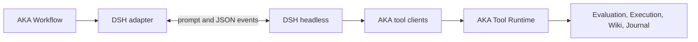
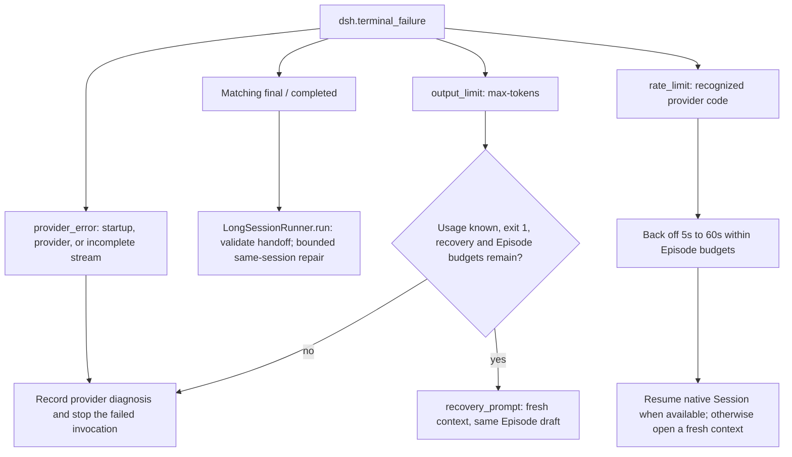

# Optimize kernels with DSH

AKA can use [DeepSeek Harness (DSH)](https://github.com/deepseek-ai/deepseek-harness)
as its coding agent. DSH reads the operator, develops the implementation, and
uses AKA's tools to evaluate and refine it. AKA manages GPU execution,
correctness checks, performance comparisons, and promotion of the selected
implementation.

Choose DSH with `--agent-cli dsh`. The adapter is available in the default Light
workflow and the explicit Legacy workflow.

## Get ready

Follow the [Quick Start](quickstart.md) to install AKA, configure GPU access, and
prepare an operator. On the coordinator, install DSH using its
[setup instructions](https://github.com/deepseek-ai/deepseek-harness) and configure
authentication for your chosen provider. Keep `dsh` on `PATH` so AKA can launch it.

```sh
dsh --version
dsh --profile headless --help
```

The adapter uses DSH's headless runner and JSON event stream. An existing DSH
profile works too when it includes the headless runner. Select that profile and
its provider and model in the settings below.

## Start an optimization

This example uses the default headless profile with the official DeepSeek route:

```sh
export ATREX_DSH_SESSION_SETTINGS='{"provider":"deepseek-official","model":"deepseek-flash"}'

aka optimize --repo-root /path/to/aka -- \
  --op-dir /path/to/operator \
  --platform '<gpu-target>' --framework Triton \
  --agent-cli dsh --workspace /path/to/runs
```

Use the GPU target configured for your AKA environment and the framework used by
your operator. The operator and its inputs follow AKA's existing problem format.
See [Inspect outputs](quickstart.md#inspect-outputs) for the retained source,
verification results, and Session observations.

To use a provider already configured in another headless profile, fill in its
profile, provider, and model names:

```sh
export ATREX_DSH_SESSION_SETTINGS='{
  "profile": "my-headless",
  "provider": "my-provider",
  "model": "my-model",
  "reasoning_effort": "default"
}'
```

Then run the same `aka optimize` command. Authentication stays with DSH's normal
provider configuration.

## Choose a profile and model

`ATREX_DSH_SESSION_SETTINGS` accepts a JSON object with these optional fields.
`ATREX_SESSION_SETTINGS` provides the shared fallback.

| Setting | Default | Purpose |
| --- | --- | --- |
| `profile` | `headless` | Select a DSH profile that includes the headless runner. |
| `provider` | `deepseek-official` | Select a provider route configured in DSH. |
| `model` | `deepseek-flash` | Select a model available on that route. |
| `reasoning_effort` | AKA's requested effort | Set a supported effort, or use `default` to follow the provider's configuration. |

For the official DeepSeek route, AKA maps `medium` to `high` and `xhigh` to
`max`. Other requested levels pass through to DSH. An explicit `reasoning_effort`
selects the value sent to the route. `default` is useful for models whose DSH
configuration exposes provider defaults rather than selectable effort levels.

AKA uses `DSH_HOME` when it is set and otherwise selects `~/.dsh`. If your DSH
launcher uses a different home, set its absolute path before starting AKA:

```sh
export DSH_HOME=/path/to/dsh-home
```

Keep the same model settings, DSH home, and AKA composition when continuing a
Campaign. AKA retains the native DSH Session identity for same-session
continuation and checkpoints.

## What to expect during a run

DSH works through the same evaluation, profiling, knowledge, and report tools
used by AKA's other coding agents. The selected AKA profile controls which tools
are available. Skills come from the managed workspace, and GPU requests stay in
the foreground while AKA tracks their progress.

With Session capture enabled, AKA records the conversation, tool activity,
native Session family, and reported token usage. Available counters retain their
input, output, and cache categories; incomplete samples carry a partial or
unavailable measurement label.

AKA launches DSH with its unattended permission preset. Current integration
coverage uses the native coordinator runner. DSH with Linux Bubblewrap
coordinator isolation still needs end-to-end validation of the connection-file
and tool-call path; treat that combination as experimental pending maintainer
sign-off. See [Agent workspace isolation](agent-workspace-isolation.md) for
Bubblewrap requirements and installation grants for custom launchers.

## Troubleshooting

| Symptom | Next step |
| --- | --- |
| `dsh` is unavailable | Check that the coordinator's `PATH` includes your DSH launcher. |
| Provider or model lookup fails | Use the route and model names from the selected DSH profile. |
| Authentication fails (`MISSING_CREDENTIAL`) | Check that profile's provider authentication with DSH on the coordinator, using the same `DSH_HOME`. |
| `UNSUPPORTED_REASONING_EFFORT` | Choose a level supported by the model, or set `reasoning_effort` to `default`. |
| A Session ends with an error or incomplete event stream | Read the captured provider stderr and Session observations, correct the reported cause, and continue through AKA's normal recovery flow. |

## Adapter internals and verification

AKA owns the optimization workflow and DSH owns the model loop. DSH's Cordis
plugins run inside the DSH process. This adapter connects the two through the
existing AKA Agent interface:



An adapter-owned overlay configures workspace Skills, foreground shell calls,
and uncompressed native logs under `$DSH_HOME/aka-sessions`. A private,
invocation-scoped connection file carries the AKA Session capability to DSH's
shell children. Managed Campaigns create it after the Runtime mints the
capability and remove it when the invocation finishes.

Successful completion requires both a zero process exit status and a matching
DSH `final` event with `reason.kind=completed`. Native checkpoints retain the
selected Session family and its latest log generation. Usage accounting combines
reported root steps with newly observed child attempts and excludes prior
Session history. Exact capture accounting requires current native evidence as
well as complete root step counters. Missing native evidence leaves the observed
total available with a `partial` label and a `dsh_step_usage_incomplete` warning.

### Session lifecycle

DSH allocates the native identity. AKA learns it from the opening `session`
event, then uses that identity to select the native ledger and Session family.
The transitions below name the code responsible for launch, continuation, and
checkpoint restore.

```mermaid
stateDiagram-v2
  [*] --> Launching: fresh_session_command
  Launching --> Observed: session_id_from_stream / opening session event
  Observed --> Persisted: native_session_files / latest family logs
  Persisted --> Resuming: resume_session_command / --session-id
  Persisted --> Checkpointed: capture_native_session / export_checkpoint
  Checkpointed --> Restored: restore_checkpoint
  Restored --> Resuming: resume_session_command
  Resuming --> Observed: matching native identity
  Observed --> Completed: validated_exit_status / completed final
  Launching --> Failed: terminal_failure
  Observed --> Failed: terminal_failure
  Completed --> [*]
  Failed --> [*]
```



### Failure classification and recovery

`dsh.terminal_failure` classifies the headless stream. Light's
`LongSessionRunner.run` first accepts an already valid Supervisor handoff as
authoritative; otherwise it applies the recovery paths below. Each continuation
retains the Episode's draft and accounts for tokens already consumed.



An absent or mismatched final event maps to
`provider_error / dsh_incomplete_stream`. The failed invocation stops with its
diagnosis and retained draft. A timeout or external termination follows the
runner's existing bounded continuation rules when a resumable identity and
budget remain. Output-limit recovery allows two fresh contexts by default;
rate-limit recovery uses the same Episode and its active-time and token budgets.

### Runtime connection lifecycle

The managed runner binds the connection after the Runtime capability exists.
The client reads a regular file through a bounded, no-follow descriptor and
validates the loopback URL before making a request.

```mermaid
sequenceDiagram
  participant P as run_bounded
  participant R as Runtime session_environment
  participant C as runtime_connection_environment
  participant D as DSH shell child
  participant T as tools/sandbox.py
  P->>R: Mint invocation-owned url and token
  R-->>P: Capability environment
  P->>C: prepare_runtime_connection
  C->>C: Tighten directory to 0700; create 0600 file
  P->>D: Pass ATREX_AKA_RUNTIME_CONNECTION_FILE path
  D->>T: Invoke existing AKA client
  T->>T: Check descriptor, size, JSON, and loopback origin
  T->>R: Authenticated tool request
  Note over P,C: Return, exception, or timeout unwinds the context
  P->>C: finally: release_runtime_connection / unlink
```

The adapter's prepare/release hooks provide the same cleanup around unmanaged
Agent invocations. A coordinator killed with `SIGKILL` can leave a
`session-*.json` file under `$DSH_HOME/aka-connections`, since forced process
termination skips cleanup. The directory is private (`0700`) and each file is
private (`0600`). After confirming the owning invocation has stopped, remove its
leftover file. Cleanup is invocation-specific so concurrent runs keep their own
connections.

### Verification evidence

The protocol was verified with DSH `0.2.2-alpha.2`. Local checks cover launch,
native continuation and checkpoints, failure classification, accounting,
provider-home preparation, connection-file handling, and shared execution
recovery. A check using the installed DSH CLI exercises editing, Skills, tools,
capture, and continuation against synthetic credentials and loopback services.
The [pull request](https://github.com/alibaba/atrex-kernel-agent/pull/134) records
the source and wheel validation results. Test scripts stay local in keeping with
the repository's convention.

Linux Bubblewrap validation remains a maintainer sign-off item. Custom Cordis
extensions can build on this adapter in a later phase.
