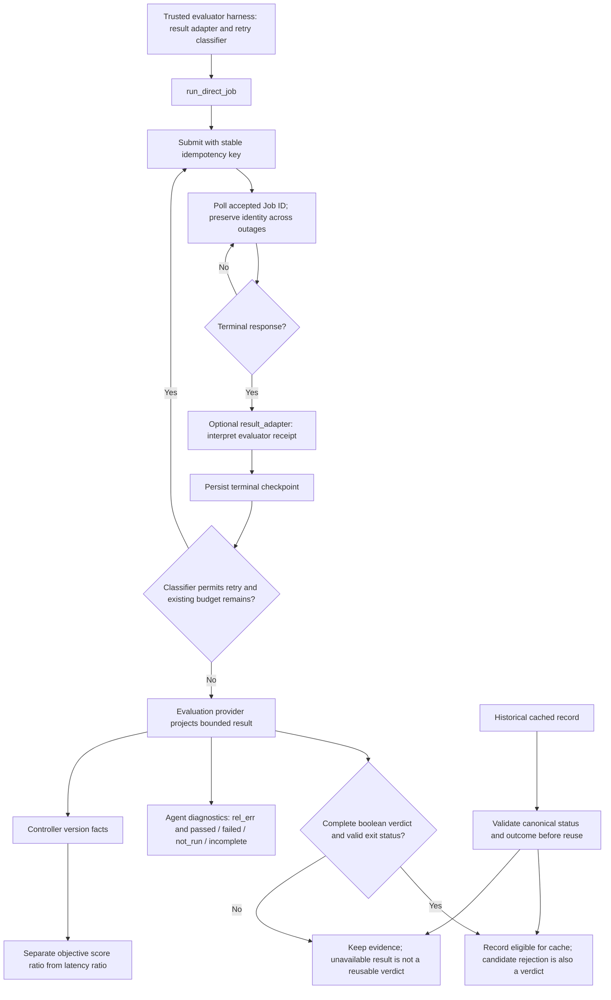
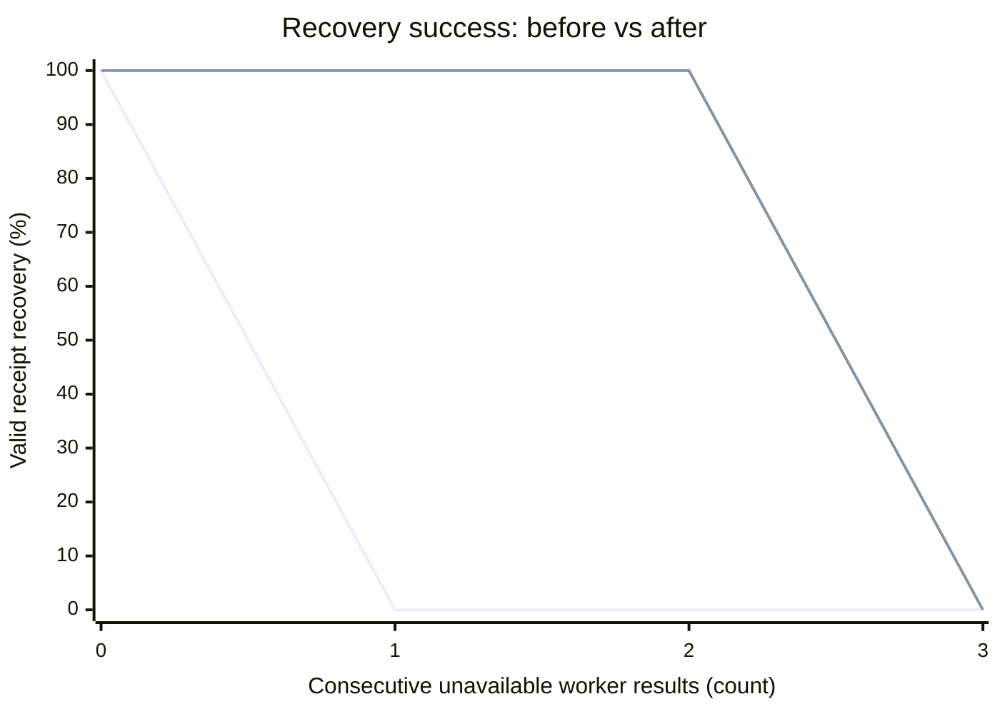

# Evaluator outcomes across transport, cache, and version reports

A successful Dev allocation can contain a failed evaluator process. Treating the allocation as a completed evaluation prevents a trusted harness from classifying that failure before checkpointing. In addition, an unavailable result can be cached permanently, diagnostic projection loses case execution status and failure detail, and a version's objective-score ratio can be confused with an unweighted latency ratio.

The intended callers are trusted evaluator adapters and the existing Supervisor. The optional callbacks extend the transport API; the remaining changes restore evaluation and reporting invariants. No new task mode, permission, benchmark implementation, tolerance, or promotion formula is introduced.

## Boundaries and control flow



- **Transport — `evaluation/gateway.py`:** optional `result_adapter` and `retry_classifier` run inside the existing checkpoint/retry lifecycle. No adapter leaves the native envelope behavior intact. The classifier must return `None` for outcomes that must not be retried; the existing timeout, idempotency, cancellation, and retry budgets remain authoritative. Caller-supplied `identity_extra` should bind its evaluation contract. The callbacks are trusted Python code, never Agent-supplied executable content.
- **Cache — `experiment/records.py` and `experiment/store.py`:** writing requires an actual boolean verdict, and reading rejects failed/unknown/unavailable canonical outcomes. Old evidence stays immutable. Completed candidate rejection and exhausted native ABBA wall-clock timeout remain reusable terminal decisions. This is not permission to blindly resubmit an uncertain physical job: its durable checkpoint remains authoritative.
- **Projection — `evaluation/projection.py`:** retain the existing relative-error summary and bounded, enumerated case status. Diagnostic detail does not change correctness.
- **Reporting — `workspace/versions.py`:** comparable complete passing versions with the same objective receive `score_ratio_vs_v0` separately from `latency_speedup_vs_v0_geomean`. The ambiguous legacy geometric-speedup field is cleared for objective-bearing versions. Versions without an objective retain their existing representation. These fields do not drive promotion.

Existing checkpoints are not migrated or rewritten. Apply the code to new controlled runs; the result adapter does not retroactively reinterpret an already-sealed terminal checkpoint. Rollback is a code revert; retain evidence and do not roll back a live run by deleting its records.

## Validation and recovery curve

The curve measures deterministic recovery success, **not GPU performance or model quality**. Baseline is `0df128c`; implementation is `5390ffe`. Python 3.12.13, macOS arm64; no model or GPU; mocked network and sleep; concurrency 1; fresh checkpoint directory for each repetition; 60-second wait budget, zero queue grace, two infrastructure retries. Each of four fault counts has five repetitions per variant, 40 runs total. The same response sequence and payload are used on both sides. A second identical invocation checks that replay submits no extra job. There is no randomness; min/max success in each group coincide, so no statistical confidence claim is made.



Legend: the first line is **Before** (drops at one injected failure); the second is **After** (drops only beyond the two-retry budget). Both coincide at zero and three failures.

[Raw observations and environment](recovery-results.json)

| Consecutive unavailable worker results | Before: valid receipts | After: valid receipts | After: submissions per run |
|---:|---:|---:|---:|
| 0 | 5/5 | 5/5 | 1 |
| 1 | 0/5 | 5/5 | 2 |
| 2 | 0/5 | 5/5 | 3 |
| 3 | 0/5 | 0/5 | 3 |

The success criterion is recovery within the configured budget without false success or duplicate dispatch on replay. The beyond-budget case remains unavailable and stops at three total submissions.

Additional consumer-owned local regressions: 54 passed, one skipped because the baseline lacks an optional Wiki capability. They cover unchanged native routing, bounded durable retry, explicit no-retry outcomes, missing receipts, candidate rejection deduplication, historical unavailable-cache rejection without rewriting evidence, case-status/error projection, objective/latency ratios, and adapter assembly. These consumer checks are supplemental; the self-contained public reproduction below does not depend on those fixtures. No test scripts are added by this change.

An explicit inline check also verified that a completed native ABBA timeout after its one allowed retry remains a cache hit. The first local invocation of that check used macOS's symlinked temporary path and was refused by the existing private-directory guard; rerunning with the resolved directory passed. No production code change was needed.

## Reproduce the recovery curve

In an editable checkout with the AKA packages installed, run the following command. It loads only the baseline Gateway module from Git and executes both variants against the same synthetic transport; no GPU jobs or external requests are submitted.

```bash
python - <<'PY'
import contextlib, io, json, os, subprocess, tempfile, types
from pathlib import Path
from unittest.mock import patch
from aka.light.evaluation import gateway
from aka.light.experiment.store import JOB_ROOT_ENV, MeasurementStore
from aka.light.evaluation.public_result import PREFIXES, canonical_result
from aka.light.evaluation.native_abba import _terminal_abba_timeout_error

source = subprocess.check_output(["git", "show", "0df128c:src/aka/light/evaluation/gateway.py"], text=True)
before = types.ModuleType("baseline_gateway")
before.__file__, before.__package__ = gateway.__file__, gateway.__package__
exec(compile(source, gateway.__file__, "exec"), before.__dict__)

def adapt(job):
    if job["status"] == "succeeded" and job["result"]["exit_code"] != 0:
        return dict(job, outcome="unavailable", error={"error_class": "infra", "reason": "worker_unavailable"})
    return job

def retry(job):
    return "infra" if (job.get("error") or {}).get("reason") == "worker_unavailable" else None

rows = []
for failures in [0, 1, 2, 3]:
    for label, module in [("before", before), ("after", gateway)]:
        successes, counts = [], []
        for repetition in range(5):
            submitted = []
            def api(url, method, path, body, seconds):
                assert method == "POST"
                submitted.append(body["idempotency_key"])
                bad = len(submitted) <= failures
                return {"job_id": f"dv-replay-{repetition}-{len(submitted)}", "status": "succeeded",
                        "result": {"exit_code": int(bad), "stdout": "unavailable" if bad else "receipt"}}
            with tempfile.TemporaryDirectory() as tmp, patch.dict(os.environ, {JOB_ROOT_ENV: str(Path(tmp).resolve())}), patch.object(module, "_gateway_json", side_effect=api), patch("time.sleep"), contextlib.redirect_stderr(io.StringIO()):
                args = dict(url="https://gateway.test", kind="dev", payload={"command": "worker"},
                            timeout=60, queue_wait_grace=0, max_infra_retries=2)
                if label == "after":
                    args.update(result_adapter=adapt, retry_classifier=retry)
                first = module.run_direct_job(**args)
                second = module.run_direct_job(**args)
                assert first.stdout == second.stdout
                expected = min(failures + 1, 3) if label == "after" else 1
                assert len(submitted) == expected
                job = json.loads(first.stdout)
                ok = job["result"]["exit_code"] == 0
                if label == "after" and not ok:
                    assert job["outcome"] == "unavailable"
                successes.append(ok)
                counts.append(len(submitted))
        rows.append(dict(failures=failures, variant=label, successes=sum(successes),
                         repetitions=5, percent=sum(successes)*20, submissions=counts))

error = _terminal_abba_timeout_error([[{"message": "timeout"}], [{"message": "timeout"}]])
request = {"operation": "same_allocation_abba", "options": {}}
response = {"exit_code": 1, "stdout": PREFIXES["same_allocation_abba"] + json.dumps({"correct": False, "error": error}), "stderr": ""}
record = dict(operation="same_allocation_abba", cacheable=True, task_digest="fixture", request=request, response=response)
with tempfile.TemporaryDirectory() as tmp:
    store = MeasurementStore(Path(tmp).resolve())
    with patch.object(store, "read", return_value=record):
        assert store._cached("fixture", "fixture") == record
assert canonical_result(response, request)["status"] == "completed"
print(json.dumps({"rows": rows, "terminal_abba_timeout_cache": "PASS"}, indent=2))
PY
```

## Review gates

| Gate | Result | Evidence |
|---|---|---|
| Change type | Mixed | Optional transport callbacks and report fields plus correctness fixes |
| No test scripts in diff | Pass | Production modules and review documentation/data only |
| Minimal implementation | Pass | Two explicit hooks reuse the existing lifecycle; cache write and read fixes address different entry points |
| Why and impact | Pass | Unavailable evaluation reuse, lost diagnostics, ambiguous score ratios described above |
| Design and failure paths | Pass | Diagram and module contracts above |
| Before/after curve | Pass | Four fault counts, both variants, raw data and public reproduction |
| Permissions and privacy | Pass | No new execution permissions; only generic synthetic evidence published |
| Validation | Pass | Recovery/replay, native ABBA terminal cache, and consumer regressions |
| Verdict | Approve | No blocking issue found in local review; hosting-platform checks and required reviews still apply |

## Complete evaluator failure feedback

A negative evaluator result must retain the information needed to repair the candidate. Previously the Agent projection kept only eight failure messages, cut diagnostic text, and discarded ordinary stdout/stderr on generalized failures. Rank-local state checks were not traversed. A producer could report an output mismatch with error metrics and tolerances while the Agent received only a generic correctness failure.

The shared extractor now traverses rank results and reports output/state names, rank, check index, seed, original error, measured errors and producer tolerances. The projection preserves all failure entries and complete received text, including compiler/runner logs, numerical-probe failures and ABBA-side diagnostics. Timing/profile detail remains separately bounded. Existing upstream truncation annotations remain visible; this change cannot reconstruct bytes that an upstream executor never returned.

Hidden workload dimensions remain private: input generators and shape metadata are not copied into diagnostic records, and generalized feedback redacts shape fields and dimension encodings in error text (JSON shape fields, torch.Size, numeric vectors, matrix dimensions and size-mismatch messages). Opaque case IDs, output indices, error metrics, tolerances, source locations and error text remain useful. Credentials and configured private paths are still redacted. Verdicts, retry advice, acceptance thresholds, evaluator inputs and performance scoring are unchanged.

Validation for this bug fix used Python 3.14 on macOS, without GPU execution: 16 existing consumer regressions passed and three optional/environment-dependent cases were skipped; seven local regression scenarios passed for long Unicode logs, more than eight errors, rank-local state checks, hidden dimensions/credentials, recorded producer output mismatch, unavailable-result logs, runner exceptions and missing receipts. No test scripts or private evidence are published. The failure-feedback change is a bug fix to the existing diagnostic contract; no new model/tool permission or optimization behavior is introduced. Rollback is a code revert with all original job evidence retained. Running processes need a controlled restart or replacement before they use the new code.
