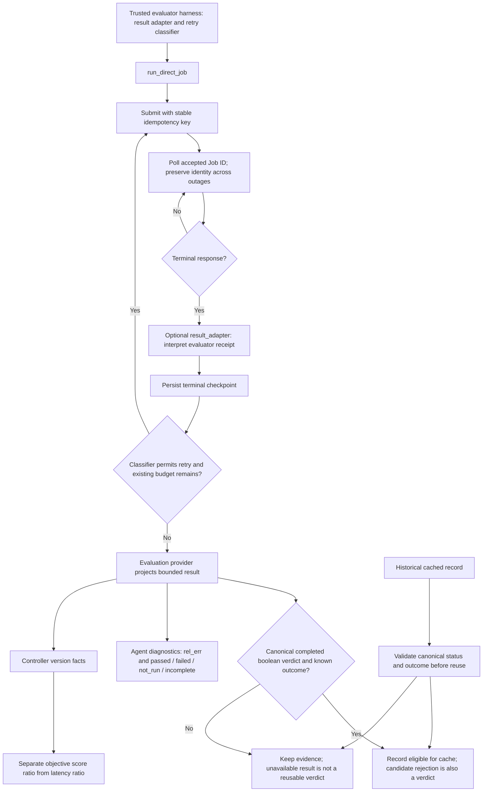
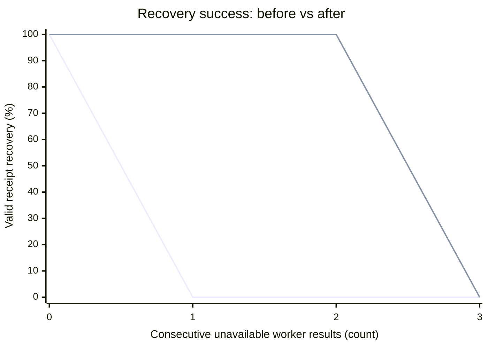

# Evaluator outcomes across transport, cache, and version reports

> Historical design and validation record, preserved from [revision 1abdf3f3](https://github.com/alibaba/atrex-kernel-agent/tree/1abdf3f36cbb7797fdedec7924ff40431975df7b). This is a documentation snapshot, not a runtime compatibility claim: commands and private module paths below describe earlier implementations. Reproduction requires the original implementation revisions named in the record. For current usage, see the [current guide](../measurement-records.md).

A successful Dev allocation can contain a failed evaluator process. Earlier behavior treated that allocation as a completed evaluation, could cache unavailable results, lost diagnostic detail, and conflated objective-score ratios with latency ratios. The current contracts below separate transport success from evaluator verdicts and preserve bounded repair evidence.

This document retains implementation-specific validation records. The before/after curve is tied to the revisions and environment listed below; its test counts are historical evidence, not a fresh validation of every subsequent checkout.

The intended callers are trusted evaluator adapters and the existing Supervisor. The optional callbacks extend the transport API; the remaining changes restore evaluation and reporting invariants. No new task mode, permission, benchmark implementation, tolerance, or promotion formula is introduced.

## Boundaries and control flow



- **Transport — `evaluation/gateway.py`:** optional `result_adapter` and `retry_classifier` run inside the existing checkpoint/retry lifecycle. No adapter leaves the native envelope behavior intact. A supplied classifier replaces the native eval classifier, rather than chaining with it: return `None` to prohibit a retry, or explicitly delegate unrecognized eval failures to `eval_retry_kind`. The adapted envelope is checkpointed and reused during recovery; an adapted truthy error makes the process return code nonzero even if the allocation succeeded; the existing timeout, idempotency, cancellation, and retry budgets remain authoritative. Caller-supplied `identity_extra` should bind its evaluation contract. The callbacks are trusted Python code, never Agent-supplied executable content.
- **Cache — `experiment/records.py` and `experiment/store.py`:** publication and reuse share `cacheable_evaluation`, requiring a canonical completed boolean verdict and rejecting unknown/unavailable outcomes. Contradictory receipts are recorded as `not_cacheable`, without a publication exception. Interrupted `validation_pending` records resume their original identity and job checkpoints. Old evidence stays immutable. Completed candidate rejection and exhausted native ABBA wall-clock timeout remain reusable terminal decisions. This is not permission to blindly resubmit an uncertain physical job: its durable checkpoint remains authoritative.
- **Projection — `evaluation/projection.py`:** retain the existing relative-error summary and bounded, enumerated case status. Diagnostic detail does not change correctness.
- **Reporting — `workspace/versions.py`:** comparable complete passing versions with the same objective receive `score_ratio_vs_v0` separately from `latency_speedup_vs_v0_geomean`. The ambiguous legacy geometric-speedup field is cleared for objective-bearing versions. Versions without an objective retain their existing representation. These fields do not drive promotion.

Existing checkpoints are not migrated or rewritten. Apply the code to new controlled runs; the result adapter does not retroactively reinterpret an already-sealed terminal checkpoint. Rollback is a code revert; retain evidence and do not roll back a live run by deleting its records.

## Validation and recovery curve

The curve measures deterministic recovery success, **not GPU performance or model quality**. Baseline is `0df128c`; implementation is `5390ffe`. Python 3.12.13, macOS arm64; no model or GPU; mocked network and sleep; concurrency 1; fresh checkpoint directory for each repetition; 60-second wait budget, zero queue grace, two infrastructure retries. Each of four fault counts has five repetitions per variant, 40 runs total. The same response sequence and payload are used on both sides. A second identical invocation checks that replay submits no extra job. There is no randomness; min/max success in each group coincide, so no statistical confidence claim is made.



Legend: the first line is **Before** (drops at one injected failure); the second is **After** (drops only beyond the two-retry budget). Both coincide at zero and three failures.

[Raw observations and environment](recovery-results.json)

| Consecutive unavailable worker results | Before: valid receipts | After: valid receipts | After: submissions per run |
|---:|---:|---:|---:|
| 0 | 5/5 | 5/5 | 1 |
| 1 | 0/5 | 5/5 | 2 |
| 2 | 0/5 | 5/5 | 3 |
| 3 | 0/5 | 0/5 | 3 |

The success criterion is recovery within the configured budget without false success or duplicate dispatch on replay. The beyond-budget case remains unavailable and stops at three total submissions.

Additional consumer-owned local regressions: 54 passed, one skipped because the baseline lacks an optional Wiki capability. They cover unchanged native routing, bounded durable retry, explicit no-retry outcomes, missing receipts, candidate rejection deduplication, historical unavailable-cache rejection without rewriting evidence, case-status/error projection, objective/latency ratios, and adapter assembly. These consumer checks are supplemental; the self-contained public reproduction below does not depend on those fixtures. No test scripts are added by this change.

An explicit inline check also verified that a completed native ABBA timeout after its one allowed retry remains a cache hit. The first local invocation of that check used macOS's symlinked temporary path and was refused by the existing private-directory guard; rerunning with the resolved directory passed. No production code change was needed.

## Inspect current execution evidence

The curve above belongs to the historical revision linked at the start of this page.
Its removed private imports are not an executable recipe for current Light. For current
measurements, use the supported observability entry points from the repository root:

```bash
python observability/light_runtime_calls.py --help
python observability/light_agate_calls.py --help
python observability/export_light_gateway_record.py --help
```

Select a Campaign and Gateway Record to export the raw Agate requests/responses and the
Agent receipt. See the [observability guide](../session-observability.md) for exact options and
[measurement recovery](../measurement-records.md) for current retry/cache semantics.
Historical test counts and curves do not qualify a new checkout.

## Complete evaluator failure feedback

A negative evaluator result must retain the information needed to repair the candidate. Previously the Agent projection kept only eight failure messages, cut diagnostic text, and discarded ordinary stdout/stderr on generalized failures. Rank-local state checks were not traversed. A producer could report an output mismatch with error metrics and tolerances while the Agent received only a generic correctness failure.

The shared extractor now traverses rank results and reports output/state names, rank, check index, seed, original error, measured errors and producer tolerances. Within the diagnostic response budget below, the projection preserves all failure entries and complete received text, including compiler/runner logs, numerical-probe failures and ABBA-side diagnostics. `bound_performance_feedback` independently bounds optional timing detail; its `max_performance_bytes` argument does not bound diagnostics. Existing upstream truncation annotations remain visible; this change cannot reconstruct bytes that an upstream executor never returned.

Hidden workload dimensions remain private: input generators and shape metadata are not copied into diagnostic records, and generalized feedback redacts shape fields and dimension encodings in error text (JSON shape fields, torch.Size, numeric vectors, matrix dimensions and size-mismatch messages). Opaque case IDs, output indices, error metrics, tolerances, source locations and error text remain useful. Credentials and configured private paths are still redacted. Verdicts, retry advice, acceptance thresholds, evaluator inputs and performance scoring are unchanged.

Validation for this bug fix used Python 3.14 on macOS, without GPU execution: 16 existing consumer regressions passed and three optional/environment-dependent cases were skipped; seven local regression scenarios passed for long Unicode logs, more than eight errors, rank-local state checks, hidden dimensions/credentials, recorded producer output mismatch, unavailable-result logs, runner exceptions and missing receipts. No test scripts or private evidence are published. The failure-feedback change is a bug fix to the existing diagnostic contract; no new model/tool permission or optimization behavior is introduced. Rollback is a code revert with all original job evidence retained. Running processes need a controlled restart or replacement before they use the new code.


## Diagnostic size and cache contract

Complete redacted diagnostics are retained in the Gateway Record. `aka.evaluation.tool_results.bound_diagnostic_response` does not trim by serialized length: compiler tails often contain the actionable error. The terminal receipt contains a compact error summary, actionable diagnostics, Record ID/path, and bounded stdout/stderr previews with explicit locations for the complete fields. Env returns its complete capability response.

A receipt preview is distinct from incomplete execution/transport evidence. Preview shortening never changes the verdict or cache eligibility. Original executor output and Gateway Job checkpoints remain private and auditable.

`MeasurementTask.finish` checks the **entire serialized record plus its trailing newline against 32 MiB**, including request, identity, response and the derived Agent payload, before writing it. If non-diagnostic structure or the envelope still exceeds the hard bound, publication stops while the reservation remains resumable; no unreadable `record.json` or `validation_pending` marker is published. Original job IDs and evidence survive recovery. The record size limit bounds durable record serialization, not terminal previews or total private job-artifact retention; an oversized record fails explicitly rather than silently losing diagnostics.

A stage-level failure reason appears once at stage scope, rather than once per allowed shape. A generic stage failure is omitted when more specific diagnostics already exist; distinct producer reasons remain visible. Malformed `input_artifact` fields cannot abort extraction, and malformed/empty rank results fall back to direct shape cases.

Failing-case seeds are deliberately exposed as repair metadata alongside opaque case IDs. This is not a seed-blinded holdout contract: revealing a seed reduces that form of secrecy, even though hidden dimensions, generators and input values remain withheld. Candidate review must still reject seed/input-specialized answers; receipt diagnostics do not establish absence of overfitting. No seed generation, benchmark acceptance or scoring policy changes in this PR.

Review-fix validation: Python 3.14 on macOS, no GPU dispatch. Eleven local regression scenarios passed, covering inconsistent Eval/ABBA receipts, positive/negative/terminal-timeout cache reuse, malformed producer fields, stage deduplication, unbracketed dimensions with intact error metrics, oversized Unicode and many-line logs, numerical marker/list limits, exact record-envelope overflow with identity-preserving recovery, and adapter/classifier replay. The seven prior diagnostic scenarios also passed unchanged. The pre-fix code reproduced publication exceptions and the reported diagnostic/redaction regressions. Checks remain local; no test scripts or private workload evidence are included in the PR. These review fixes restore the documented contracts and do not change tolerances, scoring or GPU kernels.
