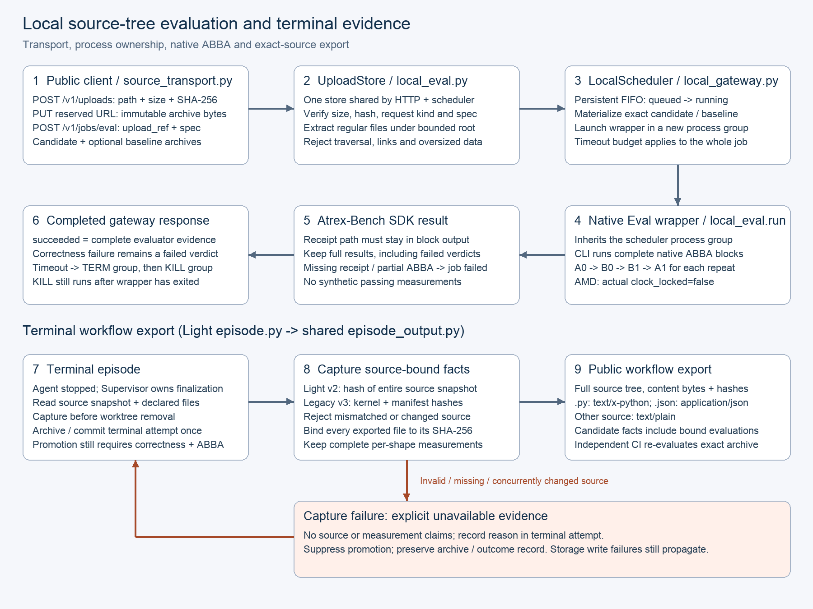
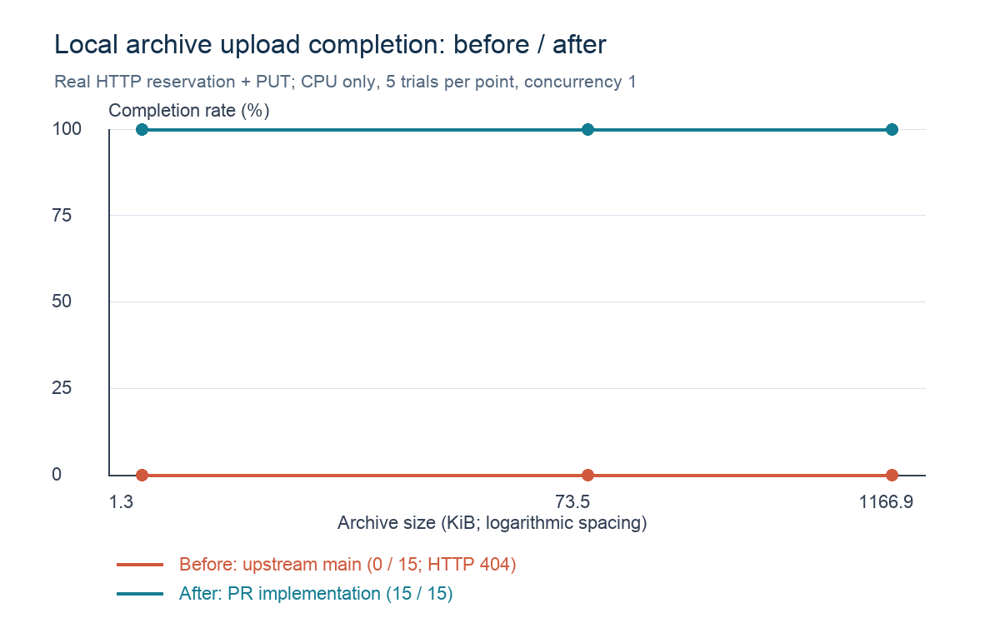

# Local source-tree evaluation and terminal evidence

Local optimization clients upload source-tree candidates before calling Eval. The old localhost gateway returned HTTP 404 for `/v1/uploads`; it accepted inline Python but could not execute the client's archive request. Light also omitted final attempted-source exports, preventing independent verification after an episode worktree was removed. The target callers are local Light workflows and clients using the existing source-upload protocol.

This change enables local archive transport and native Atrex-Bench ABBA evaluation, preserves complete evaluator evidence, and exports the exact final candidate with source-bound measurements. A successful gateway job means the evaluator completed and returned evidence; it does **not** turn a failed correctness verdict into a pass.

## Design and code mapping



1. `light/evaluation/source_transport.py` reserves an upload, PUTs archive bytes, and includes the returned reference in Eval. `legacy/execution/runtime_tools/local_eval.py:UploadStore` binds each reservation to its path, byte count, SHA-256, request kind and GPU spec. The HTTP handler and scheduler share one store instance. Duplicate identical PUTs are allowed; differing bytes are rejected.
2. `local_eval.materialize_source` checks the reservation and extracts only unique regular files. Traversal, links, oversized archives and missing entry points fail before execution. The existing localhost trust boundary remains: evaluation runs trusted caller code as the gateway's user, not in a security sandbox.
3. `local_gateway.LocalScheduler` persists queued/running/terminal states and launches each job with `start_new_session=True`. One job timeout covers the wrapper and all native ABBA blocks. The evaluator inherits the process group. Cancellation, timeout and scheduler shutdown signal the group; cleanup sends SIGKILL even when the wrapper already exited after SIGTERM. The supported maximum is 10,800 seconds, allowing full native measurement without silently truncating an ABBA block. This does not change the default timeout or reserve extra capacity.
4. `local_eval.run` invokes the native evaluator and reads its SDK receipt only from the expected output directory. Every repeated block must contain A0/B0/B1/A1 in order. Missing receipts or incomplete ABBA become job failures; complete SDK results retain all failed correctness verdicts. The job-level deadline is the owner of process-tree termination, so each block does not reset a separate full-job budget.
5. Requested and applied clock locks are distinct. Unsupported AMD clock control leaves `clock_locked=false`; the adapter does not mutate ROCm performance levels or claim a lock. Native evaluator evidence determines acceptance.
6. `light/workflow/episode.py:_record_terminal_episode` snapshots final source before worktree removal. Shared `legacy/workflow/episode_output.py` exports every declared source file and its digest. Light v2 receipts bind the whole source snapshot; legacy v3 receipts separately bind kernel and manifest. A v2 receipt cannot certify a separate solution manifest. Stale-source receipts are ignored, and incomplete or failed measurements remain non-passing facts.
7. Invalid, missing or concurrently changed source produces explicit `unavailable` evidence with no source or measurement claims. The terminal attempt retains the reason and its archive/outcome record; it cannot promote the candidate. Failure to persist the unavailable record or archive still propagates instead of pretending a durable record exists. `.py`, `.json` and other source files export as `text/x-python`, `application/json` and `text/plain`, respectively.

## Non-goals and trade-offs

This change does not alter operator math, model selection, prompts, promotion thresholds, remote GPU scheduling, or the isolation model. It does not guarantee a performance improvement or make unavailable evidence pass a gate. It does not add a new test tree to this repository: regressions live in the downstream suite.

Archive materialization adds bounded disk I/O and persistent upload files. Larger job budgets can occupy a local allocation longer; cancellation and process-group cleanup remain essential. Complete source export increases artifact size. Rejecting incomplete evidence can surface failures that were previously hidden. File-system write failures remain fatal to persistence.

Rollback: stop in-flight local jobs, shut down the gateway, and pin the previous package/revision or revert this PR as a unit. Keep existing evidence directories for diagnosis and use a fresh state directory when testing the old gateway. Old code has no archive upload endpoint and must use its supported inline-source workflow; do not interpret that limitation as a passing archive run. No main branch merge or live deployment is part of this PR.

## Measured transport benefit



[Raw observations and environment](assets/local-gateway-upload-comparison.json) contain all 30 trials. Baseline is upstream `91d1488b9e51558b04d7be78310aacf7e5be46cd`; the after implementation is identified by the exact gateway file SHA-256 in the data. Both versions use the same macOS ARM64 host, Python interpreter, request schema, seed 42 corpus, concurrency 1, fresh state directory per version, and five repeats at each archive size. No model, prompt or GPU is involved. Each point is the observed completion fraction: baseline 0/5 (HTTP 404), after 5/5. Empirical variation within each point is zero; five trials are not a production reliability estimate. Latency observations are included but no speedup is claimed between a rejected and a successful operation.

The success criterion for transport is accepting and storing every valid reserved archive while rejecting mismatched bytes. Full integration success additionally requires source-matched GPU correctness, complete native ABBA evidence and independent evaluation of the final archived source. Transport data alone does not satisfy that integration gate.

To reproduce the transport workload, run each gateway revision with `python -m aka.legacy.execution.runtime_tools.local_gateway --help` to select a fresh state directory and local port. For each random byte count 1,024, 65,536 and 1,048,576, create `kernel.py` containing `Model = 42\n#` followed by `random.Random(42).randbytes(count).hex()`, then put that file in a gzip tar archive. Repeat this request pair five times per size, recording status and elapsed time:

```sh
curl --fail-with-body -H 'Content-Type: application/json' \
  --data @reservation.json http://127.0.0.1:8000/v1/uploads
curl --fail-with-body -X PUT --data-binary @candidate.tar.gz "$PUT_URL"
```

`reservation.json` has `kind: "eval"`, `spec: {"target_hardware": ["local"], "num_gpus": 1}` and one `files` entry with `path: "candidate.tar.gz"`, its actual `bytes` and lowercase `sha256`. `PUT_URL` is the URL returned by the reservation. The baseline fails the reservation and therefore never reaches PUT. Use identical archive bytes for both versions. This is a transport measurement, not a native evaluator benchmark.

## Validation status

The downstream CPU suite covers real HTTP upload/client/scheduler operation, native ABBA receipt completeness, preserved failed verdicts, exact source-tree export through the real Light v2 receipt writer, manifest binding, altered-source rejection, terminal persistence failure handling, and an evaluator subprocess that ignores SIGTERM. The full four-part GPU integration gate remains required and pending; completed V0/V1 measurements do not imply full gate success.
