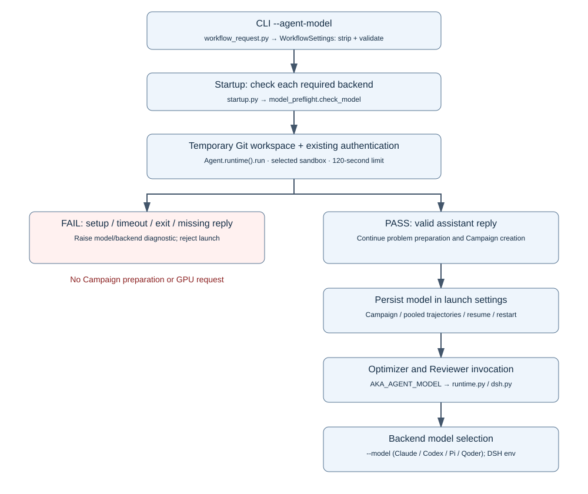

# Model override and startup validation

## Motivation and scope

Users switching models currently need backend-specific settings, and a bad model
or missing permission can surface only after optimization setup. The requested
workflow is one launch option that reuses existing authentication and verifies
availability before spending time preparing a Campaign or requesting GPU work.
Target users are operators launching or resuming Light, including pooled search
and independent Reviewers.

`--agent-model MODEL` supplies one normalized model name for the main Agent and
Reviewers. It neither changes the backend/provider nor asks for a new API key.
It does not provision model access, provide model fallback, or change GPU
measurement and optimization policies. Without the option, existing defaults and
startup behavior remain unchanged.

## Code map and precedence

- `bootstrap/workflow_request.py` and `contracts/workflow.py`: parse, trim and
  validate the name; the launch DTO persists it for restart.
- `workflow/light/startup.py`: probe the optimization backend and, when required,
  the distinct Claude Claim Reviewer backend before loading the problem.
- `agent/model_preflight.py`: run a real minimal call through the shared Agent
  owner in a temporary Git workspace using the selected sandbox. Setup errors,
  timeout, nonzero exit and missing assistant reply all reject startup. The
  probe explicitly enables private session capture and scans its complete
  `conversation.jsonl` one provider event at a time, before removing the
  temporary workspace. Reply detection does not depend on the last 2000 stdout
  characters; trailing Codex events cannot hide an earlier assistant response.
  User prompt echoes and tool results cannot satisfy the check.
- `agent/runtime.py`: apply `AKA_AGENT_MODEL` as `--model`. Codex settings-derived
  `-c model=...` pairs are removed first; provider and other config remain intact.
  Pi's existing model flag is replaced rather than duplicated. Claude/Qoder
  inline JSON or file-backed session settings are copied in memory and their
  top-level `model` is replaced; both `--settings` and `--model` then select the
  same model. Other settings and the original file remain unchanged. Relative
  settings paths resolve from the Agent workspace, not the Supervisor process
  directory. Unreadable files or non-object JSON produce a diagnostic naming the
  settings environment variable. Command-only callers must supply a workspace
  for relative paths.
- `agent/backends/dsh.py`: map the override to `AKA_DSH_MODEL`.
- `workflow/light/long_horizon/session.py` and `search_driver.py`: carry the
  override into fresh and resumed optimizer Sessions and pooled trajectories.
- `workflow/light/campaign.py`: apply the same override path to Reviewer calls.
  Explicit Claim Reviewer overrides do not rewrite Anthropic model-alias env
  variables; only the omitted-option path retains its existing reviewer defaults.

## Validation and measurable benefit

Real Claude calls in Lima with the user's existing configuration:

| Execution | qwen4-max | Invalid model name |
|---|---:|---:|
| Native | Passed in 5.27 s | Rejected in 1.27 s |
| Bubblewrap | Passed in 4.03 s | Rejected in 1.61 s |

A real startup-entry check reached preparation with the valid model and made zero
preparation calls with the invalid model. User settings were unchanged. This
measures early configuration failure detection, not improved Kernel performance.
Command-level checks cover serialization, normalization, resume, existing Codex
model settings, default preservation, and setup/provider failure diagnostics.

## Costs, limits and rollback

The probe is a real, potentially billed model call per required distinct backend,
with up to 120 seconds per probe. Fail-closed behavior means transient provider
or network outages also block this launch; the user can retry when service
recovers. Success proves availability at startup, not future service health or
that every subsequent task will succeed. Backend routing may resolve aliases;
AKA does not independently attest the provider's selected model.

To roll back for a new launch, omit `--agent-model`; existing backend defaults
then apply and the additional probe is skipped. A saved launch retains its
explicit model, so create a launch without the override to return to defaults.
The feature commits can also be reverted; no user credential or configuration
file migration is required.
