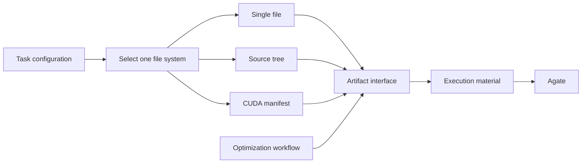

# Native CUDA on Agate

Light campaigns with explicit `file_system=cuda_manifest` and `framework=cuda`
author separate CUDA sources and a manifest.
The Supervisor leaves CUDA manifest authoring to the Skill instead of seeding
Python-loader metadata. Episode performance records match the complete candidate
snapshot, including headers and build settings, without requiring `kernel.py`.
The installed `atrex-gpu-gateway` Skill owns the format and usage instructions:
[AKA workspace contract](../src/aka/light/workspace/resources/skills/atrex-gpu-gateway/reference/aka-workspace.md)
and [Agate manifest v1](../src/aka/light/workspace/resources/skills/atrex-gpu-gateway/reference/eval-manifest.md).

Use `--sandbox-profile pre` to explicitly select Agate preproduction for integration tests.
This does not change global Agate settings or Diamond.

The Agate Skill is copied from the gateway repository and included in the AKA
package and Agent Skill discovery. AKA maintains `reference/aka-workspace.md`
locally to describe its file-system selection; syncing preserves that integration
guide. Update the upstream Skill files with:

```bash
python3 tools/sync_agate_skill.py /path/to/atrex-gpu-gateway
python3 tools/sync_agate_skill.py /path/to/atrex-gpu-gateway --check
```

Validation (2026-10-27): 43 offline regressions cover archive digests, Git promotion,
header/declaration identity, crash recovery, measurement deduplication, Skill
installation, and numerical failure classification. Both Light and Legacy wheels
build from their source distributions; the bundled Agate Skill is byte-identical
to the gateway-owned source. L20N preproduction exercised native CUDA Evaluate,
multi-file CUTLASS, targeted numerical inputs, Profile, two-shape native ABBA and a
deliberately incorrect candidate. One ABBA allocation encountered repository networking
failure; the existing infrastructure retry recovered it and both shapes passed. Check/Disassemble and SOL/SSH do not accept native manifests; unsupported
native requests stop without a Dev fallback.


Final-package preproduction validation (2026-10-27): `ev_9403730bedb7`
compiled and evaluated the retained native RMSNorm candidate on three shapes,
with six correctness cases per shape. `ev_8d1db9813e60` compiled and linked
`src/entry.cu`, `src/elementwise.cu`, and `support/config.cpp`, including two headers
from `include/`; both shapes passed all six correctness cases and performance
measurement. These are interface checks, separate from Agent optimization rounds.
Neither candidate includes Python source.

## Independent candidate file systems

A task selects one file system through the `candidate` module configuration.
The optimization workflow uses the same `Artifact` interface for every selection;
it never parses source declarations or chooses source filenames.

```json
{"api_version": 1, "patches": [
  {"id": "candidate", "config": {"file_system": "cuda_manifest"}}
]}
```

| Selection | Independent implementation | Managed candidate |
| --- | --- | --- |
| `single_file` | `candidate/single_file.py` | One Python source file |
| `source_tree` | `candidate/source_tree.py` | Pinned Python adapter plus editable source directories |
| `cuda_manifest` | `candidate/cuda_manifest.py` | CUDA sources, headers and `solution.json` |

Each implementation owns initial-source preparation, layout, validation, reads,
execution packaging, restoration and evidence paths. They do not import or call
one another. `common.py` defines their interface and shared file operations;
`registry.py` selects an implementation. `storage.py` contains the shared snapshot
codec and Git transaction, and `artifacts.py` exposes format-independent operations.
Changing one format belongs in its implementation file.

When `file_system` is omitted, new tasks use `source_tree`, including CUDA tasks.
Without import configuration, the file system freezes the SourceProvider's initial
`kernel.py` as `impl/model.py` and creates a fixed `kernel.py` adapter importing
`Model`. The Agent can edit/add/delete files under `impl/`. No import manifest is
needed. Source trees require native Atrex-Bench Eval; SOL/SSH tasks must explicitly
select `single_file`. Select `cuda_manifest` explicitly to use Agate-generated CUDA
bindings. Existing campaigns retain their format and must resume with that explicit
selection if it differs from the new default.
The selected implementation is pinned in `.atrex_file_system.json` after the
framework baseline. A resumed task must match it. A missing or invalid file fails
within that implementation; execution never retries through another file system.
Historical workspaces without a selector are recognized on import. The V0 Python
reference is an evaluator-owned bootstrap input, before the selected V1 candidate.
Explicit controller snapshot restoration remains available for recovery.

Source imports are configured on the same module:

```json
{"api_version": 1, "patches": [
  {"id": "candidate", "config": {
    "file_system": "source_tree",
    "source_tree": {"manifest": "/path/to/source-manifest.json", "directory": "/path/to/source"}
  }}
]}
```

`workflow.source_tree` remains an input alias for existing configurations. New
configurations use `candidate.source_tree`; conflicting values are rejected.



Correctness, speedup decisions, episode budgets and promotion policy remain in
the optimization/acceptance layer. Uploads, retries and job polling remain in the
execution layer. The file-system implementations import neither layer.

All layouts use the same Git sealing path. Source and build-setting changes
alter candidate identity; metadata-only commits do not count as optimization.
Historical Python bytes, Git blob identities and measurement records retain their
existing interpretation.

Regression coverage includes each implementation, explicit selection, prevention
of format fallback, full snapshot recovery, obsolete file deletion, header and
manifest identity, frozen measurements, Git sealing, baseline provenance, complete
terminal evidence and source-distribution builds. Validation runs in Aone Sandbox.

## Agent optimization evidence

The RMSNorm campaign uses bf16 inputs on L20N preproduction, with shapes
`(3, 128)`, `(256, 2048)` and `(510, 8192)`. V1 is the accepted framework
baseline; V2 onward count as optimization rounds. Every measured optimization
candidate contains `kernel.cu` and `solution.json`, with no candidate `kernel.py`.
Python reference and input-generation files remain evaluator inputs.

| Round | Actual edit | Standard correctness | Paired ABBA | Decision |
| --- | --- | --- | --- | --- |
| 1 / V2 | Replace shared-memory row staging with register-cached `uint4` vectors | PASS, six cases per shape | 0.9163×; 7.9265 → 8.6507 µs geometric mean | Reject; restore exact V1 source |
| 2 / V3 | Register cache plus a single-barrier block reduction | PASS, six cases per shape | 1.0354×; 8.8745 → 8.5707 µs geometric mean | Accept as `5a1f46b7` |
| 3 / V4 | Prefetch weights before reduction, retaining vectors in registers for small K | PASS, six cases per shape | 1.0227×; 7.6302 → 7.4607 µs geometric mean | Agent handoff timed out; frozen-source comparison completed separately; retain V3 |

ABBA compares each candidate and its incumbent within the same allocation;
standalone timings are not used to infer cross-round gains. V2 restored CUDA
SHA256 `d92225a8c0f00bdcaa2f749e7288d509cb6ebb4ab7bb1b6f2e5dfd432f6320f2`.
Records: V2 `gateway-a0d34f06132f4f6f84daa282c343ff48`; V3
`gateway-5f1237e95776411c8e8e4389bc757af5`. The V1 and V3 optional numerical
planners each reached their 600-second limit and were skipped under the existing
policy; these supplemental checks are not reported as passes.

V2 ran on the earlier file-system facade build; V3/V4 run on the independent
selected-file-system build. Final-package interface checks above separately
validate the completed refactor. An earlier episode that timed out without a
source edit is preserved as failed evidence and does not count as a round.

V4 exhausted its 1800-second active episode budget before reporting; its full
Evaluate record `gateway-6d69293c5e9249909d2fbdf7f685f6af` had already passed.
A separate Sandbox run using the final package compared that exact frozen
candidate against accepted V3, without editing or promoting it. Candidate digest:
`908d5630b3ed032b61957522e7735746d177ed40f28a8d3d3793c9783f730337`.
The campaign retained V3 digest
`1f0a5396a7d287ac16a46ea6755e37fcc1ea86045cbfac0a716ced67b91f32da`.
Thus three actual Agent-authored edits have correctness and performance evidence,
but the third autonomous handoff did not complete. The independent comparison
is supplementary evidence, not an override of the campaign acceptance gate.
Supplementary GPU jobs: `ev_9c6a67eb9362`, `ev_83048a3d8cec`, `ev_32532da4633d`.

## Default source-directory validation

New tasks default to `source_tree` without requiring an import manifest. The
47-case regression suite passed in Aone Sandbox. Production Agate L20N validation
used an empty candidate configuration: automatic bootstrap, expansion to a CUDA/
C++/header tree, full-directory ABBA, numerical rejection and snapshot restoration.
Three shapes (1024, 4097, 65536 elements) passed; deliberately changing the header
offset failed all 18 correctness cases. Restoring the exact snapshot removed an
extra file and passed all shapes again. Representative production jobs:

- Bootstrap: `ev_2787c0b8bbc2`.
- Native directory: `ev_4ac735703b98`.
- ABBA: `ev_115498cdf910`.
- Expected failure: `ev_60219850f090`.
- Restored tree: `ev_2c02b39449d3`.

These exercise AKA initialization and its real evaluation path, not additional
Agent-authored optimization episodes.
