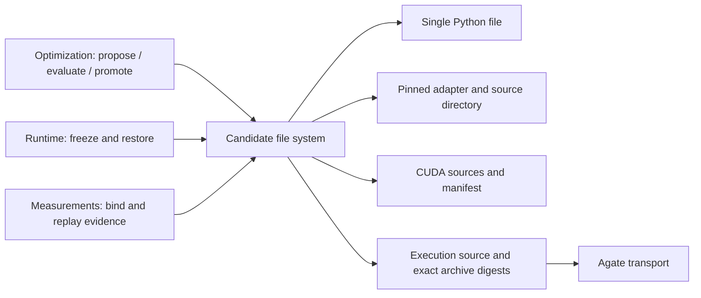

# Native CUDA on Agate

Light campaigns with `framework=cuda` author separate CUDA sources and a manifest.
The Supervisor leaves CUDA manifest authoring to the Skill instead of seeding
Python-loader metadata. Episode performance records match the complete candidate
snapshot, including headers and build settings, without requiring `kernel.py`.
The installed `atrex-gpu-gateway` Skill owns the format and usage instructions:
[AKA workspace contract](../src/aka/light/workspace/resources/skills/atrex-gpu-gateway/reference/aka-workspace.md)
and [Agate manifest v1](../src/aka/light/workspace/resources/skills/atrex-gpu-gateway/reference/eval-manifest.md).

Use `--sandbox-profile pre` to explicitly select Agate preproduction for integration tests.
This does not change global Agate settings or Diamond.

The Skill is copied verbatim from the gateway repository and included in the AKA
package and Agent Skill discovery. Update it with:

```bash
python3 tools/sync_agate_skill.py /path/to/atrex-gpu-gateway
python3 tools/sync_agate_skill.py /path/to/atrex-gpu-gateway --check
```

Validation (2026-10-27): 35 offline regressions cover archive digests, Git promotion,
header/declaration identity, crash recovery, measurement deduplication, Skill
installation, and numerical failure classification. Both Light and Legacy wheels
build from their source distributions; the bundled Agate Skill is byte-identical
to the gateway-owned source. L20N preproduction exercised native CUDA Evaluate,
multi-file CUTLASS, targeted numerical inputs, Profile, two-shape native ABBA and a
deliberately incorrect candidate. One ABBA allocation encountered repository networking
failure; the existing infrastructure retry recovered it and both shapes passed. Check/Disassemble and SOL/SSH do not accept native manifests; unsupported
native requests stop without a Dev fallback.


## Candidate file-system boundary

`aka.light.workspace.candidate` owns file layouts. The optimization workflow
consumes an `Artifact` (an immutable complete snapshot) and asks it to read,
install, export, identify, validate changes or prepare an execution source.
Changing manifest structure or candidate file organization belongs in this
package; the optimization state machine does not parse manifests or choose
source filenames.



The package contains three implementation files behind one public entry point:

| File | Responsibility |
| --- | --- |
| `artifacts.py` | Format-independent operations and capabilities, measurement binding, exports and recovery |
| `storage.py` | Snapshot encoding, file boundaries, Git reads and atomic candidate commits |
| `native.py` | Native manifest parsing and source-file validation |

Correctness, speedup decisions, episode budgets and promotion policy remain in
the optimization/acceptance layer. HTTP upload, retries and job polling remain
in the execution layer. The file-system package imports neither layer.

All layouts use the same Git sealing path. Source and build-setting changes
alter candidate identity; metadata-only commits do not count as optimization.
Historical Python bytes, Git blob identities and measurement records keep their
existing interpretation. Once a native candidate is pinned, execution rejects
a downgrade to a Python candidate. The V0 Python reference remains a separate
evaluator-owned bootstrap input.

Regression coverage includes all three layouts, complete snapshot recovery,
header deletion, manifest changes, complete terminal trace evidence, frozen measurement evidence, native-to-Python
rejection, sealed Git commits, and legacy Python baseline identity. Tests and
sdist-to-wheel validation run in Aone Sandbox, not on the workstation.
