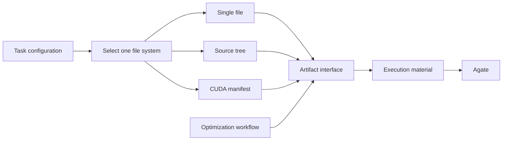

# Native CUDA on Agate

Light campaigns with `framework=cuda` author separate CUDA sources and a manifest.
The Supervisor leaves CUDA manifest authoring to the Skill instead of seeding
Python-loader metadata. Episode performance records match the complete candidate
snapshot, including headers and build settings, without requiring `kernel.py`.
The installed `atrex-gpu-gateway` Skill owns the format and usage instructions:
[AKA workspace contract](../src/aka/light/workspace/resources/skills/atrex-gpu-gateway/reference/aka-workspace.md)
and [Agate manifest v1](../src/aka/light/workspace/resources/skills/atrex-gpu-gateway/reference/eval-manifest.md).

Use `--sandbox-profile pre` to explicitly select Agate preproduction for integration tests.
This does not change global Agate settings or Diamond.

The Skill is copied verbatim from the gateway repository and included in the AKA
package and Agent Skill discovery. Update it with:

```bash
python3 tools/sync_agate_skill.py /path/to/atrex-gpu-gateway
python3 tools/sync_agate_skill.py /path/to/atrex-gpu-gateway --check
```

Validation (2026-10-27): 43 offline regressions cover archive digests, Git promotion,
header/declaration identity, crash recovery, measurement deduplication, Skill
installation, and numerical failure classification. Both Light and Legacy wheels
build from their source distributions; the bundled Agate Skill is byte-identical
to the gateway-owned source. L20N preproduction exercised native CUDA Evaluate,
multi-file CUTLASS, targeted numerical inputs, Profile, two-shape native ABBA and a
deliberately incorrect candidate. One ABBA allocation encountered repository networking
failure; the existing infrastructure retry recovered it and both shapes passed. Check/Disassemble and SOL/SSH do not accept native manifests; unsupported
native requests stop without a Dev fallback.


## Independent candidate file systems

A task selects one file system through the `candidate` module configuration.
The optimization workflow uses the same `Artifact` interface for every selection;
it never parses source declarations or chooses source filenames.

```json
{"api_version": 1, "patches": [
  {"id": "candidate", "config": {"file_system": "cuda_manifest"}}
]}
```

| Selection | Independent implementation | Managed candidate |
| --- | --- | --- |
| `single_file` | `candidate/single_file.py` | One Python source file |
| `source_tree` | `candidate/source_tree.py` | Pinned Python adapter plus editable source directories |
| `cuda_manifest` | `candidate/cuda_manifest.py` | CUDA sources, headers and `solution.json` |

Each implementation owns initial-source preparation, layout, validation, reads,
execution packaging, restoration and evidence paths. They do not import or call
one another. `common.py` defines their interface and shared file operations;
`registry.py` selects an implementation. `storage.py` contains the shared snapshot
codec and Git transaction, and `artifacts.py` exposes format-independent operations.
Changing one format belongs in its implementation file.

When `file_system` is omitted, task creation chooses once: `source_tree` when
source import is configured, `cuda_manifest` for CUDA, otherwise `single_file`.
The selected implementation is pinned in `.atrex_file_system.json` after the
framework baseline. A resumed task must match it. A missing or invalid file fails
within that implementation; execution never retries through another file system.
Historical workspaces without a selector are recognized on import. The V0 Python
reference is an evaluator-owned bootstrap input, before the selected V1 candidate.
Explicit controller snapshot restoration remains available for recovery.

Source imports are configured on the same module:

```json
{"api_version": 1, "patches": [
  {"id": "candidate", "config": {
    "file_system": "source_tree",
    "source_tree": {"manifest": "/path/to/source-manifest.json", "directory": "/path/to/source"}
  }}
]}
```

`workflow.source_tree` remains an input alias for existing configurations. New
configurations use `candidate.source_tree`; conflicting values are rejected.



Correctness, speedup decisions, episode budgets and promotion policy remain in
the optimization/acceptance layer. Uploads, retries and job polling remain in the
execution layer. The file-system implementations import neither layer.

All layouts use the same Git sealing path. Source and build-setting changes
alter candidate identity; metadata-only commits do not count as optimization.
Historical Python bytes, Git blob identities and measurement records retain their
existing interpretation.

Regression coverage includes each implementation, explicit selection, prevention
of format fallback, full snapshot recovery, obsolete file deletion, header and
manifest identity, frozen measurements, Git sealing, baseline provenance, complete
terminal evidence and source-distribution builds. Validation runs in Aone Sandbox.
