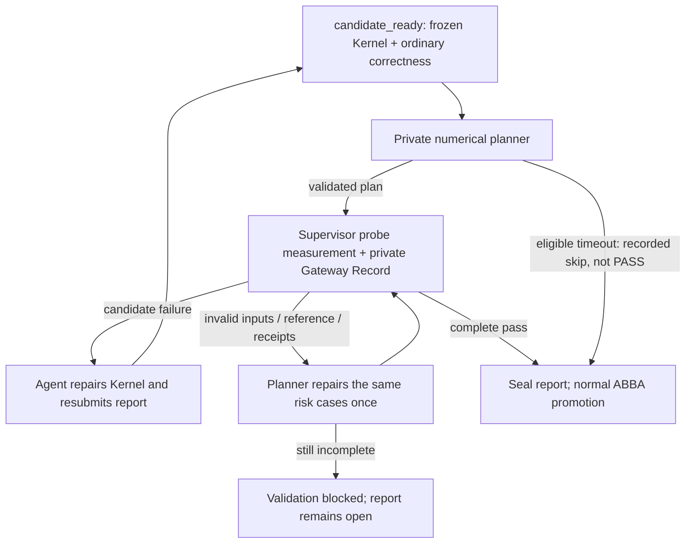

# Supplemental numerical validation

Production candidates retain ordinary full-contract correctness, dependency/framework review and ABBA promotion gates. Supplemental numerical validation is disabled by default in Light. Set the Workflow option `numerical_validation: true` through a [composition patch](optional-light-modules.md#other-module-options) to enable it. When enabled, the Supervisor additionally asks a numerical planner for bounded, executable risk probes. Planner opinions never reject a Kernel; measured candidate failures do. Leaderboard mode is unchanged. There is one Episode workflow, not Fast/Full modes.

## Contract and ownership

- `aka.workflow.light.orchestration.numerical_policy` snapshots the complete candidate artifact and trusted inputs outside the Agent workspace. Source layout and editable roots remain pinned; source, headers, and build settings follow the selected candidate contract. Hidden Shape definitions are not copied into the planner workspace, but original evaluator errors may quote case details. Its auxiliary session has no Runtime capability or GPU tools; Bubblewrap uses a dedicated read-only input allowlist when enabled.
- The planner writes a declarative plan: at most three cases, actual nested tensor ABI paths, supported generators and public input constraints. It cannot provide Python, an evaluator, private Shape IDs or thresholds. Supported distributions include constant, uniform, log-uniform, sparse, alternating, ramp, packed bytes and near-constant. Unspecified input leaves retain the original generator's values.
- `aka.evaluation.drivers.remote_numerical` executes up to three representative matching Shapes, two seeds and all declared ranks per case, using the canonical evaluator. Receipts bind case, selected Shapes, seeds, ranks and observed coverage. A complete failing workload can disprove correctness; a PASS requires all selected coverage. No eligible Shapes yields an explicit unsupported advisory, not a passing test.
- Supplemental floating outputs use relative L2 `||candidate-reference||₂ / max(||reference||₂, 1e-12)`: non-FP4 threshold `1e-3`, FP4 threshold `0.2`. Structural, dtype, finite-value, mutation and exact non-floating checks remain evaluator-owned. Ordinary allclose/FP4 policy is unchanged.
- Native `input.py`/`reference.py`/`shapes.json` is required for these constructors. SOL contracts without that ABI receive a recorded unsupported advisory. Their full-workload correctness remains required; Light native ABBA does not support SOL/SSH.

## Report and repair

The selected Acceptance service invokes the numerical gate after ordinary correctness and before report sealing. Measured failures return `candidate_numerical_failed` with public distributions, metrics and Gateway Record IDs. Repair the candidate, measure it, and resubmit `episode-report` with direct Gateway record IDs by default; record an Experiment only when research recording is enabled. Plans survive candidate edits and Supervisor restarts; changing the candidate does not let a planner waive the retained tests. Recovery also checks the sealed commit, not mutable draft bytes.

Reference non-finite outputs, invalid generation or incomplete receipts return to the planner for one plan-repair attempt. The case IDs must be preserved. Unresolved validation yields `candidate_numerical_pending`, not a Kernel correctness failure. Baselines get up to two supplemental Kernel-repair turns; Episodes retain their existing continuation budget.

Each planner uses `--production-review-timeout` (default 600 seconds). A bounded plan recovered from a timeout remains untrusted until schema/evidence validation and execution. Without a usable plan, a timeout permits a recorded `skipped_planner_timeout` only after ordinary correctness passed, evidence is unchanged and no measured supplemental candidate failure remains. Malformed non-timeout responses do not receive this exemption.

GPU probes use the private MeasurementStore and exact-task reuse. Python-backed probes use
the remote numerical driver; native CUDA manifests use `aka.workflow.light.orchestration.typed_numerical`
through Agate Eval so compilation and dependency binding stay evaluator-owned. The typed
supplemental route currently requires one GPU.

Confirmed service outages use the Supervisor's fixed 60-second outer retry wait and the
current [Gateway recovery policy](measurement-records.md#failure-and-recovery-policy).
Known jobs are reconciled by ID; unknown CLI submissions are not blindly replaced.
Nested requests retain the report's deadline and revocation. Missing receipts alone
do not establish a device outage or a numerical counterexample.

Probe preparation and interpretation belong to Evaluation. Ordinary candidate/performance
defaults are 20/120 seconds; supplemental probes have their own preparation policy and
must not be described as sharing a 600-second ordinary candidate default. The current
[preparation implementation](../src/aka/evaluation/numerical_preparation.py) still uses
explicit per-case/command limits. These limits are separate from the planner's Workflow
review timeout and from evidence-completeness checks.

## Evidence and limits

Numerical probes retain bounded original diagnostics before Agent projection.
Each Measurement Record's `repetition-N/numerical-diagnostics.json` binds the
Agate job ID and remote stdout/stderr to that record. The raw receipt includes
per-workload/seed evaluator exit codes, timeout partial output, input-generation
tracebacks, and the nested Atrex-Bench evaluator's stdout/stderr and result prefix.
Nested streams retain up to 8 KiB each, with explicit truncation indicators;
the Gateway retains up to 2 MiB of stdout and 64 KiB of stderr. Ordinary Legacy
evaluation does not enable this capture or change its scoring behavior.

The complete diagnostic files remain outside Agent workspaces. Failure receipts
include the original error, evaluator stdout/stderr, exit code and timeout flag
for the probe planner, the optimization Agent and subsequent `record-read`.
They are not replaced by a generic "private diagnostics withheld" message.
Upstream per-stream capture limits remain visible; public projection does not reconstruct
bytes that were never captured. The current response-size, truncation, shape-redaction,
and failing-seed policy is described in [evaluator diagnostics](evaluator-outcomes/README.md#diagnostic-size-and-cache-contract).
CI may collect them into a **separate, access-controlled operator diagnostic
artifact**, with credential redaction and bounded reads, not into the public
trajectory/report or Aone Pages. Entire request/input snapshots are not exported.
Old failed runs cannot recover logs that were already
discarded; the new capture applies to subsequent probe executions.

Recovery distinguishes incomplete validation from a measured candidate failure:
the probe planner gets one repair pass and all retained risks are remeasured.
If validation remains incomplete, V1 preserves the candidate and exits blocked;
it does not send an unproven Kernel failure to the implementation Agent. During
an Episode, the report remains unaccepted (`candidate_numerical_pending`) and can
be resubmitted after operator repair, or completed as blocked. Confirmed service
outages use the infrastructure retry policy; missing receipts alone do not prove
an outage. Measured candidate failures instead trigger candidate repair. Diagnostic
capture does not relax any acceptance gate or add blind retries.

Plans, planner session captures and validation records live under `<Supervisor scope>/numerical/<workspace key>/`. Individual GPU requests and raw diagnostic files live under `<Supervisor scope>/measurements/`. The Agent receives the bounded receipt/repair projection with original failure diagnostics, not the complete internal record.

Additional model calls and GPU probes are a real cost. Representative probes are not exhaustive proofs and no reduction in false accepts is claimed from local regression checks. Native coordination (the default `light` profile) is not an OS security boundary. This change does not enable Bubblewrap by default, restore Agent Git access, restore old plan/profile files, or replace ordinary correctness/ABBA with model judgment.

Rollback means returning to the previous revision at an Episode boundary; retain private evidence for audit. Do not delete retained plans to get a failing candidate admitted.

## Local verification

Historical integration validation used 37 local numerical/control-flow regressions and 125 existing plugin, retry-state, output-projection and configuration regressions. Numerical checks cover retained plans across repairs/restarts, failure versus incomplete coverage, planner timeout recovery, immutable input snapshots, repairable report rejection, parent revocation, evaluator bundle identity and real MeasurementStore exact-request reuse. Static undefined-name and whitespace checks also pass. Regression scripts remain outside the repository.

Model and GPU executors were replaced by test doubles in these checks. No live-model/GPU campaign or new Bubblewrap end-to-end run was performed; these checks do not establish numerical coverage or production cost.

A separate real-subprocess CPU regression used the CI-pinned Atrex-Bench
evaluator (`185684a5266385d7466c3ff69fc71ecaee719a25`) and a candidate whose
constructor takes 21 seconds. The old implicit 20-second budget produced 0/2
observations and `CandidateTimeoutError`; the explicit Light budget produced
2/2 passing observations. Both reported risk distributions also completed 6/6
CPU observations with a reference-equivalent candidate. These checks establish
the timeout/receipt failure mechanism, not successful CUDA compilation or the
exact cause of a historical CI run whose raw evaluator errors were discarded.
