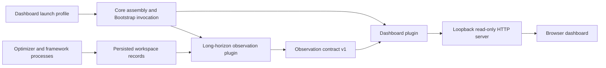
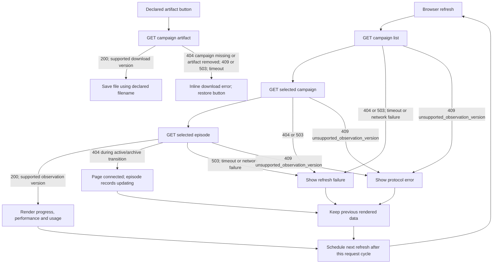

# Optimization dashboard

The optional `aka.dashboard` Core plugin starts a local, read-only page for engineers
supervising running or completed kernel optimization campaigns. It combines experiment
progress, accepted performance, settled Episode Agent token usage and artifact downloads.
A separate `aka.observation.long_horizon` plugin projects existing optimizer records into
the neutral `observation_source` contract. Other workflow adapters can supply different
stages and outputs through the same interface.

The viewer uses Python's standard-library HTTP server, native HTML/CSS/JavaScript,
locally packaged fonts and a two-second foreground refresh interval. A standalone
Bootstrap launch profile owns its lifecycle. The default optimization profile does not
select the viewer or its data source.

## Components and ownership



| Component | Implementation | Responsibility |
| --- | --- | --- |
| Observation types | [`aka.contracts.observation`](../src/aka/contracts/observation.py) | Version, payload types and optional artifact capability |
| Long-horizon source | [`plugin.py`](../src/aka/observation/long_horizon/plugin.py) | Provide `observation_source`; open readers and create sample-data previews |
| Native projection | [`reader.py`](../src/aka/observation/long_horizon/reader.py) | Discover campaigns, interpret native schemas, associate records and preserve settlement semantics |
| Artifact export | [`artifacts.py`](../src/aka/observation/long_horizon/artifacts.py) | Declare available outputs and generate task-level summaries and ZIPs |
| Viewer startup | [`plugin.py`](../src/aka/dashboard/plugin.py), [`startup.py`](../src/aka/dashboard/startup.py) | Inject the source, validate configuration, bind HTTP during invocation and register cleanup |
| HTTP boundary | [`server.py`](../src/aka/dashboard/server.py) | Explicit routes, response-version checks and download headers |
| Browser | [`index.html`](../src/aka/dashboard/static/index.html) | Render source-defined stages, history, usage, artifacts and connection state |

Both optional distributions depend on `atrex-aka-framework`, which packages Core,
Contracts, Bootstrap and the generic CLI. The long-horizon adapter imports only
Contracts interfaces, but installing it brings in the full Framework distribution.
This larger install footprint follows from the Framework/Legacy consolidation;
neither optional distribution requires Legacy or imports the optimizer.
Plugin import and Core assembly construct
services without scanning workspaces or opening a port. `Startup.start()` opens the
reader and binds HTTP; `close()` releases sockets and request threads, including idle
browser preconnections. `run()` cleanup and Core disposal may both call `close()`.

The observation adapter and viewer own disjoint package files. Build tooling includes
HTML, local fonts, license text and launch profiles in the dashboard's sdist and wheel.
Each plugin declares its implementation and resource identities. See
[distribution ownership](application-plugin-migration.md#distribution) and the
[Core interface](plugin-framework.md).

## Observation contract v1

`ObservationSource.protocol_version` is the integer `1`. `open(workspace)` returns a
thread-safe, read-only reader with `campaigns()`, `campaign(id)` and `episode(id, number)`.
`create_preview(temporary_directory)` writes sample data only into a directory owned by
the viewer process. Sources retain no Core Context or Root.

All JSON observations carry `observation_version: 1`. The source version is checked when
constructing Startup; HTTP and browser responses are checked independently. Unknown
response versions produce HTTP 409 and a visible protocol error. Campaign IDs use
letters, digits, underscores and hyphens; the viewer does not interpret filesystem
layouts or directory naming conventions.

| Field | Meaning |
| --- | --- |
| `display_name`, `empty_message` | Source-provided names and empty-state text |
| `stages: [{id, label}]` | Ordered source-defined flow markers |
| `progress.stage_id`, `progress.phase_label` | Current marker and observed activity label; `phase` retains the source state ID |
| `progress.record_updating` | Active/live identity transition; retain the previous associated progress when available |
| `progress.last_terminal` | Historical status, timestamp and whether it predates newer activity |
| `counts` | `episodes`, `accepted` and `rejected`, matching the declared contract and headline consumers |
| `canonical.incumbent`, `canonical.history` | Certified performance and adapter-defined comparability segments |
| `tokens` | Settled total, measurement quality, scope, receipt count and pending-settlement flag |
| `phases: [{phase, label, usage}]` | Ordered token attribution rows, including source-defined additional phases |
| `issues` | Native-schema incompatibility, identity mismatch or records being updated |
| `artifacts`, `artifact_scope` (optional) | Declared download IDs, names, filenames, types, sizes and export scope |

V1 exposes observations actually consumed by the page and result export. Budget limits,
process liveness and current-run confirmation require lifecycle producers and are deferred.
Missing usage remains null; it never means zero. Additional native phases receive labels
and join the default adapter's stage or attribution list without changing the viewer.

A source declaring artifacts also implements
`ArtifactReader.artifact(campaign_id, artifact_id) -> bytes`. Artifact IDs use the same
URL-safe character set; filenames are basenames. The adapter owns file access and
packaging. Unknown or removed outputs raise `KeyError`. Existing v1 sources may omit
artifact fields and this method; the viewer then shows an empty download section.

Replace the default source with a composition patch:

```json
{
  "api_version": 1,
  "patches": [
    {"id": "observation-source", "remove": true},
    {"id": "my-source", "insert": {"name": "my_workflow.observation_plugin", "required": true}}
  ]
}
```

The replacement module provides `observation_source` and declares its own dependencies
and identity files. Installed launches accept `aka run --patch`; source calls to
`run_profile` explicitly pass `aka.dashboard.tokens.OBSERVATION_SOURCE` in `tokens`.
A missing required source fails Core assembly rather than creating an implicit reader.

## Progress states and record transitions

These are representative **observed** transitions, projected from persisted records.
The observer does not enforce the optimizer's execution order or derive completion
percentages from stage numbers. Full mode includes ABBA verification; fast mode records
evaluator verification. Unknown phases extend the source-provided stage list.

```mermaid
stateDiagram-v2
    state "Observed progress" as Observed {
        [*] --> Waiting
        Waiting --> Preparing: preparing record
        Preparing --> Exploring: exploring record
        Exploring --> Verifying: awaiting_verification / checking_fast_evaluator / verifying
        Verifying --> Recorded: episode archived or live.phase recorded
        Recorded --> Preparing: next episode
        Waiting --> BaselineInterrupted: baseline crash record
    }
    state "Keep associated progress; records updating" as Retained
    Observed --> Retained: active/live identity mismatch
    Retained --> Observed: matching episode and version arrive
    Observed --> Completed: fresh completed manifest; no active episode
    Observed --> Failed: fresh failed manifest; no active episode
    Observed --> Interrupted: fresh interrupted manifest; no active episode
    Completed --> Observed: new activity records
    Failed --> Observed: new activity records
    Interrupted --> Observed: new activity records
```



`WorkspaceReader._snapshot()` implements the phase projection, active/live association,
`record_updating` retention and stale-terminal checks. It uses the last associated
progress on identity mismatch when one has been observed. `_read()` separately retains
a cached valid record during malformed or incomplete JSON writes and adds an issue;
without a cached value, the affected observation is unavailable. A declared unsupported
native schema adds `unsupported_schema_version` and is excluded rather than parsed as
an old schema. `episode()` rejects mismatched journal identities and can retain the
public live experiment summary when the worktree or journal is unavailable.

The baseline crash record supplies the `Baseline interrupted` phase. It is not exported
as a separate unused raw payload. A terminal manifest is historical evidence: newer
active/live/state timestamps mark it stale, so it cannot override new activity. Page
connectivity describes the observer connection; activity records do not confirm that an
optimization process is alive or that a new run has completed.

## API and failure paths



`Handler.do_GET()` in `server.py` returns 404 for unknown records, 409 for unsupported
observation versions and 503 for unavailable workspace I/O. Artifact routes distinguish
an unknown campaign from a missing artifact. `get()` and `refresh()` in `index.html`
check versions, preserve previous data on failed refreshes and schedule the next request
cycle. An episode-detail 404 between active-record removal and archive publication is
reported as records updating with a connected page. `downloadArtifact()` reports errors
inline rather than saving an error response as a file.

| Route | Response |
| --- | --- |
| `GET /` | Packaged English page |
| `GET /assets/{font}` | Allowlisted local fonts |
| `GET /api/campaigns` | Campaign list, aggregate token quality, refresh interval and preview marker |
| `GET /api/campaigns/{id}` | Progress, canonical history, usage, diagnostics and optional artifacts |
| `GET /api/campaigns/{id}/episodes/{episode}` | Episode summary, attribution, experiments and evidence names |
| `GET /api/campaigns/{id}/artifacts/{artifact_id}` | Declared bytes, attachment filename and observation-version header |

The service listens only on `127.0.0.1`. Configuration accepts ports 0–65535 and a
positive refresh interval; port 0 selects an available port. The browser supplies opaque
IDs, never a file path. POST/PUT/PATCH/DELETE return 405. The API does not expose execution,
recovery or stop controls. Text is inserted through DOM `textContent`.

Foreground refresh defaults to 2 seconds; background tabs refresh no more frequently
than every 30 seconds. The next cycle starts after the preceding cycle finishes. JSON
requests have a 10-second timeout; downloads have a 30-second timeout. Historical records
are cached by modification time and size. Several files may be read across an optimizer
update, so identity checks and explicit partial-data states remain necessary.

## Long-horizon records and measurement semantics

The default reader accepts a single campaign or a parent containing direct
`kernel_opt_*` directories. It does not recursively discover private episode worktrees
and excludes symlinked campaign directories. Only the adapter interprets this layout.

| Record | Public projection |
| --- | --- |
| `memory/live.json` | Last experiment, observed phase, episode/version and experiment count |
| `.atrex_long_horizon/active_episode.json` | Episode identity, mode, phase and registered journal location |
| `.atrex_long_horizon/state.json` | Settled Episode Agent tokens, receipts and episode outcomes |
| `.atrex_long_horizon/episodes/eNNNN/attempt.json` | Accepted/rejected/pivot/blocked/interrupted outcome and verification |
| `.atrex_long_horizon/episodes/eNNNN/telemetry.summary.json` | Structured usage, phase attribution, measurement quality and reason codes |
| `memory/vN.json` | Canonical correctness, certified performance and comparability metadata |
| `framework_baseline.json`, baseline crash progress | Framework baseline or interrupted baseline observation |
| `trace-retention-manifest.json` | Timestamped historical terminal status and hardware labels |

Verified legacy records without schema declarations remain readable. Declared live,
telemetry, journal, baseline, crash and trace-manifest versions must match supported
schemas. Originally unversioned state, attempt and memory records do not accept unknown
version declarations. Non-string framework, phase or worktree values are treated as
missing at their consumption boundary.

Canonical history starts with V0 and the recorded framework baseline. Accepted attempts
advance the incumbent only with passing correctness, complete measurements, a passing
verification gate and matching candidate/version identity. Rejected candidates appear
in episode details while retaining the previous certified incumbent. A promotion without
usable measurements leaves a curve gap. Changes in objective, device or workload create
separate comparable segments. Task summaries omit private shapes and raw Agent sessions.

The headline token total comes from `state.tokens`; attempt tokens and telemetry totals
are alternative views of the same usage and are never added again. Receipt counts explain
existing settlement deduplication; the reader does not rewrite the ledger. An unfinished
invocation leaves usage pending while experiment observations continue to refresh.

Episode usage prefers structured telemetry and preserves its control count separately.
A mismatch or unqualified same-session resume yields partial measurement with reason
codes. Missing structured usage can expose a known control subtotal as partial. Unknown
or unobservable zero usage remains unavailable. Input/output/cache types retain backend
accounting; cache fields are not blindly added into total tokens. Phase attribution has
its own quality, with missing values left unavailable. Aggregate totals become observed
subtotals if any campaign has missing or partial usage.

The current settlement scope covers Episode Agent calls. Setup, V1, independent reviewers
and auxiliary CLIs require a separate full-pipeline ledger; the page does not label the
existing ledger as full-pipeline usage or infer currency costs.

## Artifact downloads

The default adapter declares available root `kernel.py` and `solution.json` files,
`result-summary.json` and a ZIP bundle. Missing or symlinked source files are omitted.
The summary contains task-level performance, progress and settled usage. The ZIP contains
only available source/manifest files and that summary, generated in memory without
writing to the optimizer workspace. It excludes raw memory, private evaluator data,
Agent transcripts and unrelated directory trees.

The page labels exports as current workspace files. They are read at download time;
they are not pinned historical candidates. Files may change while an optimization runs,
and an output removed after listing produces a download error. Other adapters can declare
their own files and bundles. Download controls retain keyboard focus and in-flight state
across progress-only refreshes.

## Launch and installation

Use Python 3.10 or later. From a source checkout:

```sh
PYTHONPATH=src python -m aka.dashboard --workspace /path/to/runs --port 0
PYTHONPATH=src python -m aka.dashboard --demo --port 0
```

`--demo` uses a viewer-owned temporary workspace with explicitly labeled sample records
and downloadable sample files. It launches no Agent or GPU optimization. The sample
workspace is removed on shutdown. `--demo` and `--workspace` are mutually exclusive.

Build the viewer and default adapter with their dependencies:

```sh
python -m pip install build
python tools/build_distributions.py --output /tmp/aka-dashboard-dist \
  atrex-aka-framework atrex-aka-dashboard \
  atrex-aka-observation-long-horizon
python -m pip install /tmp/aka-dashboard-dist/*.whl
```

For published packages, `pip install 'atrex-aka-dashboard[long-horizon]'` selects the
default adapter. A custom source requires the dashboard base package and its adapter.
Find the installed profile:

```sh
python -c 'from pathlib import Path; import aka.dashboard; print(Path(aka.dashboard.__file__).parent / "profiles/dashboard.json")'
aka run --profile /absolute/path/to/dashboard/profiles/dashboard.json -- \
  --workspace /path/to/runs --port 0
```

The launch manifest targets `startup`, declares the `observation_source` token and
requires that service. Its composition selects `aka.observation.long_horizon.plugin`
and `aka.dashboard.plugin`. Source startup explicitly supplies the same token; installed
Bootstrap obtains it from the dashboard's `aka.tokens` entry point. `--port` after `--`
overrides the display port. A Core patch can replace host/port/refresh configuration.
Startup prints the actual URL; Ctrl+C closes the observer. Completed campaign records
remain viewable as long as the observer is running.

Rollback is to stop the observer and stop selecting its profile; the optional packages
can be uninstalled. Optimization execution continues through its existing profile.

## Validation and follow-up boundaries

Keep local verification scripts outside the repository; record commands, environment and
results in the PR. Verify accepted/rejected and interrupted outcomes, canonical promotion,
receipt replay, pending and unavailable usage, dynamic stages, source replacement, native
and observation protocol errors, malformed fields and record transitions. Exercise
individual and ZIP downloads, unknown IDs, removed/symlinked files and unchanged workspace
contents. Installed-package checks cover resource ownership, the Bootstrap CLI and cleanup;
browser checks cover campaign switching, preserved data on failure and responsive themes.

Future lifecycle observations need actual run IDs, budget/configuration producers and
fresh start/stop evidence before extending the contract. Streaming usage requires runtime
events and receipt reconciliation; refreshing persisted files does not create streaming
measurements. Full-pipeline accounting needs receipts for setup, V1, reviewers and helper
calls. These extensions belong to producers and adapters, with explicit protocol migration
when required; the viewer continues to consume source-defined observations.
