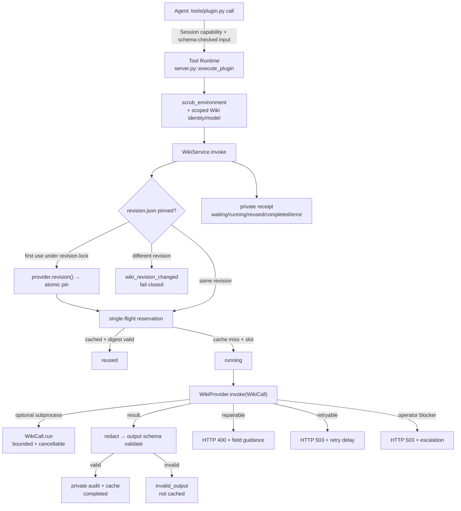
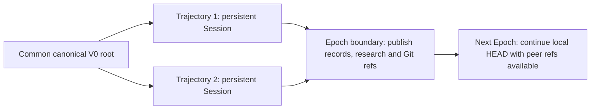
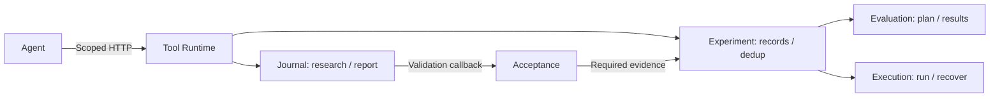

# Light modules and launch profiles

New `aka optimize` and `aka workflow` launches default to `light`: native Agent execution,
session capture, managed drafts, private HTTP tools and unified Light Episodes. This is a
launch-selection change, not a change to the Legacy providers. Use `--profile workflow`
to retain the Legacy Agent, Task and Workflow, or `--profile light-sandbox` for Bubblewrap.
Wiki, supplemental numerical validation, and Direction/Experiment recording are default-on;
generated memory remains default-off.

Install the matching `atrex-aka-light` package together with its framework/legacy dependencies.
If Light is unavailable, default startup fails with installation guidance; it never silently
falls back to Legacy. Explicit `--profile workflow` still works without the Light package.
`aka run` remains profile-explicit, and standalone Execution selection is unchanged.
Recorded continuations restore their frozen selection before considering any new-launch
default; an existing Legacy continuation is not converted to Light. For a manual restart
of a Legacy workspace without continuation metadata, pass `--profile workflow` explicitly.

## Select a composition

| Launch profile | Agent | Workspace / Workflow | Tool service |
| --- | --- | --- | --- |
| `workflow` (explicit Legacy) | Upstream | Upstream | Upstream behavior |
| `observed` | Native, capture enabled | Upstream | Upstream behavior |
| `sandbox` | Bubblewrap, capture disabled | Upstream | Upstream behavior |
| `light` (default; omit `--profile`) | Native, capture enabled | Managed drafts / light Episodes | Private HTTP measurements, records and Journal |
| `light-sandbox` | Bubblewrap, capture enabled | Managed drafts / light Episodes | Same private service |

The `observed` and `sandbox` profiles replace only the Agent provider. They do not remove legacy Setup/Fast stages, take over Git, or hide evaluator inputs that the legacy Workflow requires. The two light profiles deliberately select the managed Workspace, Tool Runtime and light Workflow together. A report cannot be accepted without its evidence store and sealed source; turning off those dependencies is not a supported combination.

Configuration has two framework-defined layers: `profiles/<name>.json` is the
launch manifest (services, resources and environment), and
`profiles/compositions/<name>.json` selects implementations and their options.
Both managed Light compositions reuse the upstream Workflow bundle and a single
`compositions/bundles/light-services.json` containing the seven additional Light
services. Only the necessary Agent/Workspace/Workflow replacements remain in
each composition; the two variants differ in `agent.config.sandbox`. Bundles are
additive, so those replacements cannot be moved into a bundle without copying
upstream entries or changing Core. `observed` and `sandbox` still reference the
upstream bundle directly. Profile names, service IDs, defaults and `--patch`
overrides are unchanged; Core resolves initialization order from dependencies,
not JSON row order.

Agent shell tools retain the launching Python environment, including symlink-based virtual
environments. Every launched Light Agent runs Legacy's dependency-policy watchdog,
including `observed`, `sandbox`, `light` and `light-sandbox`. Activation is independent
of `production`/`leaderboard`, capture, Bubblewrap and outage-marker configuration;
this is an execution-boundary rule, not the production candidate acceptance gate.
The shared watcher uses Legacy's polling and SIGTERM/SIGKILL policy for confirmed
local installers, GPU/JIT execution or shared-Gateway mutations. Legacy's default
classification and launch behavior are unchanged. Linux procfs provides process
inspection; on hosts without procfs this watcher cannot inspect local commands.
Bubblewrap mounts, protected assets, HTTP authorization, active-time limits and
cancellation remain separate. The outage-marker path still returns environment
tempfail (75), while dependency violations carry an explicit policy diagnostic.
Auxiliary outputs from policy-terminated sessions are not published, even if the
child catches SIGTERM and exits zero. The existing shell wrappers also remain.
This restores guard activation, not the old free-form-stderr resume prohibition:
SIGTERM recovery still does not depend on matching dependency-policy text in stderr.

Light supplies its corrected HTTP-aware classifier to the shared watcher. Relative transport paths
require the inspected process's own working directory; the Supervisor's directory
is never a substitute. A missing/inaccessible cwd or client read is inconclusive,
not an unregistered-client violation. Only a successful content comparison can
reject a workspace copy of the HTTP client. Verified client arguments are remote
request data, not local install/build/import commands; separate local shell
commands are still classified individually. Missing evidence is not a policy
violation or a grant of Runtime authority; the authenticated Runtime remains the
authority boundary. Verified remote requests do not trigger local-policy termination.

### Shared production policy

Light reuses Legacy's production prompt rules, single-file structural checks,
fail-closed reviewer gate, reviewer prompt and verdict validation. Production
still requires self-authored computation in the selected framework: a prebuilt
FlashInfer operator is not an acceptable replacement, while toolchain/header/ABI/
launch support is judged by actual use rather than package name. A missing,
invalid or rejecting policy verdict prevents candidate acceptance. Legacy's
default prompt, gate and scoring behavior are unchanged.

Light adapts only the workflow-facing instructions (`submit-kernel` records an
exact Agent-owned Git commit; returned numerical feedback replaces private files)
and the bounded multi-file source contract. A tree candidate retains fixed-file
and editable-root checks and the same semantic review, with citations restricted
to the supplied candidate files. The reviewer prompt has a single Legacy owner.
The existing multi-GPU Agate source-policy exception remains; it does not disable
correctness, numerical or performance checks. Light keeps its own accepted-submission
winner selection and optional features.

Local GPU/JIT imports remain prohibited by the execution instructions, including
FlashInfer and similar packages; remote probes do not waive production candidate
restrictions. Candidate acceptance and the always-on dependency-process watchdog
are separate gates; passing one never bypasses the other.

Supplemental numerical validation canonicalizes its trusted installed Prompt and
Harness paths, including virtual environments imported through `lib64 -> lib`.
Candidate files and reviewer-owned evidence still use bounded reads that reject
symlinks in every path component; this installation compatibility does not relax
the workspace boundary.

Build and install the three packages from a matching checkout:

```sh
python3 -m pip install build
python3 tools/build_distributions.py --output /tmp/aka-wheels atrex-aka-framework atrex-aka-legacy atrex-aka-light
python3 -m pip install --force-reinstall --no-index --find-links /tmp/aka-wheels atrex-aka-light
aka optimize --repo-root /path/to/aka --profile light -- --op-dir /path/to/problem --platform '<gpu_arch>' --framework Cuda
```

Use `--profile light-sandbox` on a Linux coordinator with Bubblewrap. macOS supports the native profiles; selecting Bubblewrap there fails explicitly. There is no silent native fallback.

The independent Execution selection is `--execution-profile reliable`, or `aka execution --profile reliable`. It preserves the public Execution contract and uses the hardened Gateway submission/checkpoint implementation. It affects prepared controller calls routed through Execution; it does **not** replace the standard Workflow transport. Light profiles additionally select that same provider for their Tool Runtime's executor dependency. These are separately owned composition instances, not an implicit shared singleton.

Prepared controller calls preserve the selected provider's complete launcher:
`legacy` uses `aka.legacy.execution.gateway.sandbox`, while `reliable` uses
`aka.light.evaluation.gateway`. Both retain the shared argv, deadline and cancellation
mechanics. The Light HTTP path continues to use its bounded `run_gateway` extension.

Campaign outage recovery is single-sourced in `aka.legacy.execution.recovery`, also
exported through `aka.light.execution.recovery`. Composed launches persist the exact
module selection in `launch-selection.json` and bind its digest in schema-4 restart
metadata. Restart/monitor replay uses that selection rather than fresh defaults;
missing, changed or inconsistent selection evidence is rejected. Selection-free
schema-3 state follows Legacy's explicit owner-validated migration rules. This shares
campaign restart metadata only: Light's persisted Job IDs, idempotency keys, short
transport backoff and 60-second validation-infrastructure retry loop are unchanged.

## Options

### Independent Wiki execution

GPU Wiki is **enabled by default** in both `light` and `light-sandbox`.
Disable it explicitly through the Tool Runtime module:

```json
{"api_version":1,"patches":[{"id":"tool_runtime","config":{"wiki":false}}]}
```

With `wiki: false`, the Agent receives no KernelWiki Skill, Wiki catalog entry,
or Wiki-query prompt requirement. Direct Wiki requests return `wiki_disabled`
without starting a query. Omitting `wiki` keeps it enabled; `wiki_options` alone
configures the enabled Wiki but does not override an explicit `wiki: false`.
Recorded continuations retain their frozen selection; this does not change the
Legacy Workflow default or running Campaigns.

The built-in catalog and request/response schemas are package-owned control-plane assets.
The checkout corpus is provider-owned data: Light resolves and revision-pins it only on the
first Wiki request. A checkout without `gpu-wiki/` therefore still starts Light normally;
Wiki requests return `wiki_configuration_invalid` with operator guidance until the corpus
is restored. Remote providers do not require a checkout corpus.

When enabled, set `tool_runtime.config.wiki_options` independently of Optimizer configuration:

```json
{"model":"qwen3.8-flash","effort":"low","timeout":120,"bridge_timeout":60,"queue_timeout":15,"concurrency":16}
```

These are the execution defaults except `model`, which defaults to an empty string
(retain the trusted Supervisor provider's model/CLI default). The total Wiki budget
includes queueing, both native bridge attempts and retrieval; it does not inherit
the GPU queue grace. Wiki slots are Campaign-local and independent of GPU slots;
different read-only queries do not hold the Session's GPU/Journal mutation lock.
Authorization and revocation remain checked on every request, wait and response.

An explicit Claude model/effort applies only inside Wiki workers. Optional
`settings_file` and `base_url` select private operator-managed Claude settings;
the endpoint must match before credentials can be forwarded. Do not put secrets
in composition JSON. Agent flags cannot override bridge selection or deadlines.
No global CLI settings or Optimizer configuration is rewritten.

Within one Episode, identical frozen tool arguments and query-file bytes, Wiki
policy, provider identity and pinned plugin revision share one in-flight query.
Completed successful responses are stored under `<scope>/wiki/results/` and reused
verbatim (including `query_id`) across Session retries and Supervisor restarts.
Different Episodes do not share results. Failed, interrupted or invalid responses
are not cached; a Wiki retry is read-only and never resubmits a GPU job. Change the
question/options to request a new query. Restart after updating the pinned Wiki
store; live mutation of the corpus is not supported. Index preloading is unchanged.

Each caller gets a private `<scope>/wiki/requests/<request-id>.json` timing receipt:
queue/total milliseconds, cache status, native bridge/retrieval milliseconds,
attempt count and available token counters. A killed bridge leaves partial timing
with missing phases represented as null, not zero. Cached calls have no new model
or retrieval cost. Public result envelopes and native ranking are unchanged.

Wiki queue, in-flight and execution timeout errors have distinct `wiki_*` codes
and safe retry guidance. These are not GPU environment failures. An unavailable
provider configuration requires operator repair, not Agent credential changes.

### Wiki providers

The knowledge source behind the Tool Runtime is a separate `wiki` service
(`aka.contracts.wiki.WikiProvider`). Both Light compositions select the built-in
`aka.light.wiki.plugin`, which serves the GPU Wiki from the selected checkout exactly
as before. Point it at another store with the same command-line contract:

```json
{"api_version":1,"patches":[{"id":"wiki","config":{"root":"/path/to/gpu-wiki"}}]}
```

To use a different source (for example a remote knowledge service), replace the
`wiki` row with a module that provides the same service:

```json
{"api_version":1,"patches":[
  {"id":"wiki","remove":true},
  {"id":"wiki","insert":{"name":"my_package.wiki.plugin","required":true,"config":{}}},
  {"id":"tool_runtime","config":{"wiki":true}}
]}
```

A provider supplies a plugin catalog (`catalog_root/plugin.json`) and executes its
operations; the Tool Runtime keeps authorization, queueing, single-flight caching,
timing receipts, redaction and revision pinning:

| Provider member | Contract |
| --- | --- |
| `catalog_root` | Plugin directory. Tools declared with `"runtime_tool": "wiki"` are the Agent-visible operations (`python3 tools/plugin.py list/call`); input is validated before dispatch, output after. It may contribute Skills and `wiki_episode`, `wiki_conversion` and `wiki_hardware_evidence` instruction files, which replace the built-in Light Wiki prompt fragments. Legacy plugins may additionally provide their legacy workflow scopes. |
| `cli_root` | Directory implementing `query_nl.py`/`query_wiki.py`/`query_hardware.py`, or `None`. Only then are `tools/sandbox.py --kind wiki-*` requests served; otherwise they return `wiki_operation_unsupported`. |
| `revision()` | Identity of the served knowledge. The first value is pinned in the Campaign's private `wiki/revision.json`; a different value after restart fails closed with `wiki_revision_changed`. It is part of every cache key. |
| `invoke(call)` | Executes one operation against `call.revision` within `call.deadline`. `call.run` launches bounded, cancellable subprocesses. Raise `WikiProviderError`: `retryable` failures return 503 with retry guidance, `repairable` ones return 400 for the Agent to correct, others are operator blockers. |

Provider code runs in the Supervisor, never in the Agent workspace. `server.py`
starts from `scrub_environment()`, then adds only the scoped telemetry, Wiki profile/task
identity and explicitly selected Wiki model route. GPU/Agate, store, private-reference
and Campaign restart authority do not cross the seam. Wiki subprocesses are standalone
requests, not Campaign restart-managed children. Settings paths, endpoints, private references
and credential values are redacted before output-schema validation, private audit and cache
publication. Only validated results are reused.



The diagram maps the public contract (`aka.contracts.wiki`), authenticated routing
(`aka.light.runtime.server`), lifecycle/cache/revision state (`aka.light.wiki.service`)
and the provider-owned implementation. Provider error codes are diagnostic fields in
an `provider_error` receipt state; they cannot impersonate `completed` or `reused`.

Journal attribution supports the existing `wiki_usage` rows with `wiki_id`
(`store::record`) as well as versioned `cite` (`wiki@version relative-path:start-end`).
Copy the provider's emitted query ID verbatim; IDs are bounded opaque tokens, not
restricted to the local query prefix. Each row retains `disposition`, `use` and
`evidence`, and may carry both a record ID and a citation. `wiki_query_ids` and
`wiki_usage_status` keep the same use/no-use semantics. New Light Experiment requests
with invalid attribution fail before writing and return repairable field issues and
the complete request schema; resubmit corrected fields with the same Gateway Record
IDs without rerunning GPU work. Previously stored malformed attribution remains
diagnostic on read. This does not waive candidate correctness or submission review.

### Other module options

Provider configuration uses the existing Core composition patch format. For example, pass `--patch /path/to/options.json` before the `--` separator:

```json
{
  "api_version": 1,
  "patches": [
    {"id": "agent", "config": {"sandbox": "bwrap", "capture": false, "bwrap_executable": "bwrap", "read_only_paths": []}},
    {"id": "tool_runtime", "config": {"measurement_repetitions": 3, "wiki": false, "queue_timeout": 60, "request_timeout": 1800}},
    {"id": "workflow", "config": {"startup": true, "numerical_validation": false, "goal_episodes": false}}
  ]
}
```

Patches replace a module's whole configuration; omitted fields receive that provider's defaults, not the previously selected profile's values. The `tool_runtime` and light Workflow options apply only to light compositions.

Keep `"startup": true` in Workflow patches passed to `aka optimize`: the launch profile
sets this field, while the standalone provider defaults it to false. Omitting it removes
the required `startup` service and prevents the CLI from launching the campaign.

| Provider | Options and defaults |
| --- | --- |
| `aka.light.agent.plugin` | `sandbox: none`, `capture: false`, `bwrap_executable: bwrap`, `read_only_paths: []`, `proc_mode: private`, `timeout_seconds: 28800` |
| `aka.light.runtime.plugin` | `measurement_repetitions: 1` (or `3`), `pause_agent_during_requests: true`, `wiki: true`, `queue_timeout: 60`; omitted `request_timeout` preserves the controller's queue/execution deadline policy; `wiki_options` independently controls Wiki execution (above) |
| `aka.light.wiki.plugin` | `root: ""` (the selected checkout's `gpu-wiki`); see [Wiki providers](#wiki-providers) |
| `aka.light.workflow.plugin` | `startup: false` in the standalone provider, set to `true` by CLI profiles; `numerical_validation: false`, `goal_episodes: false`, `output_limit_recovery_retries: 5`, no Episode active-time limit by default; pooled three-trajectory synchronous `search` is enabled by default and an explicit empty mapping selects serial execution; optional `source_tree` import compatibility |
| `aka.light.workspace.plugin` | No functional options; every trajectory uses one persistent Agent repository and keeps source, Git, scratch, custom Skills and tools across Episode audit segments. The retired stored value `inherit_state: true` remains readable; `false` is rejected. |
| `aka.light.execution.plugin` | No options; endpoint/timeouts remain prepared Execution request values |
| `aka.light.evaluation.plugin` | No options; constructs measurement plans and projects/aggregates results |
| `aka.light.experiment.plugin` | No options; injects the selected Evaluation and opens Campaign-scoped stores |
| `aka.light.acceptance.plugin` | No options; supplies source-policy review used by `submit-kernel`; ordinary Evaluate remains the correctness/performance evidence authority |
| `aka.light.workflow.journal_plugin` | `tool_modules: [directions, experiments]`; select either module independently or use an empty list to disable both research annotations |

Capture can be switched without enabling isolation. Wiki disabling removes its mounted Skill and required-query prompt fragments as well as rejecting the endpoint. Supplemental numerical planning is disabled by default and can be enabled independently. Leaving it disabled does not disable ordinary evaluator correctness, five-case Atrex-Bench validation, full SOL workload coverage, production constraints, or ABBA acceptance. Three-repetition aggregation is opt-in; untimed correctness checks are not repeated three times.

### Projected-proc compiler preflight

For `proc_mode: projected`, run `python -m aka.light.agent.preflight` in the
Linux container that will execute the Agent. This public, model-free command
checks the packaged C shim, compiler/development headers and temporary storage,
returning `{"check": "projected_proc_compile", "status": "ready"}` on success
and a nonzero exit with fixed guidance on failure. CI consumers should use this
entry point instead of importing private process-view helpers. It neither
installs system packages nor launches an Agent/GPU job, and it does not certify
Bubblewrap namespace permissions. Packages installed in a separate CI container
are not evidence that this execution container has a working compiler.

### Agent active-time limit and blocking Runtime calls

Light has **no Agent active-time limit per optimization Episode by default**. Configure
`workflow.config.episode_timeout_seconds` with a finite positive number of seconds when a Campaign
needs an explicit ceiling, for example:

```json
{"api_version":1,"patches":[{"id":"workflow","config":{"startup":true,"episode_timeout_seconds":14400}}]}
```

Report-repair and same-provider-session output-limit continuations share that Episode budget within
the running controller; they do not reset it. The budget
is in memory, not a persisted allowance across controller restarts. Separately,
`agent.config.timeout_seconds` sets the default per-invocation active-time ceiling
(28,800 seconds); explicit auxiliary-session timeouts, including Framework
Bootstrap, remain in force. An
invocation uses the smaller of its ceiling and the remaining configured Episode budget. To exceed
the Agent provider's 8-hour per-invocation ceiling, increase `agent.config.timeout_seconds`; set an
Episode limit separately only when desired.

After receiving a complete authenticated GPU, Wiki, Journal or plugin request,
the independent Supervisor HTTP handler uses `SIGSTOP` to suspend only the
requesting Provider process tree, including tool children and subagents. The
handler and remote job continue running. It uses `SIGCONT` when execution ends,
including error paths, **before writing the response** so a large reply cannot
deadlock on a stopped reader. Overlapping requests count as one suspended time
interval and resume only after the last request finishes. These intervals do not
consume Agent active time. Backgrounding or disconnecting the tool client does
not release suspension early. Cancellation/revocation kills the owned tree
instead of resuming it into more work; PID start identities prevent reuse from
targeting another Session.

Claude also receives an invocation-local foreground hook for `tools/sandbox.py`
and `tools/plugin.py`, preserving other hooks and global settings. The server's
pause control is authoritative for every Provider, not just Claude. This behavior
requires the selected Light Tool Runtime; `observed`/`sandbox` compositions using
the legacy direct Gateway do not acquire an HTTP suspension boundary. Their Agent
ceiling still applies but cannot exclude legacy tool waits. Gateway execution,
queue and Wiki deadlines remain separate and unchanged. An external wall-clock
watchdog includes tool waits: disable it or set it explicitly above the intended
active-time budget when running managed Light Episodes.

### Output-limit recovery and response accounting

Light ports Runtime's Claude `max_output_tokens` recovery into the Episode
Workflow. A matching root-session API-error or observed root `max_tokens` event interrupts a CLI
that remains alive, preserves the complete provider conversation, and injects a bounded
continuation prompt into the **same provider Session and Episode draft**. Child errors and quoted
text cannot trigger it. A valid terminal Report still wins before recovery. Other exit codes do
not enter this output-limit recovery path.

`output_limit_recovery_retries` defaults to **5**, accepts 0–10, and **0 disables**
it. Its allowance is separate from ordinary same-session handoff repairs, including
Goal Episodes. Recovery retains the candidate source tree, `scratch/`, `skills/`
and `tools/`; it does not rerun Bootstrap or increase the provider output limit.
The bounded continuation prompt asks the same Session to reduce response granularity, save partial
work, and continue one concrete step at a time. Unknown GPU outcomes must be reconciled before
resubmission, and disabled Journal tools remain disabled.

All invocations contribute to the same Episode's Token total and usage receipt.
When a remaining campaign Token budget is supplied, it is checked before starting
another invocation; an in-flight invocation can still cross that limit. This does
not change the pooled-search scheduling policy. The active-time budget above is
shared by all these invocations. `attempt.json` records `output_limit_recoveries`;
invocation telemetry records the provider session ID, purpose, failure kind and
provider error code. Exhaustion retains a specific `max_output_tokens` diagnosis.

Claude billing totals still use **`result.usage`**, not `modelUsage` or an added
sum of child transcripts. With capture enabled, native final response counters
replace provisional stream counters by matching message ID while retaining phase
marker order. Repeated messages use the latest counters; child copies do not add
another bill. If response counters cannot reconcile, the diagnostics say so
without changing the authoritative total or fabricating phase allocations.
Capture-off sessions retain provisional stream attribution, so `partial` phase
telemetry can remain even when the overall Token total is `exact`.

Episode drafts use the Runtime's selected plugin catalog. On the first resume of an older draft,
its managed assets are refreshed and any incorrectly installed KernelWiki Skill/discovery links
are archived outside the Agent workspace. Each Session refreshes reserved assets; custom Skills
and tools, including their README indexes, survive Session resumes.

### Default Epoch / Trajectory island search

An ordinary Light **Episode corresponds to a Runtime Attempt**: one serial optimization
step, including its Session continuations, report, correctness checks and acceptance.
An Agate call is not an Episode. Light defaults to three persistent islands, one Episode
per island per Epoch, with up to three islands running concurrently. The default is
equivalent to:

```json
{
  "api_version": 1,
  "patches": [{"id": "workflow", "config": {
    "startup": true,
    "search": {
      "epochs": 10,
      "trajectories": 3,
      "episodes_per_trajectory": 1,
      "max_parallel_episodes": 3,
      "synchronization": "synchronous",
      "role_specialization": false
    }
  }}]
}
```

This schedules 10 Epochs × 3 Trajectories × 1 Episode = **30 logical Episodes**.
Within each Trajectory Episodes are serial; different Trajectories may run concurrently.
The concurrency limit bounds whole Episodes, not each Episode's GPU Shape batches.
Omitting `search` uses the three-island default. Set `"search": {}` explicitly to run the
serial Workflow instead.
Pooled search requires the native Atrex-Bench Eval/ABBA route. Explicit SSH can carry that
native contract; SOL configurations without it fail before Bootstrap rather than running
unverifiable search Episodes.



Every private trajectory starts from the same canonical V0 Agent commit and keeps one persistent
Session and Git repository. An Episode is only an Agent-chosen audit boundary. Runtime does not run
terminal correctness/ABBA gates or promote an incumbent. Epoch sharing publishes eligible research,
Gateway Records and exact peer Git refs; each trajectory decides what to inspect or continue.

Each trajectory keeps one stable Agent Git repository, its own Skills/tools, scratch,
optional memory, Journal, measurement store and recovery state. Supervisor-private Session
archives remain available for audit and token accounting but are not projected back to the Agent. Shared
Git bundles preserve exact candidate-source commits (including commit metadata) so peer commit
IDs remain valid `kernel_commit_id` values; verified performance facts are attached separately. Skills/tools
are not merged, and Git prose remains untrusted historical context rather than instructions.
Measurement deduplication continues across Episodes **within that trajectory**. There is no
cross-trajectory measurement deduplication/history sharing in this implementation. An
Episode's full scheduling identity is `(Epoch, Trajectory, trajectory-local Episode)`;
local Episode numbers alone are not Campaign-global identifiers. Kernel/Gateway/Journal
IDs retain their existing uniqueness contracts. Agent evolution, competing Agent Branches,
programmable Agent-owned Epoch workflows and multi-DSL orchestration are not added here.

Search budgets are explicit: `epochs × trajectories × episodes_per_trajectory` replaces
the serial segment budget. `--token-budget` is shared across trajectory Episode
usage and stops new admission; already-running Episodes finish, so a parallel batch can
overshoot it. It excludes Bootstrap/auxiliary usage as the existing Episode accounting does.
There is no performance-based stall or target-utilization stop because observed best results do
not control admission. Other Workflow switches keep their defaults; include them in the same
whole-config patch when overriding them.

The Campaign root keeps `coordinator.json`, serialized by `coordinator.lock`, and one directory per
synchronous or asynchronous publication under `publications/pNNNNNNNN/`. Its
`publication.json` stores the global synchronization record, `sources/tNNNN/` stores each
producer's immutable Git history and receipt, and `imports/tNNNN.json` records each consumer's
eventual import. The coordinator
checkpoint contains only Campaign-wide scheduling facts such as the Epoch, active jobs and global
best; each trajectory's HEAD, Session, completed Episode and lineage winner remain in
`lineages/tNNNN/state.json`. Each publication records its synchronization mode, lineage Episode
watermarks, source Git refs, sealed evidence and scheduler summary. State writes precede dispatch.
On restart, completed Episodes are read and unfinished
ones resume through normal Session recovery. Peer publication replays only immutable evidence
and Git-bundle export. A coordinator lock prevents two controllers from scheduling the
same search. Corrupt state, changed configuration or unrelated controller edits fail closed.
An interrupt stops admission, revokes trajectory Runtime capabilities and cancels outage
waits; active model turns keep their existing bounded process lifecycle before shutdown.
Use a new workspace when switching between serial and pooled search; neither checkpoints
nor incomplete searches are silently migrated. Resume with the same composition/options.

Local validation covers 38 search checks: scheduling/concurrency, shared budgets, Epoch
barriers, exact recovery, Git publication crash points and preservation of unrelated edits.
A controlled subprocess harness also runs the real Episode engine, HTTP Report submission,
Session capture and archival for two trajectories over two Epochs (four Episodes), checking
separate tool inheritance, scratch reset and restart without replay. No real model/GPU campaign or new Bubblewrap
end-to-end run was performed for pooled search.

### Single-file and contracted source-tree Kernels

The `candidate` module defaults to `source_tree`. Without import configuration,
it normalizes the initial implementation into one fully editable `kernel.py + impl/`
source tree. `kernel.py` is the evaluator entry point, not a fixed adapter; the Agent
may keep all implementation code there or split host, CUDA, header and Python helpers
under `impl/`. Select `file_system=single_file` explicitly only for the legacy
single-file layout or SOL. To import a package, configure the candidate module
to snapshot a plain local directory (no Git required):

```json
{
  "api_version": 1,
  "patches": [{"id": "candidate", "config": {
    "file_system": "source_tree",
    "source_tree": {
      "manifest": "/absolute/path/to/task/source_manifest.json",
      "directory": "/absolute/path/to/source-directory"
    }
  }}]
}
```

Or use `"repository": "/absolute/path/to/git-checkout"` instead of `directory`
to import an exact Git revision. These options are mutually exclusive.

This import-only compatibility manifest can still describe a fixed adapter and
editable roots before Campaign normalization:

```json
{
  "schema_version": 1,
  "name": "package-kernel",
  "adapter": "adapter.py",
  "source": {
    "name": "package",
    "archive_paths": ["LICENSE", "package"],
    "package_root": "."
  },
  "editable_roots": ["package/kernels"],
  "runtime_requirements": []
}
```

`adapter.py` is resolved beside the manifest and used to seed the initial
`kernel.py` entry point. Native Light Campaigns then normalize the Agent-visible
candidate to the editable `kernel.py + impl/` source-tree contract. `source.archive_paths` selects files/directories relative
to the supplied directory or repository. In **directory mode**, the Supervisor
captures the current working bytes, including uncommitted and untracked files in
those paths; it does not run Git or modify the original directory. No
`source.revision` is required. If an existing manifest contains one, it is not used
in directory mode; the sealed contract records `source_revision: null` and a
content-based `seed_digest`, not a misleading Git identity. Avoid concurrent edits
while the initial snapshot is being captured; a file changing during its read is
rejected.

In **repository mode**, add `"revision": "<full Git commit hash>"` under `source`.
The Supervisor uses `git archive` at that revision, excluding uncommitted changes.
Both modes normalize the initial source in temporary staging before atomically creating the
schema-v3 `campaign.json`. The manifest owns the shared file-system selection and source contract;
there is no trajectory-level `source/` copy and no persistent `initial-source/` directory. Once V0
passes its full Evaluate, the complete canonical source tree is archived exactly once at
`measurements/kernels/<V0-agent-commit>/kernel.py`, and `campaign.json` records that Agent commit
and its SHA-256 digest. A pre-V0 retry must recapture the same seed contract; a post-V0 Campaign
uses the Measurement Store archive as durable source evidence. Use a new Campaign to select a new
seed. The supplied source directory does not need to be a Git repository.

The controller pins the normalized seed and source contract. The Agent-visible Kernel
boundary is always the editable `kernel.py + impl/` tree; the compatibility manifest,
original adapter path and imported package layout do not impose a second source format
after normalization. Source validation rejects symlinks, special/binary files, new
build artifacts and protected import shadowing. Limits: 4096 files, 16 MiB/file,
64 MiB total.

The Agent sees editable `kernel.py` and `impl/` alongside `skills/`, `tools/` and
`scratch/`. `WORKSPACE.md` explains this source boundary. Bubblewrap protects only
Supervisor/public state; native mode is cooperative, but submission and sealing still
validate the controller-owned source contract.
Light reserves its root-level workspace names (public inputs, `README.md`, tools,
Skills, scratch and controller metadata); a manifest colliding with them is rejected
explicitly. Put package documentation inside its imported package directory.

The full Agent Git commit ID is exposed as `kernel_commit_id`. Runtime verifies that its complete source
snapshot—not only the adapter—matches measurement and commit-review identity. The Supervisor may
archive the same bytes under a private audit commit, but never exposes that ID or changes Agent Git.
Peer Epoch publication exports each trajectory's current reachable history. It also derives each
`lineage_winner` and the cross-lineage `global_best` from accepted `submit-kernel` commits with
passing full Evaluate evidence, then broadcasts those commits, records and latencies. These winner
labels are observational: publication never checks out a winner, changes another trajectory's HEAD,
or turns the observation into promotion state. A passing Evaluate without an accepted submission
remains visible only as a Measurement Record and is excluded from Pareto and winner projections.
Custom tools/Skills keep their
independent inheritance policy. Explicitly imported source-tree tasks retain the pinned initial package
as V0.

Evaluate and ABBA upload exact source archives to native Agate Eval, using persisted
upload references and idempotency keys across recovery. There is no Eval-to-Dev
fallback. Profile, Check and Disassemble mirror Runtime's tree support: a trusted
diagnostic driver runs in Dev with the whole tree and evaluator-owned inputs;
these results are not correctness/acceptance evidence. Ordinary Dev probes and
supplemental numerical probes also receive the full candidate. Tree diagnostic
payloads above 4 MiB use OSS with Runtime's digest-verified unpacker. HTTP uses Supervisor
credentials from the Agate environment or operator CLI config, never Agent files.

ABBA accepts a reachable Git commit through `--baseline-commit`; Runtime exports its exact source
tree into private request staging. Changed files, removed files and fixed-file tampering cannot
reuse an unrelated measurement.

This option currently requires native Atrex-Bench and `package_root: "."`,
matching Runtime's native Eval archive limitation. Tree diagnostics currently
require NVIDIA NCU (auto/sass/ptx disassembly). SOL tree tasks and runtime-support
uploads are rejected, not silently degraded; explicit SSH supports native source-tree
Evaluate, ABBA and diagnostics through its isolated transport.
It composes with Epoch/Trajectory search; one Light Episode remains one Runtime
Attempt. Use a new Campaign workspace when changing a source contract.

48 source-tree checks cover editable-tree boundaries, whole-tree IDs and records, native
Eval/ABBA archive requests, diagnostic transport, source retrieval, report evidence,
Git add/delete/rename promotion, repeatable Epoch publication, and import of Runtime's
GDN/FA4 manifests and Git bundles. Another 20 directory-import checks cover non-Git
inputs, fixed/editable enforcement, bounded no-follow reads, seal/measurement binding,
concurrent initialization, failed/corrupt snapshot recovery and changed/deleted originals.
A controlled
subprocess/HTTP harness runs two trajectories over two Epochs with a real multi-file
seed, using both Git and directory imports. GPU and model calls are substituted in that harness; this is not live
GPU validation or a new Linux Bubblewrap end-to-end run. Across the tree, search and
existing regression suites, 303 checks pass and four Linux-only checks are skipped
on macOS. The Light sdist and wheel build successfully with the source/worker assets.

### Reusable workspace

Managed native Episodes expose one editable `kernel.py + impl/` candidate source tree,
writable `skills/`, `tools/` and trajectory-persistent `scratch/`,
Runtime-managed research/measurement projections, and public contracts/instructions. Each
trajectory owns one stable workspace and real Git repository. Each reusable directory has a writable README index; Agents
must update it when adding, modifying or deleting custom contents. Store reusable methods in
`skills/<name>/SKILL.md` and scripts in `tools/`; scratch is for one-off requests/probes/outputs.

Installed Skills (including enabled plugin Skills), `tools/sandbox.py`, and `tools/plugin.py`
remain reserved. Bubblewrap mounts only those entries read-only, not their whole parent trees.
Native mode remains cooperative same-UID execution, not a write-proof security boundary;
reserved assets are refreshed from trusted sources and excluded from Agent Git.
Custom Skill discovery links are refreshed before each Session. Custom scripts can be submitted
through Dev (`-- python3 tools/probe.py`, plus `--input` for dependencies); the HTTP clients
and knowledge Skills are not shipped to GPU workers.

New Episodes rebind Runtime capability, Journal and trusted public assets without reconstructing
the workspace, even if the previous Kernel was rejected, pivoted or blocked. Source, uncommitted
work, local branches/tags, `scratch/`, custom Skills and tools therefore remain exactly in place.
There is no `adaptive-state/` snapshot layer and no cross-Episode inheritance switch. Peer Git is
fetched directly into the persistent repository under remote-tracking refs such as `atrex/T2`;
the common Agent V0 root is archived once as `bootstrap/agent-v0.bundle`. Git exchange is a
component of the corresponding global Publication, not a separate lineage tree: producer bundles
live under `publications/pNNNNNNNN/sources/tNNNN/` and consumer receipts under
`publications/pNNNNNNNN/imports/`. There is no `peer-git/` or `git-sharing/` wrapper. Built-in assets always
come from the selected package/plugin catalog. The bounded no-symlink validation used for custom
Skill discovery remains a Session-start safety check, not a persistence mechanism.

### Durable optimization state

Light does not generate or project `memory/vN.json`. Agent Git is the exact source history;
`PROGRESS.md`, Direction/Experiment projections and immutable Gateway Records are the durable
Agent-facing optimization state. Supervisor-private stores retain measurements, requests,
reviews, token usage and audit facts without copying a second summary history into the Agent
workspace.

### Selectable research recording

Direction and Experiment recording are independent modules. Both are enabled by default in
`light` and `light-sandbox`; select either module alone, both, or an empty list to disable both:

```json
{
  "api_version": 1,
  "patches": [
    {"id": "light_journal", "config": {"tool_modules": ["directions", "experiments"]}}
  ]
}
```

Pass it with `aka optimize --repo-root /path/to/aka --profile light --patch /path/to/patch.json -- ...`
(also supported by `light-sandbox`). Use `["directions"]`, `["experiments"]`, or `[]` for the other
three modes. The selected value is part of the Campaign configuration and is supplied explicitly
when each trajectory Runtime service is opened. Light does not infer it from, or migrate it through,
an Episode Journal. Existing central Research records are not deleted or reinterpreted by the
selection.

With both modules disabled, `update-direction` and `record-experiment` reject writes; no synthetic
rows are created. `evaluate` continues to write immutable Gateway Records, and `submit-kernel`
continues to accept an exact Agent commit only when it already has a passing complete Evaluate and
complete performance data and passes applicable source-policy review. Enabled modules project
visible shared research as normal files; disabled modules are absent from the Agent workspace and
Runtime mutation contract. These options control research annotations, not measurement or submission.

### Agent measurement results

GPU calls and projected Record files contain: `operation`, `status`, `result`,
`gateway_record_id`, and `kernel_commit_id` when source-bound. ABBA is `operation: evaluate`
with `result.comparison` and `baseline_kernel_commit_id`. Env uses the same result envelope
without a measurement ID. Help, dry-run, Journal, Wiki and index-query contracts are unchanged.
Private executor marker streams remain available to controller-side acceptance/recovery;
they are not a second Agent-visible response. New records seal `agent_result` alongside
those streams before returning it. Old stream-only records are normalized in memory on read;
their private evidence, integrity digests and task identities are not changed or remeasured.

Evaluate exposes `correct` and `correctness: {status, rel_err, max_abs_err, max_rel_err}`.
Errors are worst-case finite nonnegative scalars across cases/Shapes/repetitions; unavailable
metrics are null. Infrastructure failures have no correctness verdict. `mode` and `input_scope`
distinguish full/correctness-only and contract/custom requests (including Shape subsets).
Correctness-only latency summaries are null and its per-Shape latency map is empty.
ABBA keeps side summaries, correctness diagnostics and speedup, without schedules, repetition
arrays, batch counts or measurement-aggregation metadata. `improvement_pct` means
`(baseline_latency / candidate_latency - 1) * 100`, matching Runtime's public aggregate.
Accepted-submission winner selection reads the task's configured objective from complete Evaluate
records; this response-format change does not alter admission, retries, or deduplication.

A successful read exits zero even for a failed historical operation. Inspect `status` and
`result.correct`; a completed evaluator can reject a Kernel. Initial failed operations retain
nonzero CLI outcomes, including temporary-failure code 75 (carried separately in the
`X-Atrex-Execution-Exit-Code` HTTP header, not the result JSON). Dev keeps its bounded
probe stdout/stderr/exit code inside `result`,
and typed-operation warnings remain in `result.stdout`/`result.stderr` when present.
No private inputs, raw request documents or Kernel source are added to the public result.

### Agent error feedback

Light uses Runtime-style repair feedback while preserving CLI arguments and opaque IDs.
The existing `ok`, `repairable`, and `error.code/message/next_action` fields remain; request errors
also include `detail`, field-level `issues` (`path`, `code`, `message`), and `recovery` instructions.
Rejected Journal calls include the effective JSON `request_schema`; Gateway calls include their
public CLI option types and choices. These contracts omit Supervisor authority flags and resolved
configuration values. Enabled plugin input errors use the plugin's declared input schema.

Disabled Direction/Experiment writes return an unavailable contract, not instructions to create
research records. `submit-kernel` rejection identifies missing full-Evaluate evidence, incomplete
performance data, unreachable Agent commits, or source-policy failures; correct the issue and
resubmit the same or a newer commit. Missing/malformed IDs are repairable; corrupt or inaccessible
private evidence is an operator/storage failure, not a reason to remeasure.

Completed exact duplicates reuse the existing validated Record and return the same normal completed
receipt; in-progress duplicates tell the Agent to wait for the original call. A confirmed pre-dispatch queue
timeout remains HTTP 429 with backoff and unchanged-request retry guidance. Post-dispatch unknown
outcomes remain non-repairable HTTP 503 and must be reconciled before any resubmission. CLI-local
format and transport failures use the same compact issues/recovery format without importing private
Supervisor code. Raw Gateway errors remain bounded and redacted, with recovery guidance separating
candidate repair, infrastructure recovery, cancellation and uncertain outcomes. HTTP error hints
are also scrubbed of Session credentials and known Supervisor-private roots.

## Ownership and behavior

The providers reuse the current public `Agent`, `Workflow`, `Problem`, `SourceProvider`, `CandidateWorkspace` and `Executor` contracts. No alternate Agent token or process-global provider replacement is installed. Evaluation, Experiment, Acceptance and Journal are actual injected services in the light composition, with version-local contracts in `aka.light.contracts`. They are not advertised as new upstream-stable APIs or as the latest unmerged upstream interfaces.

| Service key | Implementation | Owns |
| --- | --- | --- |
| `agent` | `aka.light.agent.plugin` | Local model processes, sandbox, native sessions and diagnostic capture |
| `candidate` | `aka.light.workspace.plugin` | Persistent Agent workspace, source contract, scratch lifecycle and Agent-owned Git operations |
| `executor` | `aka.light.execution.plugin` | Bounded Gateway processes, cancellation, physical submission and checkpoint recovery |
| `light_evaluation` | `aka.light.evaluation.plugin` | Exact measurement plans, result interpretation, public projection and per-Shape median |
| `light_experiments` | `aka.light.experiment.plugin` | Campaign stores, Kernel/Record identity, deduplication and evidence publication |
| `light_acceptance` | `aka.light.acceptance.plugin` | Candidate correctness evidence, supplemental validation and ABBA verifier construction |
| `light_journal` | `aka.light.workflow.journal_plugin` | Episode identity, Direction/Experiment claims and report validation |
| `tool_runtime` | `aka.light.runtime.plugin` | HTTP authorization, staging, routing, deadlines and scoped publication |
| `wiki` | `aka.light.wiki.plugin` | The knowledge source and its Agent-visible operations; see [Wiki providers](#wiki-providers) |
| `workflow` | `aka.light.workflow.plugin` | Bootstrap, optimization sessions, reports, acceptance and promotion orchestration |

Replacing a provider means replacing its entry's `name` in a composition (for example `aka.light.evaluation.plugin`) while preserving the declared service contract. Records still use the existing private MeasurementStore schema, and the runtime executor must implement the version-local `run_gateway` extension. Replacing either service does not imply arbitrary storage or transport schemas will interoperate.



- **Agent:** ordinary calls and native resumable sessions share the selected sandbox/capture policy. Bubblewrap uses scoped provider Homes, minimal installation mounts, argument FDs and auxiliary input/output allowlists. The Workflow owns continuation decisions. Native session Home cannot change after its ledger observer is bound. Capture remains diagnostic: persistence limits do not truncate the functional process stream.
  A sandboxed native Session prepares its Home before the shared session constructor
  binds ledger observation. Initial launch, same-session continuation and close-time
  checkpoint capture use that same Home; per-invocation telemetry IDs do not create
  new Homes. Home/config-root or sandbox-mode changes require a new Session. Native
  (`sandbox=none`) sessions keep their configured provider Homes. This does not
  reconstruct transcripts missing from checkpoints produced by older revisions.
  Ordinary calls also publish normalized Agent-visible conversation and usage through
  the shared public observation format. This includes V1 and recovery sessions before
  the first Episode, independently of optional private Capture. CI exporters can
  therefore inspect failed initialization sessions without archiving Provider Homes
  or private native transcripts. Observation files are excluded from candidate Git
  commits and GPU request snapshots; an observation-write failure is diagnostic,
  not a reason to discard the completed Agent result.
- **Task:** the existing Problem loader supplies public input, initial implementation and host-only evaluation roles. The selected SourceProvider supplies V0; it need not equal the reference implementation. CandidateWorkspace installs resources and initializes the persistent Agent-owned Git repository. Runtime never seals, commits, promotes, or rolls back Agent source. The light implementation currently supports native Atrex-Bench and SOL, not arbitrary Setup-agent-generated evaluator layouts.
- **Tool Runtime:** Session capabilities authorize exact workspaces. The host stages exact source and trusted evaluator inputs, then delegates to selected services. `MeasurementEffects` supplies only execution/audit/publication callbacks; Experiment does not receive the whole Runtime or Campaign. `ExecutionControl` binds deadline, liveness and slot ownership without passing Session tokens to the executor implementation.
- **Evaluation and Experiment:** Evaluation builds the immutable-input plan and interprets results; Experiment coordinates repetitions, checkpoints and private records. Agent duplicate requests return an error with the previous Gateway Record ID; trusted acceptance can reuse compatible records. Transport replay requires persisted idempotency; accepted jobs are polled by the same ID, and explicitly failed infrastructure jobs receive replacements. Candidate-class execution timeouts remain Candidate outcomes, while explicitly infra-class timeouts use infrastructure recovery. Operator evaluator-version/dependency pins are frozen into the plan and its identity before execution.
- **Journal and commit review:** Direction/Experiment list/load tools and Record/Kernel query tools are removed; Runtime projects visible evidence as normal files and reachable Git refs. Runtime continuously projects root `PROGRESS.md`, including a per-Shape frontier derived from visible passing standard full Evaluations across Episode segments and imported peer history. `submit-kernel` accepts one exact reachable Agent commit only when that commit already has passing standard full-Evaluate evidence and source/DSL/applicable Production-policy review passes. It launches no new Evaluate or ABBA, performs no promotion or rollback, and Runtime never commits Agent work.
- **Workflow:** deterministic V0 followed by one persistent Agent Session divided into Agent-chosen Episode audit segments. Campaign budgets control admission of another segment, not a terminal candidate gate. The upstream Legacy Workflow remains available unchanged.

Core disposes selected providers. The light Workflow closes the private servers it creates, but does not close its borrowed Agent or Task services; the composition owns them. Closing the Agent prevents further invocation. Stateless Evaluation/Acceptance/Journal factories are composition-owned; Experiment stores and Journals are scoped to Campaigns and Episodes. The private HTTP host owns Session capabilities and request concurrency.

Light has one implementation layout. The old `orchestrator`, `long_horizon`,
`supervisor` and `plugin_runtime` source trees have been removed, not retained as
parallel implementations or import aliases:

| Owner under `src/aka/light/` | Implementation |
| --- | --- |
| `agent/` | CLI adapters, sessions/capture, provider Homes, Bubblewrap, projected-proc shim and process lifetime |
| `workspace/` | Auxiliary/draft views, source snapshots, private Git, inheritance and resource installation |
| `execution/` | Dispatch, Gateway-job recovery, infrastructure retry and configuration |
| `evaluation/` | Gateway CLI, native Eval/ABBA, Profile, result projection and measurement policy |
| `experiment/` | Exact-source/measurement store, task identity, deduplication, checkpoints and history queries |
| `acceptance/` | Source-policy and optional numerical review used by explicit Runtime operations |
| `workflow/` | Bootstrap, persistent Session, Episode audit segmentation, search, memory and prompts |
| `runtime/` | HTTP host, capabilities, request feedback, thin clients and private plugin execution |

The existing `wiki/` service and `profiles/` configuration remain separate modules.
Light policy is not replaced with Legacy policy. Shared, identical files have one
owner: `workspace/resource_catalog.py` resolves the SOL harness, schemas, selected
prompts, profiler helpers and timeline/PPU scripts from their existing Legacy
modules. Light-specific instructions remain Light assets. The installed Skill and
remote bundle layouts are unchanged; the publisher composes them from these
sources without checking generated copies back into the repository. Routed Wiki
schemas come from the public Wiki plugin and are included in the private catalog
fingerprint. GPU Wiki data remains in the explicitly selected checkout.

### Upgrade of source-level integrations

Public profile names, module providers, Agent tool commands and persisted state
filenames are unchanged. Pause at an Episode boundary before upgrading code;
retain the original package/resource identity for recorded continuations, or use a new
workspace for a changed identity. Do not rewrite locks to bypass reconstruction checks. Private Python module
paths are not compatibility APIs. Update direct integrations to the new owners,
notably `aka.light.agent.preflight` for projected-proc compilation preflight,
`aka.light.evaluation.gateway` for the executor CLI and
`aka.light.acceptance.audit_recovery` for operator repair. Historical
`.atrex_long_horizon/`, `.atrex-supervisor-runtime/`, Record IDs and public
`tools/`, `skills/`, `scratch/` paths are deliberately retained. This change does
not silently restart running Agents or rewrite existing Campaign artifacts.

Refactor verification covers 224 local regression cases (220 passed; four
Linux-only cases skipped on macOS), including real local subprocess/HTTP Episode
handoffs, SOL initialization, multi-file source sealing, history, deduplication,
numerical diagnostics and pooled-search recovery. The four profile compositions
retain the same selected providers and configuration values. The directory-move
checks compared the 80 published assets against their previous sources. The
subsequent shared-code extraction described below additionally checks standalone
CLI behavior and the new helper-file dependency closure. The three distributions build
from sdist; an isolated installation passes the eight layout/resource/entrypoint
checks without the source tree on `PYTHONPATH`. A separate Lima Linux run checks
projected-proc Bubblewrap isolation, shim compilation, writable candidate files,
read-only contracts and the mounted shell guard. These are local regressions,
not a new live-model/GPU campaign or an internal CI run. No test fixtures or
generated distribution files are installed into the Agent workspace.

The private Gateway remains a sizable compatibility executor: Evaluation request construction and the physical Agate adapters still reuse it. Importing light services must not add their private directory to global `sys.path` or shadow upstream modules.

## Shared implementations and retained Light policy

Identical mechanics are implemented in the legacy business modules, not duplicated in Light or moved into Core. Both the main entrypoints and Light import these implementations:

| Shared owner | Reused implementation | Light-specific behavior retained |
| --- | --- | --- |
| `aka.legacy.agent` | Backend registry, CLI command/settings handling, Pi/Codex adapters, usage/marker parsing, environment construction and native-session lifecycle/resume bookkeeping | Claude `result.usage` accounting, Qoder transcript persistence, prepared Homes, sandbox/capture selection, capture-vs-ledger reconciliation and restrictions on changing Home/restarting a Session |
| `aka.legacy.evaluation.abba` / `models` | ABBA schedule, batch-result merge and verification values | GeoMean-latency promotion scoring, native Eval acquisition, record reuse, Gateway Record IDs and `reused` fields |
| `aka.legacy.evaluation.shapes` | Shape IDs, slicing and input-kwargs helpers | Typed result decoding/aggregation, scoring, seed/repetition policy, task identity, exact-source records, retries and public projection remain Light-owned |
| `aka.legacy.evaluation.resources` | Profile driver script; the upstream standalone ABBA driver remains packaged for upstream callers | Each caller's staging and authorization; Light ABBA uses native Eval, not the standalone driver |
| `aka.legacy.task.problem.resources` | Canonical Atrex-Bench harness selected by both runtimes | Each caller's staging and authorization; Light keeps its own ABBA/GeoMean promotion policy outside the harness |
| `aka.legacy.task.persistence` / `execution.config` | Durable writes, fsync and existing evaluator/queue configuration parsing | Light's no-follow reads, private snapshots, execution limits and capability checks |
| `aka.legacy.workflow.phase_tokens` | Phase/Attempt token aggregation | Provider capture, `result.usage` accounting and capture-vs-ledger reconciliation remain Light-owned |
| `aka.legacy.execution.profiling` | Utilization math, AMD assembly extraction and the NCU classification engine | Light retains its CSV-oriented CLI, source attribution and Agent-facing guidance; only the classification calculations are shared with the binary-report CLI |
| `aka.legacy.execution.processes` | Process identity, registry, guardian and owned-session lifecycle | Light selects a direct-file launcher and passes Bubblewrap argument FDs; Legacy keeps its default module launcher and existing no-FD handoff grammar |
| `aka.legacy.task.git` / `task.candidate_workspace.state` | Git queries, dirty/change detection and baseline/commit facts | Light source sealing, multi-file constraints, version facts, promotion audits and optional memory remain local |
| `aka.legacy.execution.gateway.request_values` | Relative-path normalization, syntactic argv/env parsing, inline-import inspection and FP4 detection | Each Gateway keeps its own routing, authorization, submission, retry, timeout and idempotency policies |
| `aka.legacy.evaluation.drivers.numerical_inputs` | Probe scheduling, constraints, tensor-leaf ABI traversal and input generation | Suite validation, remote evaluator execution, diagnostics, planner repair and acceptance remain caller-owned |
| `aka.legacy.evaluation.evidence_fields` | Pure Wiki attribution, evaluation and PPU field normalization | Journal storage, locks, evidence authorization, report gates and Workflow stay independent |

The Agent reuses its base lifecycle through policy hooks; it does not replace Light's capture-aware invocation with main's default runner. The two Gateway executors share calculations, not transport/retry policy. Light adds recovery and diagnostic projection at its own boundaries; selecting the main executor does not enable them. Light promotion uses GeoMean latency reduction; the upstream provider retains its `performance_score` rule.

Journal, Tool Runtime and Workflow remain separate Light implementations. CandidateWorkspace and Execution retain their existing upstream provider inheritance and Light overrides. Experiment owns private store/dedup/checkpoint policy; it consumes shared evaluator calculations through the selected Evaluation service. No shared module imports Light, and selecting the upstream composition does not activate Light policies.

Standalone scripts are maintained in their owning package, including
`aka.legacy.evaluation.drivers.remote_abba` and
`aka.legacy.execution.profiling.profile_driver`. Light publishes the shared
resources through its catalog instead of maintaining duplicate script bodies.
Installed resource lookup does not depend on checkout-level copies.

Shared imports must not require AKA on a GPU worker. Profile bundles therefore
ship `ncu_classification.py` beside the classifier. Numerical probes ship
`numerical_inputs.py` beside their driver; both callers include that helper in
the validation digest and transport inputs. Package-side imports and standalone
remote scripts use the same implementation.

The reuse pass preserves the four profile configurations and Light's policy,
public projection, execution retry, Journal service, Tool Runtime and Workflow
implementations. Offline before/after checks cover argv/error handling, token and
Journal fields, numerical scheduling and standalone scripts. All 18 reuse checks
pass on macOS and Lima Linux, including actual direct/handoff subprocesses and
FD transfer. The 224-case local suite passes with four platform-specific skips;
Lima also passes the nine dependency/sandbox checks, including private and
projected-proc Bubblewrap. These checks do not claim new model/GPU performance or
live Campaign evidence, and the test fixtures remain outside the repository.

## Infrastructure recovery and Agent feedback

Light's selected Execution/Evaluation services follow the standalone Atrex Runtime's
infrastructure classification and feedback policy. They do not import that repository
or change the upstream providers. Sandbox, capture, Wiki, Journal research recording,
measurement repetitions, request deadlines and Workflow options remain independent.

| Outcome | Supervisor action |
| --- | --- |
| Failed Job with `error_class=infra`, including `logs_unavailable` or `exec_failed` | Persist the failed Job and submit a replacement; backoff 5, 10, 20, 40, 60 seconds, then 60 seconds. No fixed one-retry limit, but cancellation and the configured request deadline still apply. |
| Collection/GET transport outage | Retry collection of the same accepted Job, without another submission. Permanent request/auth errors stop recovery. |
| Environment discovery | Read-only GET/CLI recovery on transport timeout, 408/429/5xx, malformed responses or explicit infrastructure errors. Backoff 5/10/20/40/60 seconds within the request deadline. Invalid URL and permanent auth/request errors fail immediately. Exhaustion returns infrastructure feedback, not a Kernel verdict. |
| Local transport/collection deadline | Return structured infrastructure/unavailable feedback and exit 75, without raw timeout argv/paths. Preserve known Job IDs for reconciliation. A terminal Job's `command_timeout` is classified by its explicit error class: `infra` is recoverable; Candidate/unknown errors do not become infrastructure merely because they mention timeout. |
| Direct HTTP submit transport/5xx/408/429 or structured `infra`/`oss_unavailable` error | Replay with the same wire idempotency key, persisted before POST. Known failed Job replacements get a different, deterministic key. Other permanent 4xx and invalid URLs are not retried. |
| Agate CLI submit outcome unknown | Preserve the uncertain checkpoint for reconciliation. The currently supported CLI has no general wire-idempotency flag, so unknown submissions cannot safely be replayed. Confirmed 429/503 or structured infrastructure rejection can retry; a submit timeout/408 or other 5xx without an accepted ID remains uncertain. |
| Explicit device-unavailable error inside Eval results | Up to two replacement executions; preserve raw failures. Exhaustion is an infrastructure blocker, not a correctness failure or cacheable negative result. OOM, illegal memory access, numerical mismatches and arbitrary text are not inferred to be device outages. |
| Device-unavailable ABBA batch | Up to ten replacements with a 60-second delay and durable budget. Keep completed sibling batches. Missing/invalid receipts or unknown execution outcomes do not grant permission to resubmit. |
| Cancelled Job, unknown error or Candidate failure | No automatic replacement solely for that outcome. A cancelled/unknown result is not permanent negative evidence. A complete Candidate rejection remains reusable. |

Record reads retain the saved canonical public result. New Evaluate results include bounded
`diagnostics` (stage, opaque Shape, case/output identity, upstream error and numerical
differences) and `performance_by_shape` (timing statistics and Kernel events).
Feedback is retained through Shape aggregation, ABBA side projection and Record storage.
The projected diagnostic response is limited to 8 MiB of ASCII-escaped JSON, with
explicit truncation metadata; optional performance detail has a separate budget. Complete
record serialization is limited to 32 MiB. Gateway errors retain actionable repair/recovery
guidance with credential/private-path and hidden-dimension redaction. Failing-case seeds
are deliberately exposed as repair metadata; generators, input values and whole private
request documents remain withheld. See [diagnostic limits](evaluator-outcomes/README.md#diagnostic-size-and-cache-contract). Existing duplicate-request errors still identify the previous
Record; report-format errors still allow correction and resubmission.

Previously sealed negative Eval/ABBA records with explicit device-unavailable evidence
are no longer reusable; their raw evidence remains intact. Other stored results and IDs
remain valid. This does not migrate the standalone Runtime's entire controller or
remove Light's configured HTTP/Session deadlines and CLI uncertainty protection.

## Light measurement policy

Explicit distributed evaluator contracts accept 2–64 GPUs and must agree with
`hardware.required_gpus`. Validated multi-GPU Agate campaigns skip production source-policy
inspection and framework conversion; SSH and single-GPU retain review. Correctness and
performance remain required, and supplemental numerical checks follow the selected configuration.

Light promotion now matches Runtime: compare the candidate and incumbent's GeoMean latency from the same native Eval ABBA measurement. Improvement is `(incumbent_us - candidate_us) / incumbent_us * 100`, and must strictly exceed the configured threshold (floating-point roundoff at equality is not an improvement). `performance_score` remains diagnostic, not a promotion gate. The existing Triton-to-Gluon conversion tolerance remains separate. The upstream `workflow` composition retains its original score-based rule.

Light's shared defaults are defined in `aka.light.evaluation.policy`. Performance sampling uses 100 timing iterations and 20 warmup iterations. One Runtime-owned 300-second per-Shape step budget applies consistently to candidate construction, correctness, Performance, and each A/B run. With the default two measurements per side, the enclosing ABBA allocation is 1230 seconds, including 30 seconds of scheduling overhead. If a request increases ABBA repeats without explicitly increasing the allocation, the implicit per-run limit is reduced to the equal share that fits; an explicit per-run limit is never silently reduced. Clock locking remains enabled. Full Evaluate, correctness-only Evaluate, and ABBA use 5 correctness cases per Shape (base plus 4 additional). Evaluate and ABBA batch up to 4 Shapes per job, with up to 16 batches in parallel. Shape batch size is a Runtime-owned Campaign setting and participates in task identity. Changing these defaults changes measurement identity, so records made with older policies remain readable but are not reused for new default requests.

ABBA submits native `Eval` requests with baseline source and `abba.repeats` counting complete A/B/B/A blocks. The public repeat count is per side, even 2–16; default 2 means one block. Agent exploration and Supervisor retention use the same Runtime-owned five-case correctness policy. Native SDK run order and all Shape evidence are checked before recording a verdict. Completed batches survive sibling failures and resume; the former Dev-driver fallback is removed. Explicit SSH uses the same native request and evidence contract. SOL comparisons without a native Atrex-Bench contract fail explicitly before submission; ordinary SOL Evaluate is unchanged.

The resolved measurement defaults and native transport participate in the task identity. Old Dev ABBA/old-policy Evaluate records remain readable but cannot satisfy the new measurement contract. Acceptance retry keys also identify the GeoMean policy. Journal options, persistent-workspace organization and supplemental numerical-validation configuration are unchanged.

## Security, migration and rollback

### Bubblewrap in restricted containers

Keep `sandbox: bwrap` and set the Agent module's `proc_mode: projected` when an
outer OCI policy rejects a fresh procfs mount. The default `private` mode keeps
the existing `--proc /proc` behavior; neither mode silently disables isolation.
This is an explicit compatibility choice, not an automatic permission fallback:

```json
{"api_version": 1, "patches": [{"id": "agent", "config": {"sandbox": "bwrap", "capture": true, "proc_mode": "projected"}}]}
```

The projected mode ports the standalone Runtime's container implementation:
user/PID/IPC/UTS namespaces and the empty-root filesystem allowlist remain intact.
A trusted parent publishes only this Session's descendants' namespace-local
`stat`, `status`, `cmdline` and `task/children` into a private, read-only view.
The outer `/proc` directory, other Sessions and process `root/cwd/environ/mem/fd`
escape links are not mounted. Selected public machine statistics are separately
read-only mounted. The live view uses private temporary storage (`/dev/shm` when
available), is not inherited as Runtime State and is removed on normal exit.

The bundled libc shim supports Bun's own memory-map/stack and FD-readlink needs.
Its Unix-socket broker checks peer PID ancestry and accepts no caller-chosen PID
or path. It serves only the caller's read-only maps or FD link text; the fixed
`exe` alias targets the already-allowlisted CLI executable. This is a limited
compatibility view, not a complete procfs implementation. `cc`, writable temporary
storage, namespace creation and ordinary bind mounts are still required.

FD link text is supplied only for metadata handles (`O_PATH` without
`O_DIRECTORY`). Ordinary I/O and pinned-directory handles report `ENOENT`, so
CLI capability checks use their checked-path fallback instead of trying to open
nonexistent `/proc/self/fd/N[/leaf]` magic links. The shim does not translate
directory handles back into path-based writes or expose the host's FD tree.
The Light shell guard is independently mounted read-only from the same packaged
resource named by `BASH_ENV`, including resumable-session launches; it does not
depend on the old checkout-level `tools/` location.

Light preserves its anonymous-FD environment transport across the additional
wrapper; credentials never become `KEY=value` arguments. The shim is loaded only
inside bwrap. The wrapper owns the namespace and temporary view for the CLI's
lifetime, including cancellation; direct launches retain the existing ability
to survive Supervisor exit. Select `private` again on a compatible host to
restore native procfs, or explicitly select `sandbox: none` for cooperative-only
testing. Neither compatibility mode is a network isolation boundary.

`sandbox=none` is cooperative same-UID coordination, not a malicious-Agent security boundary. Private directory layout and HTTP capabilities do not stop a process with the operator's own OS privileges. With the legacy Workflow, even Bubblewrap must retain the Git/evaluator/credential access required by that workflow. Choose the complete `light-sandbox` composition for a trajectory-stable Agent Git repository with Supervisor-owned trusted worktrees and GPU/Wiki credentials. This is filesystem/process isolation, not network isolation or a separate OS account.

Begin a new workspace when changing between Legacy and Light Workflows. Do not point two implementations at the same live workspace, or assume their checkpoints are interchangeable. Keep the previous revision and workspace backup for rollback. Explicitly selecting `--profile workflow` restores Legacy behavior for a new run; omitting `--profile` now selects Light. Selecting `observed` or `sandbox` changes only the Agent on a Legacy Workflow. Preserve the selected composition and options when resuming; frozen continuations do not adopt the new-launch default.

Light reuses the shared Workflow startup and records its own resource snapshot in
the frozen launch context. The snapshot contains the selected plugin fingerprints;
built-in Light assets are pinned by the launch selection's package identity.
This startup bookkeeping does not make Light state exportable as a Legacy portable
checkpoint, whose registry and retained-state formats are different.

Both the public module APIs and the actual source snapshots were integrated from fixed modular heads (`fd7e0466` Execution, `bb7660e1` Agent/Workflow). The newer, unmerged PR #113 redesign was inspected but not merged as part of updating `main`; its Evaluation/Experiment interfaces are not the contracts claimed here. This is an integration branch, not a claim that those upstream PRs are merged or their APIs cannot change. The pre-migration implementation is retained at `codex/aka-light-before-modularization`.

## Verification scope

The following records describe checks performed for the referenced implementation changes.
Their counts and local fixture paths are historical evidence, not a committed test suite or
an assertion that this documentation update reran GPU/model campaigns. Current live source-layout
evidence is collected in [native CUDA validation](native-cuda.md).

Projected-proc compatibility was checked on 2026-10-19 in the existing restricted
GDN/`<gpu_arch>` Sandbox with Bubblewrap 0.4.0: the unchanged private-proc probe fails with
`Operation not permitted`, while namespace-only and projected-mode probes pass.
Eight external Linux regressions cover process ownership/local PID projection,
forbidden proc links, read-only mounts, caller-only maps/FD compatibility,
anonymous environment-FD handling, and cancellation cleanup. The final wheel
includes the C source and successfully launches the real Claude Code 2.1.247 CLI.
The local module suite passes 13 checks with two Linux-only skips. Two independent
live smoke campaigns (`sandbox` and `light-sandbox`, one Bootstrap and one Episode
each, three of 90 Shapes) have passed Bootstrap and entered real Agent sessions in
distinct PID namespaces. This is startup/isolation evidence, not a claim that the
full Episodes or every Provider CLI have completed successfully.

The 2026-10-21 file-operation regression was reproduced with the real Claude Code
2.1.302 CLI: the old projection allowed Read but Write failed with `ENOENT` and
left the candidate unchanged. After the fix, Claude Code 2.1.235 and 2.1.302 passed
Read followed by Write, Edit or Bash in both private and projected proc modes
(12 combinations) on Lima/Linux. Additional checks cover the native-session
entrypoint, mounted shell guard, workspace atomic replacement, read-only public
inputs, hidden operator files, caller-only read-only maps and unavailable proc
escape links. Framework, Legacy and Light wheels were rebuilt from sdists and
installed into a fresh Linux environment; Claude Write and native-session Bash
also passed using those packaged resources. Model responses were controlled local
fixtures; these are real CLI and Bubblewrap checks, not a new live model/GPU
campaign or CI pass.

Research module selection is checked for both `light` and `light-sandbox`, including the default
Direction+Experiment mode, each single-module mode, and explicit report-only mode. The checks cover
rejected disabled writes, direct Gateway citations, report repair/sealing, projected historical
files, and frozen legacy Episode policy. GPU/model output remains controlled test data.

The optional-memory change adds 13 external checks covering default-off and opt-in V0/V1,
failed Bootstrap, summary compilation, old memory-only histories, option changes, GPU-input
exclusion, outcome/promotion commits and interrupted recovery. Two consecutive pivot Episodes
complete with memory both disabled and enabled on macOS and under real Bubblewrap in Lima.
The 150-check regression suite passes with four Linux-only skips on macOS. Model/GPU output
is controlled in these checks; no live model/GPU task was submitted. The light sdist and wheel
also build successfully.

Reusable workspace validation on 2026-10-19 adds 15 external checks: snapshot inheritance,
disabled inheritance, same-Episode resume, deletion and executable-mode preservation,
reserved asset refresh, corrupt/oversized/symlink/special-file rejection, HTTP-session failure
checkpoints, custom Dev input identity, and composition configuration. macOS passes 14 with
the Linux-only permission check skipped; Lima passes all 15 with real Bubblewrap. The end-to-end
fixture completes two pivot Episodes and confirms the second reads the first's custom Skill/tool
while scratch is empty and Kernel promotion remains zero. GPU/model output is controlled;
this is not a live optimization performance result. The existing regression suite also passes
146 checks with four Linux-only skips on macOS; the old client-edit assertion now verifies
reserved-client restoration while custom edits survive.

Runtime-policy alignment was checked on 2026-10-19 with 33 targeted offline regressions: environment recovery, timeout classification, SDK request/CLI compatibility, native ABBA parsing and resume, exact measurement defaults, and latency-based promotion. The combined regression run contains 150 checks: 146 passed and four Linux-only checks were skipped on macOS. Request construction was checked against the installed Agate SDK 0.14.3 and native result parsing against Runtime. The framework/legacy/light wheels were rebuilt from sdists and installed into a fresh environment; profile, Gateway entrypoint, service/asset and controlled capture smoke checks passed. No live GPU or model task was submitted for this alignment.

Validation uses external temporary fixtures, not committed test modules. It covers module boot/dispose, independent capture selection, native session resume, revoked HTTP capabilities, report correction, Direction/Experiment evidence, sealed candidates surviving later edits, stable Kernel commit IDs, record reads and duplicate detection after reopening the store, per-Shape median aggregation, confirmed-rejection classification and unknown-submission recovery.

On 2026-10-21, 21 targeted Execution/recovery checks passed on macOS and Lima/Linux.
They cover full launcher preservation, unchanged Legacy default argv, the public
`reliable` execution path, shared outage exception identity, schema-4 selection
persistence, clean-process Light service reconstruction, missing/corrupt/changed
selection rejection, explicit schema-3 migration and interrupted-migration replay.
Linux checks all four Light profile selections; macOS checks the two native profiles.
The checks also retain same-ID polling, persisted idempotency keys, confirmed-rejection
handling and the 60-second validation retry policy. Fourteen existing targeted
Gateway/environment recovery regressions passed separately. These are offline
fault-injection and local-process checks, not live model/GPU or outage-monitor runs.

The native Session Home binding was checked with eight targeted regressions on
macOS and with real Bubblewrap in Lima/Linux in both private and projected proc
modes. Controlled CLI subprocesses write root and subagent transcripts, continue
after a simulated SIGTERM exit, and close/export/restore their checkpoints. The
checks also cover constructor-time Codex observer binding, per-Session isolation,
unchanged native/Legacy Homes and rejection of mid-Session Home changes. These
are lifecycle checks with synthetic provider output, not live model/GPU runs.

The research-recording switch adds coverage for composition patches, frozen Episode settings,
disabled-write errors, direct report citations, incorrect/mismatched evidence rejection, failed
acceptance and resubmission, sealed-source recovery, projection fidelity, and mode-specific Agent
instructions. The combined suite passes 39 checks on Lima/Linux (including real Bubblewrap), and
37 on macOS with the two Linux-only checks skipped. GPU responses and model output are controlled
fixtures; this is not a live-model/GPU quality or performance result.

A deterministic V0 plus one complete pivot Episode runs through the selected Task, Agent, Workspace and HTTP Journal chain on macOS and under real Bubblewrap in Lima/Linux. The existing Observation reader sees the completed Episode and its settled usage. SOL initialization separately checks the selected source, canonical V0 measurement and managed tool instructions. The Linux fixture also checks hidden operator Home files, permitted workspace writes, and legacy tools importing their extracted modules inside the sandbox. Model output and GPU measurements in these fixtures are controlled substitutes, not a live model/GPU campaign or performance comparison.

On 2026-10-19, the 15 integration regressions passed again on Lima/Linux; macOS passed 13 and skipped the two Linux-only checks. An additional 12 boundary regressions covered selected-provider identity, actual executor injection, coexistence with legacy imports, evaluator-owned multi-GPU policy, frozen dependency-pin identity, the then-current six-case acceptance policy, and executor deadline/slot cleanup. Fixtures remain outside the repository. Production GPU execution, real provider installs, and restart under a live remote outage still require a deployment smoke run before rollout.

The framework, legacy and light wheels were built from sdists and installed into a fresh virtual environment. Outside the checkout, `workflow`, `observed` and `light` profiles booted; both module/direct-file Gateway entrypoints, injected services, packaged Skill assets and a captured Agent subprocess passed. The latter used a controlled Provider result (120 tokens), not a live model call.

The infrastructure/feedback alignment additionally passes 35 offline fault-injection
checks: Runtime classification/feedback parity, repeated infra failures, persisted
HTTP idempotency and restart, CLI unknown-outcome protection, same-ID collection,
lost-log replacement, bounded device/ABBA recovery, poisoned-negative-cache exclusion,
and bounded/redacted diagnostics through aggregation and public projection. The 58
existing module/options/reuse checks also pass on macOS; two Linux-only checks are
skipped in this run. These checks do not claim a new live GPU/model or Bubblewrap run.

Local reproduction fixtures for this run are `/private/tmp/aka-modular-checks-20261019.py`, `/private/tmp/aka-modular-boundaries-20261019.py`, and `/private/tmp/aka-modular-installed-smoke-20261019.py`. From the checkout, run the first two with `PYTHONPATH=src:. python3.14 <fixture>`; on Lima use their `/tmp` copies and `CHECK_SANDBOX=bwrap` for the integration fixture. The installed smoke runs from `/private/tmp` using the new environment's `python -I`, with no checkout on `PYTHONPATH`. These temporary paths are local evidence, not portable committed test dependencies.

The shared-code refactor was additionally checked against a pre-refactor source snapshot with 12 differential checks (`/private/tmp/aka-reuse-checks-20261019.py`). They cover all four backend command/usage contracts, unchanged main defaults, fresh/resumed/closed sessions, Codex fallback accounting, exact ABBA scoring and serialization, Shape batching, and 50 deterministic evaluation-result fixtures in both timed and correctness-only modes. Shared remote scripts are byte-identical to their previous Light copies; Journal, Tool Runtime and Workflow service bodies were checked unchanged. Combined with the existing integration, boundary, research-switch and Wiki/feedback fixtures, macOS passes 58 checks with two Linux-only skips. Lima passes the 27 integration/boundary checks, including real Bubblewrap and a controlled complete Episode.

The refactored framework/legacy/light wheels were rebuilt from sdists and installed into a fresh environment. Isolated (`python -I`) smoke checks cover workflow/observed/light composition startup, both Gateway entrypoints, installed script assets, standalone SOL seed help, Qoder persistence policy, Light native resume and a captured subprocess. Shared Agent imports do not load the checkout-only legacy executor; that runner is imported only when actually selected. These checks do not use live model or GPU services and make no performance claim.

On 2026-10-20, 12 controlled active-time/suspension regressions passed on macOS
and Lima/Linux. Linux additionally exercised both private-proc and projected-proc
Bubblewrap paths within the HTTP integration cases, including the actual foreground
hook inside the namespace. Checks cover an operation longer than the Agent's active
budget, all four HTTP routes, error recovery, multi-megabyte responses, overlapping
waits, peer isolation, revocation while stopped, PID reuse, and a parent exiting while
a child retains stdout. Shared-budget checks cover continuation/recovery and the
external smoke harness's configurable 8-hour default. The existing 26 output-recovery
checks and 9 option/feedback checks passed; the 15 module integration checks passed
13 with two Linux-only skips on macOS. No live model/GPU task or original platform
Sandbox was changed by these checks.
