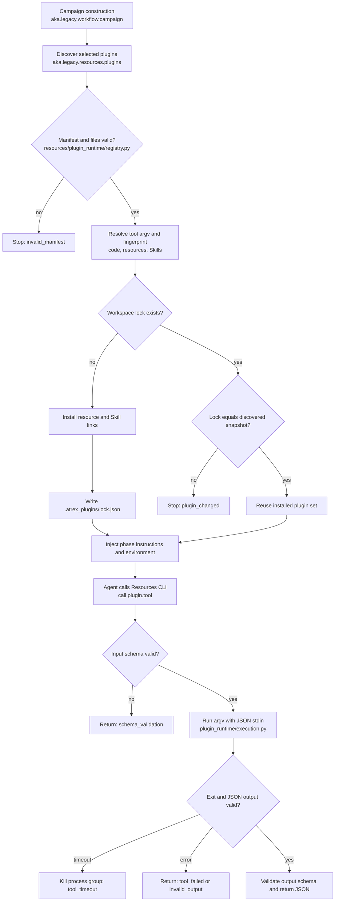

# AKA local plugins

AKA loads the plugins selected by the Resources configuration. The default Workflow selects
`plugins/gpu-wiki` and `plugins/micro-analysis` from the checkout supplied with `--repo-root`.
A custom configuration can select explicit `plugins` paths or a `plugin_dir` catalog; catalog mode
discovers immediate subdirectories containing `plugin.json`. A plugin may contribute tools, Skills,
instructions, and workspace resources.

## MicroAnalysis

`plugins/micro-analysis` is an independent Skill-only plugin containing a methodology `SKILL.md`.
It guides ISA inspection, layout probes, and controlled experiments across GPU backends. Agents
construct experiments for the current kernel and toolchain; the plugin ships no probe executable,
statistics script, or hardware-specific reference manual.
For an unfamiliar operator or device, establish the operator's dataflow and exact target/toolchain.
The Agent obtains hardware knowledge through its existing GPUWiki lookup step and checks its
applicability. When knowledge is insufficient, consult target documentation and use focused probes
or A/B experiments to resolve specific unknowns. Keep unresolved facts explicit and distinguish
contextual measurements from specifications. Backend documentation owns collection commands and
metric meanings.

New campaigns using the default Workflow include this plugin without an extra option. AKA links
the complete Skill directory into `.agents/skills/micro-analysis`, `.claude/skills/micro-analysis`,
and `.qoder/skills/micro-analysis`. In the campaign's Agent environment, list the enabled catalog:

```bash
python -m aka.legacy.resources.cli list
```

The Skill ID is `micro-analysis.micro-analysis`. Ask the Agent, for example:

```text
Use the micro-analysis Skill to investigate whether this kernel's load wait comes from addressing,
layout, or data movement. Choose an experiment that distinguishes these explanations.
```

This is a Skill, not a Resources tool, so it has no `call micro-analysis.*` command. It adds no
environment variables or per-phase instruction files. Backend profiling Skills remain independent:
on PPU, use the selected `ppu-acu-joint-profile` Skill when ACU or timeline evidence is needed.
Use the selected backend's tools for collection commands, counter definitions, and report formats.

Existing campaigns retain their locked plugin set and contents. Use a new campaign to adopt this
plugin rather than modifying a running campaign's locks.

## Design and runtime flow



The registry is cached for the lifetime of a campaign. Constructing it performs discovery and
fingerprinting once; later prompt rendering, workspace linking, environment creation, and tool
lookup reuse that snapshot. Resume checks compare the saved lock directly with the cached snapshot.

Tools use a command argument array and exchange JSON through stdin and stdout. Python, Node, shell
scripts, and compiled executables share this interface. Arguments are passed without shell
expansion. Each invocation has a bounded timeout and runs in its own process group so a timeout can
clean up descendants.

Skills keep their native directory structure. AKA links each discovered Skill into
`.claude/skills`, `.qoder/skills`, and `.agents/skills`; the selected Agent reads its `SKILL.md` in
the usual way. Conflicting resource or Skill installation paths fail before anything is changed.

## Discover and call tools

From the repository or an initialized campaign workspace:

```bash
python -m aka.legacy.resources.cli list
```

The command returns separate `tools` and `skills` catalogs. Each tool uses a namespaced name such as
`gpu-wiki.query`; each Skill has a namespaced catalog ID while retaining its native installation
name.

To query GPU Wiki, create `wiki_request.json`:

```json
{
  "request": "Target hardware B200, DSL triton. Optimize operator rmsnorm and retrieve techniques and pitfalls.",
  "max_records": 6
}
```

Then call:

```bash
python -m aka.legacy.resources.cli call gpu-wiki.query --input wiki_request.json
```

`--input -` reads JSON from stdin. The response preserves the Wiki envelope: `query_id`, `records`,
and `notes`. Canonical `wiki_id` values, payloads, and public/internal store isolation are unchanged.
`max_bytes` and `exclude` are also supported input fields.

The standard episode request uses the deterministic Wiki parser. Other prose can invoke the Wiki's
existing bridge agent. Mining and admission through `wiki-gate` remain separate from this query
tool, and direct Wiki scripts remain available for maintenance and standalone use.

The plugin declares the public store and optional `internal_gpu_wiki` sibling as dependencies. A
conflicting `ATREX_WIKI_STORE_ROOT` is rejected instead of silently selecting an undeclared store.

## Add a tool plugin

Add a directory directly under `plugins/`:

```text
plugins/local-docs/
├── plugin.json
├── instructions.md
├── query.py
├── input.json
├── output.json
└── data/
```

`plugin.json`:

```json
{
  "id": "local-docs",
  "version": "1.0.0",
  "api_version": 1,
  "tools": {
    "query": {
      "description": "Retrieve local reference facts.",
      "command": ["{python}", "{plugin_root}/query.py"],
      "input_schema": "input.json",
      "output_schema": "output.json",
      "timeout_seconds": 30
    }
  },
  "instructions": {"common": "instructions.md"},
  "resources": {"local-docs-data": "data"}
}
```

`input.json`:

```json
{
  "type": "object",
  "required": ["request"],
  "additionalProperties": false,
  "properties": {"request": {"type": "string", "minLength": 1}}
}
```

`output.json` can start as `{"type": "object"}`. A minimal implementation is:

```python
import json
import os
import sys
from pathlib import Path

request = json.load(sys.stdin)
root = Path(os.environ["PLUGIN_ROOT"])
text = (root / "data" / "reference.txt").read_text()
print(json.dumps({"source": "reference.txt", "text": text}))
```

Populate `data/reference.txt` and describe when to use the tool in `instructions.md`. Select the
plugin directory in the Resources `plugins` list, or use a `plugin_dir` catalog containing it.
The next campaign loads that selected configuration; no orchestrator code change is needed.

## Add a Skill-only plugin

```json
{
  "id": "document-review",
  "version": "1.0.0",
  "api_version": 1,
  "skills": {
    "review-document": {
      "path": "skills/review-document",
      "description": "Review a document for clarity and consistency."
    }
  }
}
```

Place the original `SKILL.md` and supporting files in that directory. A Skill-only package needs no
dummy tool or schema. Skills are required by default; `optional: true` permits an absent Skill.
Conflicting native names fail explicitly instead of shadowing another Skill.

## Manifest contract

- Plugin IDs and tool names use lowercase letters, digits, and hyphens, starting with a letter. The
  published tool name is `<plugin-id>.<tool-name>`. Duplicate IDs fail during discovery.
- `api_version` is the integer `1`; `version` identifies the plugin release.
- Each tool declares a description, `command` argv array, input/output schema files, and an integer
  timeout from 1 to 3600 seconds. `command` supports `{python}` and `{plugin_root}` placeholders.
  The executable must exist when the plugin is discovered.
- `instructions` maps scope names to files. `common` is included in every scope. AKA supplies
  `setup`, `episode`, `fast_episode`, and `framework_baseline`, with template values such as
  `{{PLATFORM}}`, `{{ARCH}}`, `{{FRAMEWORK}}`, and `{{OPERATOR}}`.
- `resources` maps workspace names to local paths. A resource can be declared as
  `{"path": "../optional-data", "optional": true, "mount": false}`. Missing optional paths are
  permitted; `mount: false` fingerprints the dependency without exposing a workspace link.
- `skills` maps native names to a directory and description. The directory must contain `SKILL.md`
  unless the Skill is optional.
- `environment` contributes variables to Agent sessions. Values may contain `{workspace}` and
  `{campaign_name}`. Conflicting declarations and reserved runtime variables fail at discovery.

The supported schema subset contains `type`, `description`, `properties`, `required`,
`additionalProperties`, `items`, `enum`, `minLength`, `minimum`, and `maximum`. Types are mandatory;
arrays require an item schema. Unknown keywords and constraints on incompatible types fail at
discovery.

## Locking and recovery

Initialization writes `.atrex_plugins/lock.json` with the discovered plugin directory, resolved
commands, versions, and SHA-256 fingerprints of plugin code, schemas, instructions, resources, and
Skills. Git metadata and Python caches are excluded. Resume and tool invocation fail if this snapshot
no longer matches. Restore the original plugin contents or start a new campaign.

Existing campaigns created before this plugin mechanism should continue with the revision that
created them. To roll back a new campaign, stop it, check out the previous AKA revision, and create a
fresh workspace; campaign workspaces are isolated and the plugin installer does not mutate source
data. The lock detects changes but does not snapshot or sandbox plugin files.

Successful calls return validated JSON directly. Errors use
`{"error":{"code":"tool_failed","message":"..."}}` with a nonzero exit code. Installed campaigns
record tool name, plugin version, status, and duration under `.atrex_plugins/calls/`; request and
response bodies are not logged.
