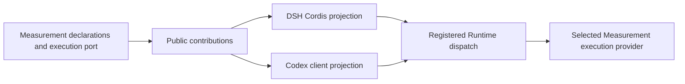

# Portable tools and instructions

AKA modules can provide tools and usage instructions through one public
contribution protocol. The managed Light Runtime selects modules and binds their
handlers. DSH presents the tools through Cordis; Codex uses the workspace's
generic HTTP client. Both paths execute the same selected handler.

Measurement is the first module using this interface. Existing `sandbox.py`
and `plugin.py` clients remain available to current workflows.

## Use Measurement

Managed Light Sessions enable the `measurement` contribution module by default.
Choose `--agent-cli dsh` or `--agent-cli codex` in your normal optimization command.
The Session supplies the selected tool catalog and module instructions.

| Semantic tool ID | Purpose |
| --- | --- |
| `measurement.evaluate` | Evaluate the current candidate with the selected evaluator. |
| `measurement.record_read` | Read a retained measurement by Record ID. |
| `measurement.kernel_records` | List measurements for a Kernel ID. |

DSH exposes native tools named `aka_measurement_evaluate`,
`aka_measurement_record_read`, and `aka_measurement_kernel_records`.
Codex receives the same schemas and instructions plus a generic client
invocation. Inside a live managed Session, inspect the catalog with:

```sh
python3 tools/aka.py list
```

For a full evaluation, save `scratch/evaluate.json`:

```json
{"mode": "full"}
```

Then invoke the tool:

```sh
python3 tools/aka.py call measurement.evaluate --input scratch/evaluate.json
```

`evaluate` also accepts `shape_ids`, `multi_seed`, `timed_runs`, and
`baseline_path`. Omitting Shape selection uses the evaluator's full workload.
The selected evaluator validates operation-specific combinations and supplies
defaults. Hardware, credentials, deadlines, input authority, and measurement
storage remain Supervisor-owned.

The response is the evaluator's public result object, including retained IDs
when available. A client exit status of zero means the tool returned valid JSON;
inspect the measurement's status and correctness fields to decide what happened.
Read earlier evidence with `measurement.record_read` and
`{"record_id": "<retained-record-id>"}`.

## Select modules and customize instructions

Use a Core composition patch to select contributions and replace one module-owned
instruction. Pass it before the optimizer's `--` separator, as described in
[Light configuration](optional-light-modules.md#other-module-options).

```json
{
  "api_version": 1,
  "patches": [
    {
      "id": "tool_runtime",
      "config": {
        "contribution_modules": ["measurement"],
        "instruction_overrides": {
          "measurement.usage": "Use {{tool:measurement.evaluate}} for the next measurement. Read saved evidence with {{tool:measurement.record_read}} before repeating work."
        }
      }
    }
  ]
}
```

Include other customized Runtime settings you want to retain in that row: Core
patches replace the whole configuration, then apply declared defaults.
An empty `contribution_modules` list selects an empty portable catalog. This
selection controls contributed tools and instructions; compatibility routes keep
their established availability and policy.

Instruction references use semantic tool IDs. Each adapter resolves them to its
own tool names or client invocations. Overrides preserve the tool definitions and
execution implementation. Unknown instruction IDs and references outside the
owning module fail at startup.

The Campaign records the public catalog, content digest, module versions, and
effective instructions in its private Runtime state. Continue with that recorded
selection. A changed selection requires a new Campaign, keeping recovery tied to
the tools and instructions that produced its evidence.

## Module and adapter responsibilities



`aka.contracts.contributions` owns three public metadata types:

- `ToolContribution`: semantic ID, description, input schema, and output schema.
- `InstructionContribution`: an owned ID and literal text with tool references.
- `ModuleContributions`: a module ID, version, and its contributions.

The first protocol version supports static Session instructions and object inputs
and outputs using the existing supported JSON Schema subset. Skills retain their resource-contribution interface.
Dynamic context and model-step admission can evolve as separate capabilities.

Measurement imports the contribution contracts and defines a small execution
port. It owns tool parameters, their conversion into evaluation requests, and usage
guidance. It works independently of Wiki, Journal, Goal, and Harness APIs.
The application composition root binds that port to the existing measurement
pipeline. Source freezing, correctness, Record storage, outcome reconciliation,
and acceptance behavior therefore have one implementation.

The generic registry and Harness projections consume metadata without importing
feature modules. A future Codex native projection can consume the same catalog
and invocation protocol.

## Register another module

An embedding application can assemble a `ContributionRegistry`, register each
`ModuleContributions` value with its `ToolBinding` handlers, and call `seal()`.
Pass it through `SupervisorRuntime(..., contributions=registry)`. Feature selection
and relationships belong in the application's composition root.

Each contribution ID begins with its module's ID. Registration validates the
complete module before publishing it, snapshots metadata, and requires exactly
one handler per tool. Sealing fixes the selection for the Runtime lifetime;
catalog reads return detached values. Modules may contribute tools, instructions,
or both. Instruction tool references resolve within their owning module.

A binding receives an opaque authorized Session context and validated arguments.
It may provide a preparation callback for identity checks while a Session is busy.
The host owns authentication, request serialization, queue deadlines, and task
conflict checks. Handlers return JSON matching their output schema. Input errors
stop before dispatch; invalid handler output is a Runtime failure requiring
inspection of retained records.

## Invocation and lifecycle

Authenticated Session requests use two generic endpoints:

- `POST /v1/contributions/catalog` with `{}` returns the frozen public catalog.
- `POST /v1/contributions/invoke` takes `catalog_id`, `tool`, and `arguments`.

Each invocation names the exact catalog digest. Stale catalogs, unknown tools,
invalid arguments, and revoked Session credentials are rejected before execution.
Requests retain the Runtime's lock, deadline, foreground waiting, and recovery
policy. Clients send each invocation once and return feedback to the caller.

The DSH plugin uses documented tool and system-prompt registration APIs. Its
instructions are literal sections, preserving unrelated template syntax. It
checks cancellation before dispatch and closes admission during disposal. An
accepted HTTP request is awaited through its result: a disconnected client alone
cannot establish that a GPU job stopped. Supervisor termination and durable job
reconciliation retain their existing ownership.

Codex receives rendered instructions at each managed invocation, including
continuation. Its generic client ships as the reserved `tools/aka.py` workspace
asset alongside `sandbox.py`. Credentials stay with the Session transport and
never enter the public catalog.

## Verification

Use a Python version supported by the package metadata:

```sh
PYTHONPATH=src python -m unittest discover -s tests -v
node --test tests/test_dsh_contributions.mjs
```

For the installed DSH CLI against local model and Measurement fixtures:

```sh
AKA_RUN_DSH_INTEGRATION=1 PYTHONPATH=src python -m unittest discover -s tests -v
```

Fixtures cover dispatch, retained results, continuation, foreground suspension,
catalog identity, module selection, instruction overrides, revocation,
cancellation, disposal, and single-attempt failures. Codex launch coverage uses
an executable protocol fixture and the real workspace HTTP client. Checks use
synthetic credentials and loopback services. Native coordinator execution is
covered; Linux Bubblewrap and live Codex model calls remain separate validation
tasks.
