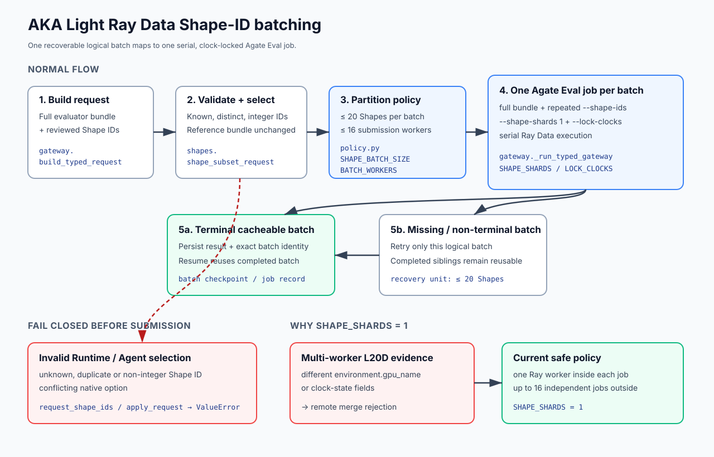

# Ray Data Shape-ID batching in AKA Light

AKA Light evaluates Native Atrex-Bench operators through bounded, recoverable
Agate jobs. This design replaces the former one-Shape-per-job default with up to
20 original Shape IDs per job while keeping Ray Data execution serial inside each
job. It is intended for Light users running multi-Shape operators on Agate
0.14.33 or newer, especially the production L20D pool where multi-worker result
merge has returned heterogeneous GPU-name and clock-state evidence.

## Goals and measurable benefit

- Keep the evaluator-owned `reference.py`, `input.py`, `shapes.json`, metadata and
  roofline bundle unchanged; select cases only through repeated `--shape-ids`.
- Reduce Agate admission, queue and job-record overhead from `N` jobs to
  `ceil(N / 20)` jobs while retaining batch-level checkpoint and recovery.
- Keep clock locking and shard count under Runtime policy rather than Agent
  control.

The job-count reduction is deterministic and directly observable:

| Shapes | Previous jobs | New jobs | Job-count reduction | Previous submission waves at 16 workers | New waves |
|---:|---:|---:|---:|---:|---:|
| 20 | 20 | 1 | 95.0% | 2 | 1 |
| 45 | 45 | 3 | 93.3% | 3 | 1 |
| 90 | 90 | 5 | 94.4% | 6 | 1 |

This change does not claim an end-to-end wall-clock speedup. Fewer admission and
queue operations compete with longer serial work per job; production timing must
be measured on identical operator sources and pool load before making a latency
or throughput claim.

## Design

| Diagram element | Implementation |
|---|---|
| Build the full-bundle Eval request and attach a reviewed Shape selection | `aka.light.evaluation.gateway.build_typed_request` |
| Validate selected IDs and preserve the full reference bundle for Agate | `aka.legacy.evaluation.shapes.request_shape_ids` and `shape_subset_request` |
| Bound each logical batch to 20 Shapes, force one shard and lock clocks | `aka.light.evaluation.policy`: `SHAPE_BATCH_SIZE`, `SHAPE_SHARDS`, `LOCK_CLOCKS` |
| Submit up to 16 independent jobs and merge only complete batch evidence | `aka.light.evaluation.gateway._run_typed_gateway` and `BATCH_WORKERS` |
| Persist terminal batches and reuse them on resume | `aka.light.experiment.abba_checkpoints` and the Gateway job record store |

The diagram describes the Agate path. The typed SSH worker consumes its
materialized `shapes.json` and does not interpret Agate's `options.shape_ids`.
For SSH, Light therefore rewrites the reference, metadata and roofline to the
physical batch and removes the selector before dispatch. This preserves the
pre-existing SSH contract and prevents every logical batch from re-running the
full workload.

The Agate batch identity includes the exact selected Shape IDs, complete source
and reference identity, measurement contract, shard policy and clock policy.
The SSH identity instead includes the filtered physical reference and endpoint
identity. A terminal cacheable batch is reused. A missing, non-terminal or
non-cacheable batch is the recovery unit; completed sibling batches are not
resubmitted.

## Failure behavior

- Unknown, duplicate or non-integer selected Shape IDs fail locally before an
  Agate task is submitted. A native Agent option that disagrees with Runtime
  selection also fails locally; the same Shape set in another order preserves
  Runtime's canonical order.
- Agate infrastructure failure affects at most one logical batch. Its completed
  siblings remain reusable, but the failed batch may contain up to 20 Shapes and
  therefore has a larger retry blast radius than the previous one-Shape job.
- SSH Evaluate and ABBA filter each logical batch before transport. They remain
  sequential on the assigned GPU, but evaluate each selected Shape exactly once
  rather than once per batch.
- Allowing multiple Ray workers produced merge rejection on the production L20D
  pool when workers reported different `environment.gpu_name` or clock-state
  fields. `shape_shards=1` avoids that merge until the remote evidence contract
  can reconcile heterogeneous worker metadata.
- The `runtime-native-eval-ray-data-v2` contract intentionally does not reuse v1
  batch checkpoints, because v1 identities described rewritten per-batch
  reference bundles rather than full-bundle Shape selection.

## Non-goals

- No change to operator math, Agent prompts, model selection, correctness policy,
  ABBA promotion thresholds or accepted-source policy.
- No Agent control over `shape_shards` or clock locking.
- No attempt to enable multi-worker Ray Data before heterogeneous worker evidence
  can be merged safely.
- No change to targeted Profile semantics; Profile still selects exactly one
  evaluator-owned Shape and does not send Eval-only `options.shape_ids`.
- No change to Legacy filtered-reference transports.

## Trade-offs and rollback

Larger batches reduce submission overhead but increase individual job duration
and retry granularity. Forced serial shards avoid the observed merge failure but
give up intra-job Ray parallelism. Up to 16 independent batch jobs can still be
submitted concurrently. The v2 contract also invalidates prior v1 batch
checkpoints, so the first run after upgrade must measure them again.

For an operational rollback, set `ATREX_EVAL_SHAPE_BATCH_SIZE=1` before starting
a fresh campaign or resume boundary; this restores one-Shape recovery granularity
while retaining the v2 full-bundle contract and serial shard safety. For a full
rollback, stop or let in-flight jobs finish, preserve their evidence, then pin the
previous AKA revision or revert this change as a unit and use a fresh workspace.
Do not mix v1 and v2 checkpoint directories or reinterpret an incomplete batch as
a candidate correctness failure.

## Validation evidence

- `ev_fa2c42d84a3c` demonstrated that Agate accepted Shape-ID selection and
  planned the requested subset through Ray Data.
- `ev_9c14523e3860` demonstrated that the same selected subset completed with
  `shape_shards=1` on production L20D.
- Local command construction verifies 20 repeated `--shape-ids`, one
  `--shape-shards 1`, clock locking, and 45-Shape partitioning as 20/20/5.
