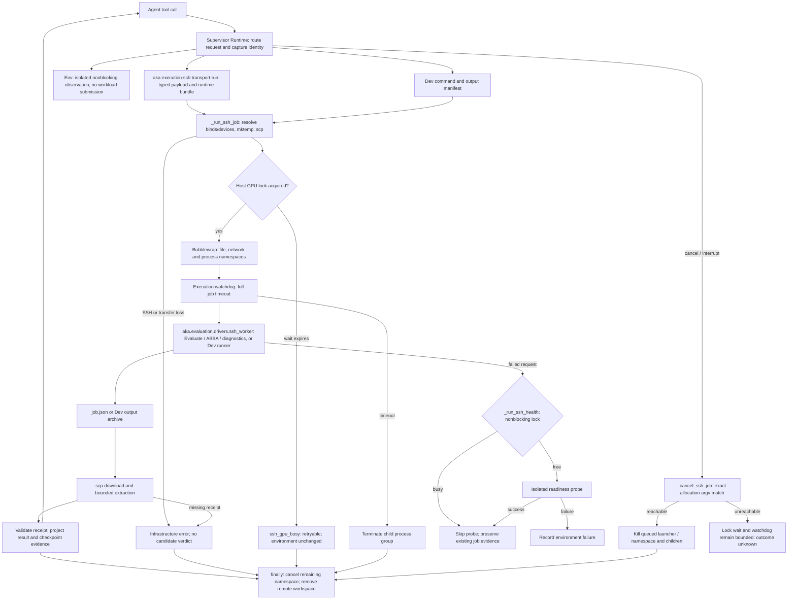

# Light OpenSSH backend

Light can execute native Atrex-Bench Evaluate, same-allocation ABBA, Check,
Profile, Disassemble, Env and custom Dev commands on an SSH host. The Supervisor
and coding agent remain on the coordinator. Sources and the selected evaluator
are uploaded for each allocation; no gateway service or credentials are required
on the GPU host. Source trees and native CUDA manifests use the same candidate
snapshots and acceptance evidence as Gateway execution.

Each campaign selects one GPU on one machine. Different campaigns can target
NVIDIA, AMD or a provisioned PPU runtime independently. This is not a scheduler
for a campaign spanning different machines or GPU architectures.

## Start a campaign

```bash
export ATREX_SANDBOX_SSH=gpu-worker
export ATREX_SANDBOX_SSH_GPU=5
export ATREX_SANDBOX_SSH_RUNTIME_BINDS='["/opt/venv", "/opt/rocm"]'
export ATREX_SANDBOX_SSH_INIT='export PATH=/opt/venv/bin:/opt/rocm/bin:$PATH; export LD_LIBRARY_PATH=/opt/rocm/lib'

aka optimize --repo-root "$PWD" \
  --problem /path/to/atrex-bench/operators/my_operator \
  --platform MI300X --hardware MI300X --framework Triton \
  --workspace-base /path/to/runs --max-iters 20
```

The Workflow request parser accepts `--platform` and `--hardware`; SSH transport
belongs to Execution's environment configuration. The named Light profiles inherit
the `ATREX_SANDBOX_SSH*` allowlist from the Workflow profile. Use the default
Legacy Execution provider for SSH; the Gateway provider rejects SSH configuration.
Clear `ATREX_SANDBOX_URL` and `ATREX_SANDBOX_PROFILE` before selecting SSH.

Use an OpenSSH host or `~/.ssh/config` alias. Authentication must work without
interactive input. The evaluator checkout is inferred from the operator directory.
The coordinator needs `ssh` and `scp`; the host needs Bash,
Python 3.10+, `tar`, `flock`, Bubblewrap and the selected GPU toolchain. Set
`ATREX_SANDBOX_SSH_BWRAP` to an absolute remote Bubblewrap executable when it is
not on the host's default PATH.

Runtime directories outside `/usr` need explicit read-only binds. Bind both the
alias and the canonical path if libraries contain absolute symlinks, for example
`/opt/rocm` and `/opt/rocm-7.2.0`. Python environments can be remapped with
`REMOTE_PATH=SANDBOX_PATH`; an environment under a home directory must be named
`.venv`, `venv`, or `env`, or be a direct child of a Conda `envs` directory.

## GPU selection and isolation

The default `ATREX_SANDBOX_SSH_GPU_ISOLATION=device` exposes only the assigned
GPU's device nodes. NVIDIA indices resolve to UUIDs and actual device minors;
AMD indices resolve through accessible KFD topology to UUIDs and render minors.
Do not assume `renderD128 + index` on partition-capable AMD machines.

On a trusted AMD machine where ROCm initializes all accessible render devices
before applying its visibility mask, explicitly select:

```bash
export ATREX_SANDBOX_SSH_GPU_ISOLATION=runtime
```

This retains the filesystem, process and network namespace boundaries, but
exposes the driver's render nodes and selects the assigned GPU with
`ROCR_VISIBLE_DEVICES`. It does **not** prevent candidate code from accessing
other devices. Select it only when that weaker device boundary is appropriate.
No failure silently changes the isolation mode.
This mode changes AMD render-node exposure only; NVIDIA keeps its assigned
device-node isolation even when `runtime` is selected. An explicit device map
always supplies its own device nodes and visibility settings.

The selected GPU visibility is applied after environment activation and custom
environment variables. An account-scoped physical-GPU lock serializes AKA
allocations, including all ABBA runs. Locks do not coordinate unrelated programs.
Lock acquisition and execution each receive the configured job timeout; the SSH
client allows both budgets plus connection/cleanup slack. Lock-wait expiry returns
retryable `ssh_gpu_busy` evidence, without marking the environment broken.
Health/preflight probes acquire the lock without waiting and report busy when it
is occupied. A post-job probe skips a busy GPU and preserves the job's evidence.

PPU or other compatible CUDA runtimes can supply an explicit, supervisor-owned
`ATREX_SANDBOX_SSH_DEVICE_MAP` JSON object keyed by physical index. Each entry
contains `vendor`, a stable `uuid`, the exact character-device `devices` list,
and the runtime visibility `environment` mapping. Use the host's real driver
nodes and selectors; the backend does not infer proprietary device names.
These settings are captured with the selected profile for children and recovery.

## Execution and failure paths



`aka.execution.ssh.transport.run` packages the typed request and consumes the worker's
`scratch/job.json`; Dev uses `_run_ssh_job` with its existing command/output
contract. `_run_ssh_job` owns staging, transfer, the physical-GPU lock and cleanup.
The host flock process retains the lock through namespace execution, including every
ABBA block. `_ssh_bwrap_command` constructs the namespace; `_ssh_visibility`
applies the assigned runtime selector after activation and custom environment.

`aka.evaluation.drivers.ssh_worker` dispatches evaluation and diagnostics using the provisioned runtime.
Completed shape batches retain their checkpoints; incomplete receipts and
transport loss remain infrastructure outcomes. `_run_ssh_health` distinguishes
contention from a failed readiness probe, so concurrent allocations cannot trigger
environment recovery solely by holding the lock. `_cancel_ssh_job` matches the
allocation's exact workspace bind arguments, including a launcher still waiting
for the lock. Failed cleanup is recorded for later handling.

The existing Gateway path is unchanged. SSH extends the command-only path with
typed evidence and ABBA; reverting this change or selecting Gateway rolls it back.
Runtime visibility is explicit and never a fallback after isolation failure.

## Operations and evidence

| Operation | SSH behavior |
| --- | --- |
| Evaluate | Native evaluator, full or correctness-only mode; selected shape batches run serially |
| ABBA | One allocation per shape batch; native A/B/B/A blocks, complete per-run and per-shape evidence |
| Check | Import/JIT and one real launch; NVIDIA sanitizer modes require compute-sanitizer |
| Profile | NVIDIA NCU, AMD rocprofv3, or provisioned PPU ACU; unavailable vendor-specific controls fail explicitly |
| Disassemble | NVIDIA SASS/PTX, AMD ISA, or artifacts exposed by the provisioned PPU toolchain |
| Env | Actual runtime architecture, available frameworks, profiler counters and allocation limits |
| Dev | Existing allowlisted command upload, timeout handling and output synchronization |

ABBA repeat counts and acceptance thresholds are unchanged. Completed shape
batches retain their existing checkpoints. Request identity includes the SSH
endpoint, GPU assignment, runtime configuration and isolation mode, so evidence
from a different allocation configuration cannot be reused. Transport loss or a
missing result is not a candidate correctness verdict.

NVIDIA clock control is applied when available. Unsupported clock control is
recorded as not applied; AMD performance levels are not reported as fixed clocks.

AMD Profile joins requested counters to the candidate's scoped dispatch trace and
exports `metrics.csv`. Use `--counters rocprofv3` with Env to discover counters;
deep profiling requires explicit `--counter` selections. NVIDIA-specific source
correlation is unavailable on AMD. Env capability queries also list installed
profilers. Counter discovery returns the assigned AMD GPU's counter names;
when isolation leaves a single reported agent, its numbering may start at zero.
Multiple-agent catalogs must match the assigned physical index.
Large catalogs explicitly report truncation. Gateway placement and unimplemented
Gateway-only options are rejected
before execution; `shape_shards=1` is compatible with the fixed SSH allocation.
The parser retains `acu` for provisioned SSH PPU runtimes; a Gateway deployment
must advertise its own supported profiler capabilities before ACU can be used there.

Cancellation terminates the allocation's remote namespace, including its child
processes. If SSH is unreachable during cancellation, the remote watchdog remains
the execution ceiling; an unknown outcome is not reported as successful cancellation.

Python dependencies must already be installed in the bound environment. Native
CUDA manifests support provisioned pip/system dependencies and clean, pinned
Git repositories bound at `/opt/aka-dependencies/<id>`. The declared Git ref and
optional commit must match that checkout. Dependencies are never downloaded
inside the network-isolated worker. Native CUDA remains a CUDA toolchain
contract; this does not make CUDA source portable to an AMD HIP compiler.

SSH supports typed prepared requests, source archives, explicit input files and
same-allocation ABBA. It does not transport closed `PreparedExecutionInputs`.
Light whole-tree diagnostics and private portable Profile paths that need that
closure raise `UnsupportedExecution` before dispatch. Supervisor conversion of an
authorized Dev input view is subject to the same restriction; use a supported
typed request or a backend advertising closed-input transport.

SOL does not provide Light's native ABBA contract; use the Legacy workflow for
SOL verification. Each SSH allocation owns one GPU; distributed evaluator
contracts and MIG selection require a separate allocation implementation.

The remote launcher requires `flock` with `--exclusive`, `--wait` and
`--conflict-exit-code` support. Missing or incompatible launch dependencies stop
with a capability diagnostic, retaining the original stderr. Lock expiry (exit 75
before the acquisition marker) is GPU contention; candidate exit 75 after acquisition
is a command failure. Environment discovery reports SSH network/auth/DNS failures
as unavailable and remote probe failures as rejected.
